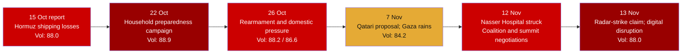

---
{"dg-publish":true,"permalink":"/finalized-work/world-reports/world-intelligence-report-november-2026/","title":"World Intelligence Report — November 2026","tags":["world-monitor","osint","geopolitics","intelligence","november-2026","gaza","humanitarian-access","iran","ukraine","france","cost-of-living","civil-preparedness","cyber","ai-sovereignty"],"created":"2026-11-13T19:09:51.243+00:00","updated":"2026-11-16T10:57:24.375+00:00","dg-note-properties":{"title":"World Intelligence Report — November 2026","description":"Hormuz and Ukraine under continuing pressure; Gaza winter exposure and the Nasser Hospital strike; European mobilisation, British preparedness, refrigeration attacks and contested digital dependence.","date":"2026-11-13","updated":"2026-11-14","tags":["world-monitor","osint","geopolitics","intelligence","november-2026","gaza","humanitarian-access","iran","ukraine","france","cost-of-living","civil-preparedness","cyber","ai-sovereignty"],"aliases":["November 2026 Intelligence Report","World Monitor Consolidation"]}}
---

# World Intelligence Report — November 2026

**Compiled by:** Eden Eldith & Codex (OpenAI)
**Coverage Period:** 13 October 2026 — 13 November 2026
**Last Updated:** @141120261711

---
>[!info] This report documents events with sources. The author has no political affiliation and advocates no unlawful action. Where individuals, institutions, or states are discussed, the intent is to document choices and structural positions — to name them where the documentary record requires it, and to source every claim that does.

## Executive Summary

The month following our [[Finalized work/World-Reports/World_Intelligence_Report_October_2026\|October 2026 Intelligence Report]] has made the continuity of essential services the common test of state capacity. War, supply disruption, public mobilisation and digital dependence meet at the same point: whether people can obtain food, water, shelter, treatment, transport and a meaningful say in the decisions governing them.

1. **War continues through the diplomatic timetable** — A Qatari proposal linked Hormuz reopening to Iranian nuclear inspections, while the window closed with Iran claiming a strike on US radar in Bahrain and a tanker mine incident. Russian attacks and renewed Ukrainian reports of Starlink disruption accompanied talks; the US midterms meanwhile gave Democrats control of the next Congress, taking office in January.[^1][^2][^3][^4][^5]

2. **Gaza's winter emergency was foreseeable** — WFP cut assistance before the first heavy rains, which destroyed thousands of shelters while more than 150,000 tents waited outside Gaza. The 12 November Nasser Hospital strike killed six according to both MSF and the UN and disabled major departments; the Humanitarian Country Team attributed preventable winter harm to policy decisions.[^6][^7][^8][^9][^10]

3. **European mobilisation moves into bargaining and contested decisions** — France's education and wage concessions did not end mobilisation; 13 November talks were followed by CFDT joining the next strike call. Italy's blockades ended but cost pressures continued, Ireland suspended action after a draft pay agreement, and Spain's housing strike was followed by policing inquiries and split legislative decisions.[^11][^12][^13][^14][^15]

4. **Britain asks households to prepare while services and consent remain under pressure** — Three-day preparedness advice arrived alongside cumulative bill pressure, a £100 budget payment and a subsequent interest-rate rise. Gosport's local accounts, Fairford charges, school-email disruption and the Piddington planning decision show distinct forms of the encounter between public need, institutional authority and the capacity to respond.[^16][^17][^18][^19][^20][^21][^22][^23]

5. **Digital dependence produces physical consequences** — Refrigeration attacks reached food and medical storage; technician intervention prevented losses in the UK accounts. Google and Microsoft outages, NHS supplier dependence, data-centre decisions and new AI-policy milestones extend the series' sovereignty question from ownership to the ability to keep services running and exercise a real choice.[^24][^25][^26][^27][^28][^29][^30][^31]

**Global Volatility Index: 88.0/100 — CRITICAL.** The available observations began at 88.0, peaked at 88.9 on 22 October, dipped to 84.2 on 7 November and rebounded 3.8 points by publication. Seven of eight observations were at or above the monthly series' threshold of 85.[^32]

### Escalation Arc — October to November 2026

The arc places events alongside observations; it does not assign a numerical share of the index to any one event. Rains began on 6 November; the 7 November node uses that day's recorded index.[^32][^7]

---

## Part I: Hormuz — The Cost of an Unfinished Settlement

### Shipping remains exposed

The opening World Monitor report carried the Guardian's 14 October report that two container ships had sunk near the Strait of Hormuz amid a surge in Iranian attacks. The previous day's Saudi strikes on oil depots near Yemen's capital, alongside reported missiles towards the location of Saudi Aramco's headquarters, placed shipping and energy infrastructure on the same regional pressure map. The event sequence extended the series' central distinction between a diplomatic agreement and a functioning transport corridor.[^33][^34]

By 28 October, Defense News carried an Iran-war cost estimate above **$47 billion**. The figure concerns the reported cost of the war, rather than a monthly expenditure total. It puts the diplomatic question alongside a resource question: how long can continuing containment, protection and combat be sustained while other theatres compete for the same capacity?[^35]

On 7 November, the feed's leading diplomatic development was a Qatari proposal linking a reopening of Hormuz to Iranian nuclear inspections. In the same report, oil traders were calling for the release of sanctioned tankers as freight costs rose. The linkage is direct: negotiating access to the strait and recovering usable shipping capacity are both necessary to bring delivered energy costs down.[^1][^36]

### Closing the window: attacks persist alongside the proposal

On 13 November, Iran said it had destroyed a US military radar in Bahrain in a retaliatory strike. The closing report also carried Iran's statement that a gas tanker had hit a mine in the Strait of Hormuz. Together with the earlier sinkings, they show why the reopening proposal cannot yet be treated as a restored shipping service.[^2][^3]

OilPrice's closing coverage described prices caught between peace expectations and escalation risk, with WTI rebounding as supply risks intensified. A price movement can anticipate a settlement before a shipowner, insurer or cargo customer can rely on it. November extends the series' distinction between a diplomatic price and the cost of physically delivering fuel.[^37]

---

## Part II: Ukraine — Support, Infrastructure and Bargaining Power

### Assurances under pressure

On 14 October, Andy Burnham told Volodymyr Zelenskyy that British support for Ukraine would not change. By 15 October, the feed paired intensifying Russian attacks with Ukrainian fears of cuts to US intelligence. That is a material distinction: a public commitment describes policy intent; intelligence access determines what can be detected, intercepted and targeted.[^38][^39]

Late-October coverage added two structural constraints. UN investigators reported that Russia had committed war crimes by targeting civilians. Meanwhile, OilPrice's account of UBS data put Russian oil exports only **10% below pre-war levels**: a volume measure that does not by itself establish revenue, but does challenge any assumption that sanction announcements have removed Russia's export capacity.[^40][^41]

The 30 October feed carried UN reporting of a Russian drone strike on a Ukrainian railway station that killed **13 people**. Alongside it, Defense News reported that Destinus' monthly cruise-missile output exceeded Europe's pre-war annual production. The juxtaposition matters: civilian transport remains vulnerable while producers accelerate the replacement and expansion of strike capacity.[^42][^43]

On 7 November, Russia struck Kyiv and its surrounding region as Ukraine prepared for talks with Russia and the United States. Talks and attacks continued on the same timetable. The recurring issue across the feed is the vulnerability of the systems civilians use to move, study and stay warm while negotiations proceed.[^44]

By 12 November, the feed carried Putin's hard line in US talks and Ukraine's report of renewed Starlink disruption. It also carried Finland's statement that it had detected a strike on a Russian warship in the Baltic. The theatre's military pressures now sit beside a continuing dependency on privately controlled communications.[^4][^45]

### British and allied capability: what has changed

The closing report carried the commissioning of the Royal Navy's first autonomous-boat squadron and an initial Atlantic Net agreement. These are concrete organisational and programme developments. They follow a month in which Arctic defence gaps and High North sustainment repeatedly appeared in the feeds. UK Defence Journal separately reported Streeting's statement that Russian activity in UK waters had risen **41%** this year, and Rutte's description of British defence spending being set to double over ten years.[^46][^47]

The industrial question remains the one carried from earlier issues: how much usable capacity can be produced, maintained and replenished? The reported **£500 million** raised by UK drone maker UForce at a **£4.5 billion valuation** describes financing. The Destinus production claim describes output. A squadron's commissioning describes a formed unit. Each is a different stage on the route to sustained defence.[^48][^43][^46]

---

## Part III: Gaza and Palestine — What Reaches People

### Food: reduced assistance before winter

For a person inside Gaza, the month's sequence is immediate: food assistance contracted, water and waste systems lacked parts and power, the first winter rains destroyed shelters, and a strike disabled major departments at southern Gaza's main referral hospital. The relevant measure is the service received at the end of that chain.

On **19 October**, WFP announced that funding shortages were cutting its reach from **1.6 million people in September to 1.1 million in October**. Family rations fell from two parcels to one with a smaller flour bag. WFP-supported hot meals fell from **250,000 to 150,000 daily**, with some difficult-to-reach communities receiving meals every other day; cash support to **75,000 families** was reduced. WFP sought **$450 million for October–March** across Gaza and the West Bank.[^6]

That programme reduction sits alongside a fluctuating bakery system. OCHA recorded **14 of 17** WFP fuel-supported commercial bakeries closing on **23 October** for lack of flour; donated flour restored **16 of 17** by **25 October**. Separately, 21 subsidised bakeries produced approximately **80,000 two-kilogram bundles daily**, mostly sold at NIS 3, with a smaller share distributed free.[^49]

| Food-access measure | Dated position | What it measures |
|---------------------|----------------|------------------|
| WFP assistance reach | 1.1 million in October, down from 1.6 million in September | One agency's programme coverage |
| WFP-supported meals | 150,000 daily after announced cuts | WFP-supported output |
| All-partner kitchens | 90 kitchens; 586,000 meals daily as of 22 October | Wider partner output; a different denominator |
| October parcel/flour reach | Approximately 422,000 people by the late-October checkpoint | Distribution to people, supplying about half of minimum calorie requirements |

Sources: WFP and OCHA.[^6][^50] The two meal totals describe different sets of providers.

### Border entry, collection and household receipt

The aid chain has several gates. A truck manifested for a crossing is not yet unloaded; a load unloaded on the Israeli side is not yet collected into Gaza; collection does not establish distribution to households. The weekly figures preserve those stages.[^50][^51]

| Reporting week | Humanitarian trucks manifested | Humanitarian trucks offloaded on Israeli side | Commercial truckloads collected into Gaza |
|----------------|-------------------------------:|---------------------------------------------:|------------------------------------------:|
| 19–25 October | 651 | 586 | 343 |
| 26 October–1 November | 466 | 397 | 498 |

OCHA received notification on **1 November** of an impending suspension of shipments from Egypt, with Israel citing smuggling concerns. Its warning that daily cooked meals could fall from roughly **600,000 to 330,000** was a conditional projection. The later British parliamentary statement dated the actual closure from **3 November for six days**. The record therefore establishes a completed interruption, followed by continuing access restrictions.[^51][^52]

### Water, sanitation and shelter: the failure was visible before the rain

October repairs to Gaza city's Mekorot line restored supply to September levels, while missing membranes and spares restricted the Southern Gaza Desalination Plant. Eleven WASH partners warned that funding could end water trucking to roughly **360 of 3,500 distribution points**. These were dated operating conditions and threatened services.[^49]

OCHA's late-October account identified the Abu Rashid stormwater pumping station near Jabalya as incapacitated by lack of power and unsafe access. In early November, restrictions on engine oil, generators and spare parts threatened pumps, sewage systems, medical cold chains and ambulances; only **half of waste-management vehicles** remained operational.[^50][^51]

Rains beginning **6 November** then struck a population already exposed. UNICEF reported approximately **1.7 million displaced people** living in tents, makeshift shelters or damaged buildings; **950,000** lived in flood-exposed areas, including **400,000 at extreme risk**. Three children aged four, five and eight and their mother were killed when a sand dune collapsed onto their tent.[^53]

| Storm impact or response | Reported position and date |
|--------------------------|----------------------------|
| Shelters destroyed / damaged | More than 6,000 / 17,400, preliminary assessment to 8 November |
| Households left without shelter | More than 3,900 |
| Households displaced again | Approximately 600 |
| Requests, assessments, assistance | More than 26,000 households appealed; 1,877 assessed and 422 assisted by 8 November |
| Civil Defence distress calls / responses | 2,166 / 218 |
| People affected | UNICEF: over 106,000 on 9 November; UK minister: over 152,000 on 12 November |
| Supplies waiting outside Gaza | More than 150,000 tents; UK statement also identified 300,000 tarpaulins |

Sources and dates: OCHA, UNICEF and the UK parliamentary statement.[^7][^53][^52] These figures describe different stages of the response and changing assessment coverage.

The author's earlier observation — that winter aid campaigns for Gaza were less visible than those for Ukraine — returns here with a concrete deadline: protection has to reach people before the rains. The [[Finalized work/World-Reports/World_Intelligence_Report_August_2026#Part VIII: Gaza — The Ceasefire's Second Summer\|August report's Gaza section]] already recorded fewer than **1,000 tents** remaining in the shelter pipeline in late July, and UNRWA approaching autumn with a roughly **$100 million funding shortfall**, reduced service hours and a continuing ban on bringing its supplies into Gaza. The question of which emergencies attract sustained public mobilisation sat alongside an already depleted capacity to protect people.

The intervening reports follow that exposure towards winter. [[Finalized work/World-Reports/World_Intelligence_Report_September_2026#Displacement, shelter, rubble\|September]] documented falling shelter assistance and winter preparation constrained by funding and entry restrictions. [[Finalized work/World-Reports/World_Intelligence_Report_October_2026#Entry, offloading and household receipt\|October]] recorded a humanitarian pipeline covering only **17% of winter requirements**. November records the rains, destroyed shelters and families left exposed while more than **150,000 tents** waited outside Gaza. Across the sequence, the need was visible months before the weather arrived; the Humanitarian Country Team's assessment below identifies the resulting harm as preventable.[^7][^8][^52][^53]

The same record documents assistance that did arrive. UNICEF supplied warm clothes or thermal blankets to at least **10,000 children** in November's first week and helped clear stormwater or sewage at more than **50 locations**. Some kitchens temporarily reduced output on 7 November, with production and missed shelter deliveries restored the next day. The remaining exposure was enormous despite those interventions.[^53][^7]

The Humanitarian Country Team's **13 November** appeal says the storm's lethal effects were preventable and attributes them to policy decisions obstructing supplies and access to safer land. Its standard is the correct operational test:

>[!quote]
> “Success must be measured not by approvals, but by whether people are receiving the assistance they need.” — Humanitarian Country Team, 13 November.[^8]

### Health: another strike removes treatment capacity

The late-October record already identified shortages of surgical medicines, insulin analogues, IV fluids and diagnostic supplies, with severely constrained oncology and no MRI service. OCHA's **4 November** snapshot reported **317 of 671 health-service points functioning**, of which **44 were fully** and **273 partially functioning**, using the 3 November checkpoint.[^49][^54]

In the early hours of **12 November**, an Israeli strike hit Nasser Hospital's surgical building. MSF reported **six killed**, including a child and a surgeon, and **52 injured**. Its account says the emergency, radiology, laboratory and operating departments were out of service at a hospital serving an estimated **1.3 million people**. The UN's same-day account reported **six killed and 27 injured**. The injury figures remain separately attributed.[^9][^10]

Reuters reported the Israeli military's claim that it targeted a senior Hamas commander and that the hospital was being used to plan attacks; Hamas denied the allegation. The reported loss of hospital departments is part of the event's consequence regardless of the competing accounts of the target.[^55]

### Deaths: the whole mortality burden and the recorded minimum

The series' mortality framework includes unrecorded traumatic deaths, people missing under rubble and excess deaths from hunger, exposure, infection and interrupted treatment. Earlier capture–recapture and household-survey work demonstrated substantial under-recording in the periods those studies measured. They establish why a registered total cannot serve as the whole mortality ledger.[^56][^57]

The inherited **×1.53 and ×1.70** direct-death factors are an extrapolation from those earlier studies. Applied illustratively to the latest retrieved **1,622 reported ceasefire-period deaths**, they produce approximately **2,480–2,760 direct deaths**. This continues the series' estimation method; it is not a new November mortality survey. The wider assessment carried from October puts deaths during the ceasefire period in the **mid-to-high thousands**, including indirect mortality. The retrieved November evidence supplies no fresh representative measurement with which to narrow that wider estimate.[^56][^57][^58]

The countable minimum is set out separately:

| Reported measure | Figure | Date and attribution |
|------------------|-------:|----------------------|
| Killed since 7 October 2023 | 74,653 | WAFA, citing medical sources, 11 November |
| Injured since 7 October 2023 | 176,007 | Same source and checkpoint |
| Killed since the ceasefire | 1,622 | Same source and checkpoint |
| Injured since the ceasefire | 5,878 | Same source and checkpoint |
| Killed / injured, 27 October–2 November | 36 / 145 | Gaza MoH figures carried by OCHA |

Sources: WAFA and OCHA.[^59][^51] Cumulative figures are not the toll for 13 October–13 November. The 12 November hospital deaths occurred after the cumulative checkpoint; adding reports together would still not produce a reconciled closing total.

The feed itself carried continuing attacks: four people reported killed on **22 October**, including a young girl, and at least five on **26 October**, including a seven-year-old girl. Their recurrence matters even when individual incidents fall below the automated report's top-ranked stories.[^60][^61]

### Political responses and the gap to protection

The 29 October feed recorded no clear Israeli election winner with nearly **90% counted**. On **8 November**, President Herzog formally tasked **Gadi Eisenkot with forming a government**. At the 10 November Knesset swearing-in, Eisenkot's bloc advanced an October 7 inquiry, prime-ministerial term limits and reversal of judicial changes. Coalition negotiations continued; **Netanyahu and his cabinet remained in office**. A mandate to form a government had been issued, but a completed coalition had not been reported by cutoff.[^62][^63]

In the West Bank, the E1 timetable also moved forward. Ir Amim, Bimkom and Peace Now's **10 November** update confirms that the **1,234-home tender 186/2026 closed on 19 October**, with bid review deferred to **19 November**. Their request for further postponement remained a request. A separate **2,167-home tender** was rescheduled to open **1 December** and close **28 December**; the groups also reported 3 November demolitions and additional orders affecting a Bedouin hamlet within its boundaries. Britain's 19 October response warned bidders about settlement-related sanctions powers and reiterated a legislative commitment on settlement imports and services. That commitment had not itself enacted a ban.[^64]

The housing, land and coalition processes have dates and institutional stages. None suspends the immediate need for food, shelter and functioning surgery.

On **12 November**, Britain announced another **£5 million for UNICEF's winter response**, following £14 million already supplied that year. Doughty called for Erez to reopen and restrictions on dual-use items to be eased. A UK–Qatar–Jordan-led statement said the peace plan's promised humanitarian access had not been realised and called for unrestricted aid through available crossings.[^52][^65]

The structural finding is plain. Supplies exist outside Gaza; shelters fail inside it. Pumps need power and parts; water and sewage accumulate around people. Hospitals lose departments while patients still need treatment. In the series' POSIWID frame, the system's outcome must be assessed through these repeated material effects. Diplomatic commitments and authorised shipments only change that outcome when they become protection, calories, clean water and care.

---

## Part IV: Britain — Household Costs and the Capacity to Respond

### The household ledger

The TUC's calculation, reported on 15 October, put additional household bills since 2021 at £13,961. This is a cumulative cost estimate attributed to the TUC, rather than a monthly increase. The same report carried a technology-market sell-off linked to US inflation and AI debt: household pressure and financial fragility were already travelling together at the window's opening.[^17][^66]

### Preparedness reaches the household

By 22 October, Defence Secretary Wes Streeting was publicly warning households to prepare for supply-chain disruption from cyber attacks and climate emergencies. The same day's coverage placed the restoration of tank-barrel production at Telford alongside a parliamentary warning about gaps in Arctic defence. Britain was simultaneously asking households to absorb interruption and rebuilding parts of the industrial capacity needed to respond.[^67][^68][^69]

Burnham's defence of the Jackdaw gasfield approval made the government's trade-off explicit: continued North Sea production was being presented as compatible with the net-zero transition. Approval is a policy decision; new supply arriving in time to relieve current pressure is a separate question.[^70]

The 26 October coverage connected this capacity question to the domestic settlement. Labour MPs called for reindustrialisation to be driven from No 10 North, while Burnham pledged £900 million for homelessness. His criticism of the Brexit deal, followed by Downing Street playing down single-market membership, showed the distance between announcing a reset and specifying its institutional form.[^71][^72][^73]

### The budget: relief against accumulated costs

The 28 October budget coverage reported higher taxes on banks and landlords funding **£100 payments to 20 million households**. That announced intervention can be compared with the TUC's cumulative bills estimate only as a contrast of scale and time horizon: £100 of relief and £13,961 of additional bills since 2021 measure different things. The material test is the disposable income and service access households retain after the package takes effect.[^18][^17]

Navy Lookout's late-October report explicitly stated that three Vanguard-class submarines being at sea did **not** signal a change in nuclear posture. The observed deployments belong in the defence record without converting them into an announcement of a new nuclear policy.[^74]

Water remained part of the same institutional-capacity problem. On 29 October, the Guardian reported that **eight of England's nine water companies** were still failing on environmental performance. The finding extends the series' record of a regulated essential service repeatedly failing its stated environmental obligations.[^75]

By 5 November, the reported interest-rate rise added another cost channel after the budget. The following report also carried warnings that early-release prisoners faced street homelessness, placing the £900 million homelessness announcement beside an immediate pressure on accommodation capacity.[^19][^76]

### Three days at home; years of institutional preparation

The Cabinet Office's **Be Ready** campaign, launched on **22 October**, asks households to prepare for **three days** of disruption to power, water, phones and internet. The department says much of the advice dates from May 2024; the new element is a three-year campaign, with France, Ireland and the Netherlands identified as using the same three-day benchmark. Streeting's 24 October readiness argument placed the military horizon at **2030**. Household buffers and military readiness therefore operate on very different timescales.[^16][^77]

The supplied chronology connects the British campaign to two further preparedness messages and the US military programme:

| Speaker / institution | Dated development | Reserve or readiness standard |
|-----------------------|-------------------|-------------------------------|
| Normandy / Seine-Maritime prefecture | **27 October** reminder of existing French guidance, first published in 2024 | **72 hours** of household supplies |
| Dan Bongino, former FBI deputy director | **26 October** podcast, reported 27 October | **30 days** of household preparedness, urged in his capacity as a commentator |
| US FORTRESS America programme | Launched **30 September**; implementation briefing **20 October** and target reporting **25 October** | **90 days** of independent essential operations at major military bases |

Sources preserve the different speakers and purposes.[^78][^79][^80] The FORTRESS briefing described assessments across roughly **500 continental-US bases**, with the full energy-resilience objective potentially taking decades. The household recommendations and military target share a concern with interrupted civilian infrastructure, while assigning very different reserves to the people and institutions expected to withstand it.[^80]

Parliament's briefing for its **2 November** resilience session makes the material gap visible. Citing an **August survey**, it reported that roughly one-third of households held supplies for a day or less, and only **4%** held bottled water for three or more days. A preparedness instruction therefore meets an existing constraint in storage, money and access before the emergency begins.[^81]

The practical constraint appears in the public discussion supplied with this issue. A 25 October video and its captured comments describe food and fuel prices overtaking wages, cheaper own-brand goods rising, and households missing meals. Proposed responses included a 28 October supermarket boycott and switching to small suppliers. Replies identified the limiting conditions: delivery dependence, transport, price and the absence of nearby alternatives. This is a documented sample of expressed experience, not a representative poll or proof of boycott participation.[^82]

Preparedness advice presumes spare money, storage, mobility and access to supplies. Where those resources are already exhausted, asking people to hold a buffer transfers a task without supplying the capacity to perform it. That is the structural connection between the budget, food-price discussion and resilience campaign.

### Gosport: local testimony, organised opposition and an acknowledged refusal

The **25 October** Gosport demonstrations carried the local dispute into another month. Contemporary reporting put attendance at approximately **550 across both gatherings** and quoted police saying there had been **no incidents and no arrests**. The counter-protest's advance listing named Stand Up to Racism Portsmouth among the hosts; the march proceeded towards Haslar. Police had imposed a route and timing conditions alongside dispersal and face-covering powers.[^83][^84]

Eden's local account records non-recognition of the counter-protest participants, repeated placard designs and a contrast with the families and varied flags at the main demonstration. His inference was that the counter-protest involved paid participation. That remains his attributed assessment; the event listing independently establishes organised Portsmouth involvement. The two forms of evidence belong in the record in their own terms.[^20][^83]

At **The Star**, the original local report of people refused entry while wearing remembrance poppies was followed by filmed staff explanations and a company acknowledgement. Wetherspoon's **26 October RNS** confirmed that some poppy wearers and other customers had been refused entry under additional security measures, denied a chain-wide ban and apologised. The company said the pub closed on police advice; the police account quoted in contemporary reporting said officers had not asked any pubs to close. Chairman Tim Martin's **27 October statement** reiterated that the company had never instructed staff to refuse customers because they wore poppies. The company and police accounts of the closure remain in conflict.[^85]

Tony Mckinder's fuller account, supplied on **30 October**, alleges that the manager explicitly made admission conditional on removing the poppy and described the excluded customers as racists. Mckinder also criticised the subsequent protest outside the pub and the use of the Last Post. That combination matters: the local record contains criticism of the refusal and of responses to it, rather than a single undifferentiated position.[^86]

The September driving arrest remains a separate case from the poppy dispute and the 25 October demonstrations. Resident accounts supplied on **15 October** describe distress and perceived excessive police force; Eden recognised people he knew in the coverage. The public police record gives a fixed penalty for careless driving and bail on a separate assault allegation to **22 December** for the 67-year-old driver. The residents' descriptions of the encounter and the official disposal each remain part of the evidence trail.[^87]

### Fairford: the investigation moves to charges

October's unresolved Fairford investigation changed materially within this window. On **27 October**, the CPS and Counter Terrorism Policing announced National Security Act charges against **Mohmed Ahmad Abdulkarim and Nouman Essghir**, both 24-year-old British nationals. Abdulkarim was accused of conduct likely to materially assist a foreign intelligence service, identified by police as Iranian; Essghir faced a prohibited-place charge. The alleged conduct dates and offences differ.[^21]

On **10 November**, US prosecutors unsealed an eight-count superseding indictment against three men, alleging a September plot against RAF Fairford, coordination through UK contacts and messages relayed from US custody. These are charging allegations. They move the record beyond October's unanswered foreign-state-link question while leaving guilt to the courts. Separately, Defense News reported the permanent removal of the military air show from Fairford after the suspected threat: a direct operational consequence.[^88][^89]

### Public order: separate peaceful assembly, disorder and criminal process

The same month contains peaceful gatherings, attacks on emergency crews and arrests for alleged support of a proscribed organisation. They require their own records.

| Event | Latest in-window account | Scope |
|-------|--------------------------|-------|
| Gosport, 25 October | Approximately 550 across both gatherings; police reported no incidents or arrests | Completed demonstrations |
| US embassy, 31 October | 325 arrests, including 320 for alleged support of a proscribed organisation | Later Metropolitan Police total reported 1 November |
| Supreme Court, 4 November | Later police count: 27 arrests on suspicion of expressing support for a proscribed organisation | Distinct demonstration |
| Scottish Bonfire Night | Seven arrests; attacks on emergency crews, vehicle fire and minor injuries | 5 November incidents |
| Scotland fireworks calls | 1,024 | Covers 31 October–5 November, not one night |
| Meadow Well, 5 November | Six arrests; officers injured, five police cars and three fire engines damaged | Police said a false HMO claim preceded disorder at a planned supermarket/flats site |
| Edinburgh, 31 October demonstration | Seven people charged by 10 November | Charges, not convictions |

Sources: local reporting and the respective police accounts.[^83][^90][^91][^92][^93][^94]

The Palestine Action proscription appeal was heard on **4–5 November**. The Supreme Court still listed it as **awaiting judgment on 13 November**. Arrests continued while that legal challenge was pending. The government's **26 October** Respect Orders announcement meanwhile extended the public-order toolkit, with adult antisocial-behaviour orders combining restrictions and positive requirements and criminal liability for breach.[^95][^96]

In Wales, a dispute about the limits of parliamentary speech produced a Reform boycott. After Joe Martin's 10 November remarks about replacement of white British people, the Llywydd ruled them discriminatory and offensive and required an apology before calling him again. Reform described its response as a defence of free speech. A motion was tabled for **18 November**; that debate remained ahead at cutoff.[^97]

### School threats and the cost of interruption

On **11 November**, Police Scotland said around **1,000 Scottish schools** had received threatening emails; more than **300 Northern Ireland schools** reported the same email to PSNI. Both forces assessed the messages as hoaxes. Highland Council recorded **196 recipients**, most of which evacuated as a precaution. These are overlapping and differently defined counts, so no UK-wide sum is inferred.[^22]

The event still interrupted schooling. A non-credible message can impose real costs when thousands of institutions must decide whether to close. The national terrorism rating **SEVERE** predated this wave: JTAC raised it on **30 April**, and it remained in force at the November check. The messages did not establish a new threat-level increase.[^98]

### Outcomes at publication

Several developments changed status before this report closed:

| Issue | Position on 13 November |
|-------|-------------------------|
| England consultant strike, 25–26 November | **Paused on 11 November** for formal talks; underlying dispute unresolved |
| Electricity margin notice for 9 November | **Withdrawn at 09:11 GMT** after the requested margin shortfall narrowed |
| Piddington asylum site | Planning permission granted for phased, non-detained accommodation for up to **1,256 people**; Home Office final decision to proceed still outstanding |
| Piddington challenge | Local opponents announced an intended legal challenge; no completed judicial outcome |
| Daniel Thomas / Danny Tommo | Pleaded guilty to dinghy criminal damage on **12 November**; separate phone-disclosure charge contested; sentencing scheduled **18 November** |
| UK–EU alignment | Lords report published **13 November** calling for stronger scrutiny of prospective food, emissions and electricity agreements; summit scheduled **20 November** |

Sources: BMA/NHS Employers, electricity reporting, planning record, court reporting and Parliament.[^99][^100][^23][^101][^102]

Piddington carries forward the series' question about consent and state capacity. Permission, a decision to operate and the provision of local services are successive decisions. The local challenge addresses who participates in them. At European level, the **12 November Dublin migration statement**, published the following day with **41 leaders' endorsements**, committed governments to closer work on returns, readmission and smuggling. It records a policy direction; the effects depend on subsequent agreements and implementation.[^103]

---

## Part V: Digital Dependence — When an Outage Becomes a Public-Service Failure

### Concentration is an operational condition

The 29 October report carried the Guardian's 20 October account of disruption associated with a London Google data-centre power outage. The issue follows the series' sovereignty argument directly: when many services depend on a small number of providers, a failure inside one provider can become a failure across institutions that appear independent to their users.[^26]

The 6 November decision to extend the NHS Palantir contract while drawing up a British alternative shows how that dependence persists through a transition. A domestic alternative must exist, work and be deployable before an institution can exercise a meaningful choice of supplier. The extension is the present action; the replacement remains the plan.[^28]

On **13 November**, the feed carried a widespread Microsoft outage, including reporting of disruption in **74 countries** and warnings from British rail operators about ticketing. This supplies a second dated example of shared digital dependence within the same window. The immediate operational consequences are established in the coverage; a specific attack mechanism or AI-related cause is not established by those reports.[^27]

### Refrigeration: digital control reaches food and medical supplies

The first French supermarket compromise occurred overnight **11–12 October**, immediately before this report's window. Its **13 October** alert expansion and the continuing campaign belong within the window. CERT-FR's alert covered Danfoss AK-SM/AK-SC, Copeland XWEB and Dixell XWEB controllers. At the **21 October Senate hearing**, ANSSI director Vincent Strubel said the retail compromises being examined involved exposed equipment, insecure administration and weak passwords.[^104]

By **2 November**, reporting documented altered refrigeration across several European countries. At Böda in Sweden, the reported temperature reached **55°C** and chilled or frozen stock was discarded. The record also covered affected Belgian and Luxembourg stores, an Estonian customer and **13 Irish SuperValu stores**. This is a physical supply loss produced through changes to control systems.[^105]

| Location / system | Dated account | Observed outcome |
|-------------------|---------------|------------------|
| Swedish grocery refrigeration | 2 November reporting | Raised temperatures; discarded stock at affected stores |
| Ireland | FT, 2 November | 13 SuperValu stores affected |
| UK meat suppliers | Industry enquiries reported 3 November | Three suppliers affected; AIMS reported no meat lost |
| Langridge Organic, UK | Director's account, 3 November | Refrigeration disconnected during setting changes; stock loss prevented |
| French blood-product storage | Attack overnight 1–2 November; reports 3–4 November | Warming detected; ministry reported no operational consequences |

Sources: Reuters, FT, The Record, PA and the French investigation.[^105][^24][^25]

The UK outcome is particularly useful: staff intervention prevented damage in the accounts retrieved. At the NCSC annual-review launch, Paul Chichester confirmed UK incidents and described national impact as minimal at that checkpoint. Richard Horne described staff working overnight to warn exposed businesses. The warning and intervention were part of the result.[^24]

The French medical incident shows the same dependency in a more consequential setting. Maintenance supplier **Coolworld** was attacked overnight **1–2 November**. Units normally set around **−30°C** were **programmed towards 110°C**, and a duty technician detected warming. EFS later acknowledged that frozen plasma intended for transfusion was also targeted, updating the initial samples-only account. The published evidence establishes a hostile setting change and detected warming; it does not establish that blood products reached 110°C. The Health Ministry reported no operational consequences.[^25]

The research chronology is also concrete. Claroty's **9 August** publication documented physical refrigeration and display manipulation. Its **13 October** publication documented AI-assisted root access on a laboratory controller in approximately **28 minutes for $6**. Those were actual experiments. ANSSI's account of the October retail incidents identified a different route through exposed administration and weak passwords. The experiment and the observed campaign each retain their own mechanism and date.[^106][^104]

The system-level connection is direct. Refrigeration, water pumping, medical storage and public transport have physical functions whose availability depends on digital administration. Protecting data alone does not describe the full consequence of losing control.

### Emergency information can itself be interrupted

Ukraine's warning app carried false nuclear, chemical and street-fighting alerts late on **1 November**; Russia reported a separate app compromise on **2 November**. Instructions to hold **three weeks of food** in those messages were attacker-generated. They belong in the incident record as false instructions, distinct from official preparedness guidance.[^107]

The later school-email waves imposed another form of disruption. Italian reporting put the **11 November** wave at around **6,300 state schools**. A separate **12 November** wave reached **3,778** in the government's figure reproduced in ANSA's article body, with **77 evacuations**, 36 of which resumed lessons that morning. Government guidance said a mass email alone did not warrant evacuation, while preserving prefects' response to specific danger. The British, Irish and Italian episodes were assessed on their own evidence; the retrieved record established no common sender.[^108][^22]

### AI infrastructure: land, water, power and the right to decide

The series' AI-sovereignty question now reaches the physical sites where capacity is built. In November, opposition to data centres produced both completed demonstrations and municipal decisions.

| Place | In-window development | Status at cutoff |
|-------|-----------------------|------------------|
| Amsterdam | Microsoft construction-site occupation, 6 November; **218 arrests** | All released by 7 November; arrests remain distinct from convictions |
| Dublin | Several thousand marched on 7 November | Completed protest seeking a moratorium |
| Hornchurch / Havering | AP documented the 7 November demonstration | Completed event |
| Boise | Six-month pause approved 10 November for projects **≥100,000 sq ft or ≥20 MW** | Enacted local measure |
| Minneapolis | Restrictions passed **7–6** on 12 November after a full ban failed | Sent to mayor |
| San José | Pause proposed on 12 November | Consideration scheduled 17 November |
| Edinburgh | Coalition of about **75 organisations** backing 14 November march | Planned; Scottish Parliament evidence deadline **15 November** |

Sources: local reporting, AP, parliamentary and campaign notices.[^109][^29][^110]

These actions ask who bears electricity, water and land costs and who has a voice in the decision. They also require a distinction between very large infrastructure projects and the distributed ability to build and run models. Concentrating infrastructure and restricting independent capability can occur together; public debate needs to preserve both questions.

### Control of models and access to research

October's two policy milestones now have updated statuses. **Anthropic's Usage Policy became effective on 12 November**. Its rule against sustained, purposeless cruelty explicitly excludes ordinary frustration, disagreement, dark creative themes and testing or research; its announced principal enforcement mechanism is ending abusive conversations. The scope matters because an exclusion is part of the operative policy, not an optional reassurance.[^30]

Parliament now lists the **UK Artificial Superintelligence Bill's second reading for 27 November**, superseding the 13 November date carried in the previous issue. It remains a private member's proposal to prohibit development, deployment and operation of ASI and create associated controls. The supplied US record similarly establishes **September introductions**, followed by an in-window political push, rather than enacted bans. In H.R.10538, the advanced-system pause at **10²⁵ training operations** is separate from the ASI/precursor-capability prohibition, which has no corresponding compute threshold.[^31][^111]

The NHS contract extension, data-centre decisions and proposed model restrictions operate at different levels of the same question: who can build, operate, replace or refuse a system? A sovereignty claim is meaningful only when those choices can actually be exercised.

The closing feed also carried OilPrice's reporting on the implications of the Nvidia espionage controversy for Gulf AI plans. The allegations require their own evidential outcome; the dependency already visible in the story is the concentration of access to compute in a small supplier base.[^112]

---

## Part VI: France — The Cost-of-Living Conflict Becomes a Capacity Test

### From 17 October to repeated national mobilisation

The French chronology supplied with this issue changes the scale of the European story. It follows **four weeks** of demonstrations, destructive incidents, restrictions, bargaining and disrupted education. The recurrent demands concern living costs, education and the distribution of public resources.

On **17 October**, clashes and looting affected Paris, Marseille, Lyon and Bordeaux. Limoges town hall burned; Marseille town hall was attacked; groups approached the Élysée. In Bordeaux, the prefectural residence was entered and damaged, with fire in the courtyard and RAID deployed. Ministers attributed the violence to the ultra-left. That is the government's attribution, not a description of everyone who demonstrated.[^113]

The commercial losses became a separate protection question. The Confédération des Commerçants de France initially estimated nearly **1,500 businesses affected**; Medef's Patrick Martin subsequently put the number at **at least 3,000**. These are successive estimates from different organisations. Lost stock, repairs and closures extended the harm beyond the day of mobilisation. UMIH's request for protection and compensation belongs alongside the demonstrators' grievances and the policing record.[^114]

Locally defined curfews followed. In Paris, the République/Les Halles restrictions operated **23:00–06:00**, with demonstrations prohibited from 20:00. On **22 October**, the administrative court suspended a ban on an Interfac IDF demonstration and the prefecture arranged a stationary gathering. A court's assessment of a specific prohibition and the continuation of other restrictions produced different outcomes within the same week.[^115]

### Turnout, enforcement and injuries

| Mobilisation | Participation accounts | Enforcement and harm checkpoint |
|--------------|------------------------|---------------------------------|
| 24 October | Interior Ministry: **410,000**; CGT: nearly **800,000** | Minister's 26 October update: **1,435 arrests**, **267 police/gendarmes injured** |
| 31 October | Ministry: **320,000 nationally**, **70,000 Paris** | Later total: **779 arrests**; 116 officer injuries by 21:00 and another 43 afterwards |
| 5 November | Ministry: **575,000 nationally**, **65,000 Paris**; CGT: **1,573,000 nationally**, **350,000 Paris** | At 18:00: **448 arrests**, **53 injured officers**, **86 fire interventions** |
| 7 November | Ministry: **146,000 nationally**, **46,000 Paris**; youth organisers: **250,000 / 75,000** | **232 arrests at 18:00**, later **at least 360** |

Sources retain their respective times, territories and definitions.[^116][^117][^118][^119] These are separate mobilisation days; adding the attendance figures would not count unique participants.

For **24 October**, the interior deployment order announced approximately **70,000 police and gendarmes**. Reuters photographs documented Centaure armoured vehicles in Paris; the chronology also records them in Marseille. The deployment demonstrates the scale of the state's immediate response, while the continued mobilisation measures the persistence of the underlying dispute.[^116]

The injury record also includes demonstrators. Two reports of Nuñez's 26 October figures diverged: **150 injured demonstrators** in Le Parisien and **more than 250** in Anadolu. Serious hand injuries and an eye injury were reported, with Toulouse prosecutors opening an inquiry into the cause of a serious hand injury. Journalists later complained of alleged baton strikes during the 5 November dispersal. Those complaints were allegations awaiting determination.[^120]

The official **5 November** assessment said most declared marches proceeded normally while also documenting school attacks and fires. The **7 November Paris march** was reported as calm, with incidents at dispersal. Both distinctions matter. A procession, subsequent disorder, injuries and arrests describe related but different events; the political account cannot be built by substituting one for all the others.[^118][^119]

### Concessions meet fiscal and delivery constraints

Reuters reported on **22 October** that French ten-year yields had passed **5%**, a 24-year high, with the spread to Germany approaching **180 basis points**. That financing environment formed the background to the government's subsequent concessions.[^121]

The **26 October education package** offered a sequence of reforms:

| Commitment | Announced timetable or scale |
|------------|-----------------------------|
| Parcoursup | Changes in **2027**; replacement in **2028** |
| Seconde class size | Cap of **28 pupils** |
| Higher-education places | **15,000 additional places** |
| Lycée renovation | **€4 billion** in preferential loans |
| University-campus programme | **€1 billion**, delivery horizon **2029**; initial works above €200 million by summer 2027 |
| Student grants | Inflation-linked from **2027** |

The official campus deadline is **2029**, superseding the earlier 2031 account preserved in the chronology.[^122]

Budget Minister David Amiel put the package at **€5 billion**, to be financed through cuts elsewhere. Teachers sought wider class-size limits and recruitment; regions objected to being offered loans while facing a proposed **€1 billion reduction** in their budgets. The controversy therefore concerns where capacity is created and where it is removed, as well as the headline amount.[^123]

At the **9 November social conference**, the government announced a **1.6% minimum-wage increase from 1 December**, taking net monthly pay to approximately **€1,502**. Its composition was one percentage point of estimated automatic indexation brought forward and 0.6 of a point of discretionary increase. A salary-monitoring committee was announced; a €1,000 employer fuel-premium ceiling was proposed for 2027. These measures have dates and mechanisms against which delivery can be assessed.[^124]

### Schooling remains interrupted; talks broaden the next strike

Lower measured teacher-strike rates did not mean normal education had resumed. On **10 November**, the ministry reported **1.60% of teachers** striking, **49 lycées blocked at 09:30**, and disruption at a quarter of higher-education establishments. By **13 November**, the broader government account described around **200 of 3,700 lycées affected over fifteen days**, with 80 repeatedly blocked at intervals and 50 almost systematically blocked. More than 100 had moved online on Tuesday evening. These describe different time windows and forms of disruption.[^125]

Rennes 2 suspended teaching at Villejean until **27 November** after the 9 November police clearance. At Chelles, teaching remained online following the petrol-bottle assault on a deputy mayor. The costs now include lost teaching time and altered access to education, alongside the disputes over reforms and policing.[^126]

The **13 November public-service meeting actually took place**. Lecornu opened month-long low-pay talks, with a follow-up set for **11 December**. **CFDT joined the 17 November public-sector strike call**. This is the closing position: concessions and negotiations have occurred, but the mobilisation has broadened rather than ended.[^11]

The chronology also preserves a distinct lethal event. The later prosecutor account of the **23 October Trappes/La Verrière shooting** recorded **one dead, seven injured, eight crime scenes and at least 128 shots**. The national anti-terrorism prosecutor took over, including investigation of a suspected racist motive. This event belongs in the security record on its own evidence, rather than being absorbed into a generic account of protest violence.[^127]

### The structural test

France makes the series' distinction between an administrative response and a repaired social condition visible. The state can assemble tens of thousands of officers within days. Education reforms, renovation work, recruitment and wage measures operate over months or years. Shopkeepers need protection now; students need teaching now; households need purchasing power now.

In POSIWID terms, the observable output across the month is continued mobilisation and interruption alongside concentrated enforcement and deferred improvements. The good-regulator theorem supplies the analytical question: does the governing model contain the variables that determine the outcome—household budgets, staffing, damaged businesses and accessible services—or mainly the variables easiest to count during an operation?

---

## Part VII: Europe — Shared Pressure, Different Outcomes

### Italy: fuel prices interrupt production and food distribution

Italy supplied the clearest sequence from a household-cost dispute to a supply disruption. By **20 October**, protesting hauliers had put pasta production under pressure: Rummo stopped after ingredients ran out, La Molisana drew down stocks, and Rome's wholesale market reported shortages of southern produce. The next day's reporting described stranded perishables and disrupted aviation-fuel deliveries at two Calabria airports.[^128]

The sequence then changed. The final Campania pickets came down on **23 October**, and supermarket deliveries restarted after **€175.2 million** in government support.[^12]

The grievance survived the removal of the blockades. The **30 October** USB general strike brought tens of thousands onto the streets, with farmers' protests and further marches following in November. ISTAT's preliminary October inflation reading was **5.4%**, up from **4.2% in September**; energy was **31.4%** higher year-on-year and unprocessed food **7.5%** higher. The temporary diesel discount expired after **7 November**. At the **12 November** fuel-industry forum, Assocostieri reported October sales down **29% among participating members**—a sales measure, not a count of closed petrol stations.[^129]

The system recovered a transport function without removing the cost pressure that had triggered the interruption.

### Ireland: bargaining changes the immediate outcome

Ireland's **14 October** public-service strike involved more than **300,000 workers**, according to the Irish Times. The next threatened action moved to **12 November**, then was **suspended on 11 November** after an overnight draft agreement.[^13]

The proposed agreement runs **1 July 2026–31 March 2029** and provides a headline **10.75%** in phased pay measures, including local bargaining. Ratification was still pending; teachers sought clarification on a separate outstanding 1% entitlement on 12 November. The planned Garda work-to-rule was a different dispute, cancelled on **9 November**. Both developments reduce immediate disruption while leaving their respective negotiating and implementation processes visible.[^13][^130]

### Spain and Portugal: housing mobilisation reaches policy decisions

Spain's **11 November general strike** placed housing costs at the centre of national mobilisation. The scale was contested:

| Measure | Authorities / other account | Organiser account |
|---------|-----------------------------|-------------------|
| Madrid march | 120,000 | 400,000 |
| Barcelona march | 55,000 | 400,000 |
| Strike participation | CEOE: below 5% | Tenants' organisers: four million |
| Service effects | EFE: 332 flight cancellations; 24 wholesale food platforms operating, with reduced activity | Different measure from street turnout |

Reuters and EFE reported the respective claims.[^131] The figures describe political mobilisation, workplace participation and service continuity separately.

On **12 November**, Interior Minister Grande-Marlaska ordered investigations into policing and halted tear-gas use in protest control. Housing legislation also split: Congress retained **Decree-Law 29/2026**, including a route for eligible tenants to request up to two additional years, while repealing **28/2026's automatic five/seven-year rolling renewals**. Both decisions appeared in the official gazette on **13 November**.[^14][^15]

Portugal's housing campaign moved from repeated Rossio occupations and clearances towards decentralised action following a **9 November court stay**. The rescheduled **12 November Web Summit protest took place peacefully**; contemporary estimates ranged from dozens to about 100. Its **14 November housing march** remained a scheduled action.[^132]

These outcomes carry the mobilisation beyond pictures of crowds. Ireland produced a draft agreement and a suspended strike. Spain produced an inquiry and two different legislative outcomes. Portugal changed where and how its campaign operated.

### Germany: later disorder and industrial action follow different tracks

The **31 October** youth mobilisation covered more than thirty German cities. The later Frankfurt assessment recorded **54 arrests**, **17 shops damaged**, five of them looted, and approximately **100 officers injured**. Police distinguished subsequent looting from the largely peaceful march; Cologne's account similarly distinguished assembly incidents from later Halloween groups.[^133]

By **12 November**, a separate industrial dispute had advanced: IG Metall authorised escalation to **24-hour warning strikes**, citing **464,000 participants in earlier hourly actions**. Selected workplaces still needed votes before full-day calls, with no detailed dates announced at that checkpoint.[^134]

### Poland: competing authorities and an unresolved attack motive

Poland's constitutional dispute became a question of who could enter the institution, exercise judicial authority and direct its finances. After Anna Korwin-Piotrowska purported to suspend Tribunal president Bogdan Święczkowski and deputy Bartłomiej Sochański on **30 October**, the Supreme Court's Professional Responsibility Chamber annulled the suspension orders on **10 November**. Korwin-Piotrowska disputed that chamber's jurisdiction and maintained the orders' effect. Four judges again failed to enter through the gate on **12 November**. Presidential consultations were scheduled for **16 November**.[^135]

The competing claims of authority remained unresolved in the supplied record. Reports about disputed payment instructions extended the institutional conflict into operations, but no official central-bank decision had been confirmed at the chronology's cutoff.[^135]

A separate crisis began with the **7 November Kraków shooting**. The later record gives **six victims killed in Kraków**, including one British and one Austrian citizen, and **15 injured excluding the attacker**. Prosecutors linked three further family killings in Ostrowiec to the same attacker. Michał Oksiński died on **9 November**, before charges were presented. The terrorism investigation continued into motive and possible assistance.[^136]

The initial ministerial far-right description was subsequently treated as a first hypothesis. Prosecutors described material spanning mass killers and extreme ideologies. On **13 November**, security coordinator Tomasz Siemoniak said the attack had been planned, preliminary information had not detected outside influence, and ideological motive remained open. Those are the latest attributed findings; they do not establish either of the categorical ideological labels circulated online.[^136]

### The common constraint

These countries share pressures on purchasing power, housing and public services, but their events have distinct organisations, triggers and outcomes. The connection is structural: people encounter systems whose normal operation increasingly depends on resources they cannot afford or institutions whose decisions they cannot meaningfully influence.

An industrial action can end while that pressure persists. A court can suspend a restriction while another authority maintains its position. A government can announce relief while its financing removes capacity elsewhere. November's European picture is therefore a set of different institutional responses to related material constraints.

---

## Part VIII: Other Fronts — Political Change and Continuing Harm

### Brazil and Sudan

The 26 October feed led with Lula's presidential-election victory in Brazil. In the same report, Britain sanctioned Sudanese military leaders reported to be implicated in a campaign of rape in El Fasher. Both belong in the world picture: an electoral outcome can alter diplomatic alignment, while sanctions document a response to violence without establishing that protection has reached those exposed to it.[^137][^138]

North Korea's launch of around a dozen ballistic missiles on 29 October added another active theatre to the month's military burden. The feed also carried reporting that Kenya was hosting thousands of Ethiopians fleeing clashes and allegations that US forces were trapping Somali civilians in areas threatened by floods; the latter remains an attributed allegation, not a finding adopted here.[^139][^140][^141]

### China–Taiwan: naval pressure continues below a declared crisis

The confirm-and-update pass on the series' Taiwan thread found a new November deployment. On **10 November**, Defence Minister Wellington Koo said the Liaoning carrier group and other Chinese formations were conducting area-denial drills in the western Pacific. Reuters placed the activity before the following week's APEC summit and Taiwan's end-November local elections.[^142]

Reuters' **13 November** report quoted a senior Taiwanese security official describing more than **100 Chinese military and coastguard vessels** massed across the western Pacific and around Taiwan earlier in the month, including simulated attacks. The official characterised this as silent intimidation. China did not respond to that report's request for comment; its existing description of the carrier activity was routine training not directed at a country. The scale estimate and interpretation remain attributed to the Taiwanese official.[^142]

This continues the series' maritime-pressure thread: forces can alter the operating environment without a declaration that a new crisis has begun.

### North America: falling petrol prices and continuing food pressure

AAA's **12 November** US petrol average was **$3.90 per gallon**, almost twenty cents lower week-on-week and the first reading below $4 since July. November to that date remained the most expensive November in its record. Separately, the US Energy Department awarded a **300,000-barrel heating-oil exchange on 4 November**, with delivery scheduled by 6 November. The source establishes the award and timetable, not verified completion.[^143]

Two newly published food-access indicators measure earlier periods:

| Indicator published in this window | Measurement period | Finding |
|------------------------------------|--------------------|---------|
| CBPP SNAP tracker, 23 October update | July 2025–July 2026 | Participation down **5.5 million / 13%**, to **36.1 million** |
| Canada's HungerCount 2026 | March 2026 | **2,355,075 food-bank visits**, up **8.7%** year-on-year and **116.8%** since March 2019 |

These are reported measures of assistance participation and food-bank visits; they are not November counts or direct measures of all food insecurity.[^144]

### US midterms: the next Congress changes hands

Democrats won control of both chambers for the Congress taking office in **January**. AP reported **255 Democratic House seats on 10 November**, with races still uncalled. Reuters' **12 November** checkpoint put the next Senate at **at least 55 Democratic seats and 44 Republican seats**, with Alaska uncalled. AP's 13 November account confirmed the change of control. These are the reporting checkpoints available before cutoff, rather than certified final totals.[^5]

This changes the institutional setting for the administration's spending, investigations and legislative agenda from January. It does not by itself settle the war, restore shipping or determine the executive's next decision.

### Enforcement, public services and institutional limits

Houston's **6 November** order restricted police contact with ICE over administrative warrants for people cited but not arrested. At White Memorial Hospital in Boyle Heights, the hospital's account of federal agents blocking an ambulance entrance put diversion at roughly **two hours**, during the 6–7 November sequence. On **12 November**, a San Diego rally demanded the release of an eight-year-old detained at a 5 November immigration appointment; the child remained in custody in that report. These are different encounters with federal enforcement, each with a documented local consequence.[^145]

In Canada, **12 November protests against Bill C-39 took place**, including an observed Ottawa rally. The bill remained at House committee.[^146]

Across these cases, the wider pattern returns to usable access: food assistance, hospital entrances, local decision-making and the physical infrastructure on which services depend.

---

## Part IX: Volatility — A Dip Followed by a Return to Critical

### Every recorded observation in the window

The index opened and closed the available November-window observations at **88.0**, with a peak of **88.9** on 22 October and a low of **84.2** on 7 November. The closing rebound was **3.8 points**. Seven of eight observations met the series' **CRITICAL threshold of 85**. These are observed runs, not a continuous daily record.[^32]

| Observation | Overall /100 | Military | Cyber | Disaster | Economic | Terrorism |
|------------|-------------:|---------:|------:|---------:|---------:|----------:|
| 15 October, 14:23 | 88.0 | 532 | 163 | 37 | 83 | 42 |
| 22 October, 21:00 | 88.9 | 570 | 217 | 43 | 66 | 24 |
| 26 October, 17:05 | 88.2 | 515 | 202 | 77 | 71 | 7 |
| 26 October, 17:18 | 86.6 | 448 | 199 | 66 | 51 | 7 |
| 29 October, 08:09:57 | 85.7 | 459 | 169 | 34 | 43 | 11 |
| 30 October, 01:55:13 | 85.7 | 456 | 172 | 27 | 45 | 20 |
| 7 November, 13:20:22 | 84.2 | 383 | 143 | 33 | 45 | 38 |
| 13 November, 13:28:13 | 88.0 | 528 | 212 | 24 | 52 | 40 |

The timestamps above are those of the history file. Report-generation timestamps can differ. The two 26 October observations are separate runs, not separate days. Category values are World Monitor signal scores; they are not counts of attacks or casualties.[^32]

### The forecast is for observations, not clock hours

The latest TimesFM 2.5-200M file was generated at **13:28:43 on 13 November**, after the closing observation. It explicitly sets its time basis to **observations** with a twelve-observation horizon. Because the runs are irregular, these steps cannot be relabelled as twelve hours or days.[^32]

| Forecast horizon | Overall point | Overall q10–q90 | Military point | Cyber point |
|------------------|--------------:|----------------:|---------------:|------------:|
| Next observation | 87.3 | 84.8–89.2 | 499.3 | 179.9 |
| Fourth next observation | 87.3 | 84.4–89.5 | 500.7 | 179.4 |
| Twelfth next observation | 87.4 | 84.4–89.8 | 509.7 | 179.5 |

The report labels the forecast **STABLE**, with a **91/100 spread score** derived from interval width. The stored JSON retains the field name “confidence”; the displayed explanation makes clear that this is not a measured 91% probability that a geopolitical forecast will prove correct. The forecast's central path stays inside the critical band, while its intervals cross the threshold.[^32][^147]

Earlier reports flagged **economic 83 against a previous q90 of 69.5** on 15 October, **cyber 217 against 216.1** on 22 October, and **disaster 77 against 64.4** in the first 26 October run. These are the pipeline's recorded anomaly comparisons. Later readings do not retrospectively remove them.[^147]

The interpretation is a return to elevated pressure after one below-threshold observation. The figures support neither continuous calm during the dip nor an uninterrupted daily escalation. The closing increase is concentrated in military and cyber signals: **383→528** and **143→212** between 7 and 13 November.[^32]

---

## Part X: Watch List

### Dated decisions and operational outcomes

| Checkpoint | Status at publication | What changes the assessment |
|------------|-----------------------|-----------------------------|
| Gaza winter supply and Nasser services | Tents remain outside Gaza; major Nasser departments reported out of service | Sustained delivery to exposed households and verified restoration of treatment capacity |
| Hormuz and the Qatari proposal | Inspection/reopening proposal reported; attacks and a mine claim continued | Agreed terms followed by sustained usable passage and lower delivered freight costs |
| France, **14 and 17 November** | Further march and strike calls; CFDT joined the 17 November action | Turnout, service continuity, policing outcomes and concrete progress on pay/education |
| Edinburgh, **14 November**; Parliament, **15 November** | Data-centre march planned; evidence call closes | Completed event and the institutional response to land, power and consultation concerns |
| Poland, **16 November** | Presidential consultations scheduled on Tribunal dispute | An arrangement that changes practical access and accepted decision-making authority |
| Daniel Thomas / Senedd, **18 November** | Sentencing and a separate free-speech debate scheduled | Actual court disposal and parliamentary outcome |
| E1, **19 November** | Review of closed 1,234-home tender deferred to this date | Award, further postponement or a change in tender status |
| UK–EU, **20 November** | Summit scheduled; alignment agreements prospective | Agreed text, implementation commitments and scrutiny arrangements |
| London Underground, **26 November, noon** | First announced 24-hour driver strike | Confirmed action, suspension or settlement |
| UK ASI Bill, **27 November** | Parliament's revised second-reading date | Debate and parliamentary decision; no assumption of passage |
| France, **27 November / 1 December / 11 December** | Rennes suspension endpoint / wage increase effective / public-service talks follow-up | Teaching restored, wage change implemented and negotiated settlement |
| E1 second tender, **1–28 December** | Announced opening and closing dates for 2,167 homes | Actual tender progression |
| Gosport September driver case, **22 December** | Separate assault-allegation bail date in the existing record | Official case update; no inference from unrelated October proceedings |

Sources are the dated sections above; London Underground dates come from the RMT's 6 November announcement.[^148] The England consultant strike is **paused**, Ireland's public-service action is **suspended pending ratification**, and the 9 November electricity margin notice was **withdrawn**. Those completed status changes are carried forward rather than left on the list as impending disruption.

### Indicators that matter across the stories

A supply route matters when it delivers. A budget matters when households retain purchasing power and services retain staff. A cyber response matters when stock, treatment and transport remain available. A negotiated concession matters when its timetable survives the next financing and implementation decision.

The report therefore uses observable outcomes and dated decisions for the watch list. It assigns no new numerical probability to an event without a defensible basis. The TimesFM observation forecast is presented separately from political and military scenario judgments.

---

## Methodology

The primary source of record is **Eden's locally run World Monitor pipeline**. This issue reads all **eight in-window reports** in full: 15, 22, 26 twice, 29 and 30 October, then 7 and 13 November. Across those runs, the summaries record **7,978 article scans** and **3,808 high-priority selections**. These are sums across runs, with overlapping articles, not unique-source totals. The two 26 October runs are preserved separately.[^147]

The consolidation combines four layers:

| Source layer | Use in this issue |
|--------------|-------------------|
| World Monitor reports, volatility history and latest forecast | Persistent feed storylines, exact linked articles, eight observations and the observation-based forecast |
| January–October issues | Series continuity, prior questions, baseline metrics and the existing analytical framework |
| Three newly supplied chronologies | UK, France and Europe/America event sequences through 13 November, including their later corrections and source registers |
| Targeted web gap-fill | Dedicated Gaza humanitarian conditions; unresolved E1, election, Taiwan and AI-policy milestones; US midterm outcome |

The main compiler read every daily report directly. Earlier issues were read in full across the supporting research team. The three chronologies were processed in full, preserving distinct event, publication and update dates. The older Oasis brief supplied continuing questions; its June claims were not reissued as November news. Sources from unpublished companion files are cited through their original references, without creating public links to private working documents.

Both **26 October** daily reports retain their metrics and linked headlines but record an aborted generated assessment. The **13 November** report notes that one unreadable extraction response was excluded. Their available evidence remains part of the corpus. Article evidence and stated measurements support this consolidation; generated hypotheses, red-team counterclaims and escalation percentages are treated as analytical outputs rather than independent observations.[^147]

URLs are copied from the source pool. Web work fills missing coverage or unresolved factual gaps; it does not replace feed links or make a supplementary item appear to have led the daily report. The latest available substantive update governs status, including restored deliveries, cancelled action and rescheduled readings. Live pages are dated to the retrieved checkpoint.

Casualty figures, contested labels, official allegations, attendance estimates and eyewitness accounts retain their attribution. Arrest, charge, conviction and sentence remain distinct. Aid manifestation, offloading, collection and household receipt remain distinct. Older events reported again in the window retain their original dates. The Gaza mortality extrapolation is explicitly separated from both the registered minimum and new measurement.

The volatility index measures the pipeline's source signals. Subindices are not incident totals. The monthly **CRITICAL threshold is 85**, so the **84.2 reading on 7 November is below threshold**, even though that daily file retains a CRITICAL badge. All eight numerical observations are reproduced unchanged.[^32][^147]

---

## Closing Assessment

If September was the month the accumulated pressures reached the coasts, and October was the month they became encounters with authority, then November was the month the continuity of essential services became the common test.

The route runs through a tanker unable to pass safely, a factory without ingredients, a supermarket losing refrigeration, a school interrupted by a threatening email, a household without the money to build an emergency reserve, and a family in Gaza with no dry shelter while tents wait outside. These situations differ in cause, severity and responsibility. What connects them is the distance between an institutional promise and the capacity available to the person who needs it.

There were material improvements. Italian deliveries resumed. Irish unions suspended action after a draft agreement. British consultants paused their strike for talks. Technicians prevented stock losses. Those outcomes belong in the same account as continuing attacks, disrupted schooling, unresolved court conflicts and preventable exposure in Gaza. A useful intelligence record preserves both the pressure and the response that actually changed it.

The series' structural question has become more concrete. The good-regulator frame asks whether institutions model the conditions required to produce their stated result. POSIWID directs attention to the result they repeatedly produce. A shipment approved, a project funded, a power granted and a consultation held each leave further work before food arrives, treatment resumes, power stays on or representation alters a decision.

The index ends at **88.0**, exactly where this window's observations began. The intervening events show why a return to the same number is not a return to the same situation. December's question is which of November's commitments becomes dependable capacity before the next interruption.

---

## References

[^1]: The Guardian. "Strait of Hormuz could reopen as part of Qatari plan for Iran nuclear inspections." 7 November 2026. https://www.theguardian.com/world/2026/nov/07/strait-of-hormuz-qatar-plan-iran-nuclear-inspections

[^2]: The Guardian. "Iran says it destroyed US military radar in Bahrain in retaliatory strike." 13 November 2026. https://www.theguardian.com/world/2026/nov/13/iran-us-radar-bahrain-sirik-hormuz

[^3]: OilPrice. "Iran Says Gas Tanker Hit Mine in Strait of Hormuz." Carried in World Monitor, 13 November 2026. https://oilprice.com/Latest-Energy-News/World-News/Iran-Says-Gas-Tanker-Hit-Mine-in-Strait-of-Hormuz.html

[^4]: The Guardian. "Putin takes hard line in US talks as Ukraine says Starlink disrupted again." 12 November 2026. https://www.theguardian.com/world/2026/nov/12/vladimir-putin-russia-target-foreign-troops-ukraine-elon-musk-starlink

[^5]: AP. "More than a dozen key races remain too early to call one week after Election Day." 10 November 2026. https://apnews.com/article/midterm-elections-mississippi-alaska-congress-vote-count-90ce111a971a0f70ba938d27fe69f65d ; Kanishka Singh / Reuters. "Chris Van Hollen announces run for US Senate majority leader, challenging Schumer." 12 November, 21:28 EST, via StreetInsider: https://www.streetinsider.com/Reuters/Chris%2BVan%2BHollen%2Bannounces%2Brun%2Bfor%2BUS%2BSenate%2Bmajority%2Bleader%2C%2Bchallenging%2BSchumer/27338263.html ; AP. "Republicans dazed by midterm election defeats grapple with what went wrong." 13 November, 12:12 UTC: https://apnews.com/article/republicans-trump-midterms-congress-9fc9b226f25e5c371db6021170b70d27

[^6]: World Food Programme. "Funding cuts force WFP to drastically reduce lifesaving assistance in Gaza." 19 October 2026. https://www.wfp.org/news/funding-cuts-force-wfp-drastically-reduce-lifesaving-assistance-gaza

[^7]: OCHA. "Humanitarian Situation Report: Heavy Rains in the Gaza Strip | 8 November 2026." Published 9 November. https://www.ochaopt.org/content/humanitarian-situation-report-heavy-rains-gaza-strip-8-november-2026

[^8]: Humanitarian Country Team / OCHA. "Urgent appeal to expedite the entry of winter supplies into Gaza." 13 November 2026. https://www.ochaopt.org/content/urgent-appeal-expedite-entry-winter-supplies-gaza

[^9]: Médecins Sans Frontières. "MSF condemns another deadly attack on Nasser hospital." 12 November 2026. https://prezly.msf.org.uk/msf-gaza-msf-condemns-another-deadly-attack-on-nasser-hospital

[^10]: United Nations / DPPA. "Today's top news: Gaza, COP31, The Gambia, Libya, Colombia." 12 November 2026. https://dppa.un.org/en/news/todays-top-news-gaza-cop31-the-gambia-libya-colombia

[^11]: Le Figaro. Social mobilisation live coverage, 13 November 2026, updates 13:00–13:15 CET: completed public-service talks and CFDT strike decision. https://www.lefigaro.fr/actualite-france/en-direct-colere-sociale-syndicats-fonctionnaires-greve-mobilisation-lecornu-salaires-lycees-proviseurs-20261113

[^12]: AFP / The Local Italy. Truckers end blockades after fuel aid. Published 24 October 2026, reporting the 23 October outcome. https://www.thelocal.it/20261024/italy-truckers-end-protests-after-fuel-aid

[^13]: Irish Times. Public-service strike coverage, 14 October 2026. https://www.irishtimes.com/ireland/2026/10/14/ireland-public-sector-strike-latest-updates/ ; AHCPS, suspension notice and draft agreement, 11 November: https://www.ahcps.ie/ahcps-circular-37-2026-suspension-of-industrial-action-and-work-to-rule/ ; https://www.ahcps.ie/wp-content/uploads/2026/11/Strengthening-Public-Services-Public-Service-Agreement-2026-2029.pdf

[^14]: RTVC / EFE. Grande-Marlaska orders policing investigations, 12 November 2026. https://rtvc.es/el-ministro-interior-ordena-investigar-actuacion-policial-12-noviembre-2026/

[^15]: Boletín Oficial del Estado. Repeal of Decree-Law 28/2026 and validation of 29/2026, decisions 12 November, published 13 November 2026. https://boe.es/buscar/doc.php?id=BOE-A-2026-23754 ; https://www.boe.es/diario_boe/txt.php?id=BOE-A-2026-23755

[^16]: Cabinet Office. "Households encouraged to take small, simple steps to stay prepared in an emergency." 22 October 2026. https://www.gov.uk/government/news/households-encouraged-to-take-small-simple-steps-to-stay-prepared-in-an-emergency

[^17]: The Guardian. "UK households have paid extra £13,961 on bills since 2021 amid soaring inflation, TUC says." 15 October 2026. https://www.theguardian.com/business/2026/oct/15/uk-households-extra-bills-inflation-tuc

[^18]: The Guardian. "Budget 2026: Healey hikes taxes on banks and landlords to fund £100 handouts to 20m households." 28 October 2026. https://www.theguardian.com/uk-news/2026/oct/28/budget-2026-healey-hikes-taxes-on-banks-and-landlords-to-fund-100-handouts-to-20m-households

[^19]: The Guardian. "Interest rate rise in midst of cost of living crisis will leave many incredulous." 5 November 2026. https://www.theguardian.com/business/2026/nov/05/interest-rate-rise-in-midst-of-cost-of-living-crisis-will-leave-many-incredulous

[^20]: Eden Eldith. Local observations and assessment recorded 25 October 2026, UK chronology entries UK003 and UK-B004. No external URL for the analyst's account. Public event listing: https://www.facebook.com/events/falkland-gardens-gosport-at-gosport-ferry-terminal/gosport-together-unity-rally/1139606985321202/

[^21]: Counter Terrorism Policing; Crown Prosecution Service. RAF Fairford investigation and National Security Act charges, 27 October 2026. https://www.counterterrorism.police.uk/news/raf-fairford-investigation/ ; https://www.cps.gov.uk/national-news/news/cps-announces-two-men-charged-national-security-act-offences-following-raf

[^22]: Police Scotland, PSNI and Highland Council. School threat-email updates, 11 November 2026. https://www.scotland.police.uk/what-s-happening/news/2026/november/statement-on-threatening-messages-sent-to-schools/ ; https://www.psni.police.uk/latest-news/threatening-emails-over-300-schools-being-treated-hoax ; https://www.highland.gov.uk/news/article/17553/statement-after-threatening-messages-sent-to-a-number-of-schools-in-scotland

[^23]: Cherwell planning application 26/01833/CROWN; The Guardian, approval on 12 November and intended challenge on 13 November 2026. https://planningregister.cherwell.gov.uk/Planning/Display/26/01833/CROWN ; https://www.theguardian.com/uk-news/2026/nov/12/angela-rayner-grants-planning-approval-for-asylum-centre-in-piddington-despite-local-opposition ; https://www.theguardian.com/uk-news/2026/nov/13/planned-asylum-centre-near-oxfordshire-village-legal-challenge-piddington

[^24]: The Record. "British businesses caught in Europe-wide supermarket fridge attacks." 3 November 2026. https://therecord.media/british-businesses-caught-in-europe-wide-supermarket-fridge-attacks ; PA / ITV, NCSC statements, 3 November: https://www.itv.com/news/2026-11-03/uk-meat-processing-firms-hit-amid-fridge-and-freezer-cyber-attacks

[^25]: Le Canard enchaîné. "Les hackers ont du sang sur les mains." 3 November 2026, with EFS clarification in the supplied chronology. https://www.lecanardenchaine.fr/police-justice/55332-les-hackers-ont-du-sang-sur-les-mains ; Anadolu, follow-up, 4 November: https://aa.com.tr/en/science-technology/french-blood-storage-facilities-targeted-in-cyberattack-report/4110658

[^26]: The Guardian. "'Too big to not fail': Google outage exposes UK reliance on a handful of cloud providers." 20 October 2026. https://www.theguardian.com/uk-news/2026/oct/20/power-outage-google-datacentre-london-widespread-disruption

[^27]: France 24. "Major Microsoft Outlook outage disrupts services in 74 countries." 13 November 2026. https://www.france24.com/en/technology/20261113-major-microsoft-outlook-outage-disrupts-services-in-74-countries ; Evening Standard. Rail-service warnings, 13 November 2026, carried in World Monitor. https://www.standard.co.uk/news/uk/microsoft-national-rail-chiltern-railways-great-western-railway-southeastern-b1304758.html

[^28]: The Guardian. "UK government to extend controversial Palantir NHS contract as it draws up plan for British alternative — as it happened." 6 November 2026. https://www.theguardian.com/politics/live/2026/nov/06/burnham-force-employers-publish-salaries-job-ads-labour-chagos-islands-shabana-mahmood-eu-universities-brexit-kemi-badenoch-tories-uk-politics-latest-news

[^29]: Idaho Capital Sun. Boise moratorium, 10 November 2026. https://idahocapitalsun.com/2026/11/10/boise-city-council-approves-6-month-moratorium-on-large-data-center-construction/ ; Fox9, Minneapolis council decision, 12 November: https://www.fox9.com/news/minneapolis-city-council-approves-data-center-ordinance-fails-pass-full-ban ; KQED, San José proposal, 12 November: https://www.kqed.org/news/12109309/san-jose-could-pause-data-center-approvals-until-new-rules-take-effect

[^30]: Anthropic. Usage Policy, effective 12 November 2026. https://www.anthropic.com/legal/aup ; "2026 Usage Policy update," 8 October 2026 announcement: https://www.anthropic.com/news/2026-usage-policy-update

[^31]: UK Parliament. Artificial Superintelligence Bill news and second-reading stage, checked 13 November 2026; next reading listed 27 November. https://bills.parliament.uk/bills/4288/news ; https://bills.parliament.uk/bills/4288/stages/21188

[^32]: Eden Eldith / World Monitor. "Volatility Index History," observations 15 October–13 November 2026; and TimesFM 2.5-200M forecast generated 13 November 2026 at 13:28:43. Local source records: `WM_reports/volatility_history.md` and `WM_reports/last_forecast.json`.

[^33]: The Guardian. "Two container ships sink near strait of Hormuz amid surge in Iranian attacks." 14 October 2026. Carried in World Monitor, 15 October. https://www.theguardian.com/world/2026/oct/14/container-ship-sinks-strait-of-hormuz-surge-iranian-attacks-iran-us-midterm-elections

[^34]: The Guardian. "Saudi Arabia strikes oil depots in Yemen and says missiles launched toward location of Saudi Aramco HQ." 13 October 2026. Carried in World Monitor, 15 October. https://www.theguardian.com/world/2026/oct/13/saudi-arabia-strikes-strategic-oil-depots-near-yemen-capital

[^35]: Defense News. "Cost estimate for Iran war rises to more than $47 billion." 28 October 2026. https://www.defensenews.com/video/2026/10/28/cost-estimate-for-iran-war-rises-to-more-than-47-billion/

[^36]: OilPrice. "Oil Traders Want U.S. to Release Sanctioned Tankers as Freight Costs Soar." Carried in World Monitor, 7 November 2026. https://oilprice.com/Latest-Energy-News/World-News/Oil-Traders-Want-US-to-Release-Sanctioned-Tankers-as-Freight-Costs-Soar.html

[^37]: OilPrice. "Oil Prices Squeezed Between Peace Hopes and Iran Escalation Risk"; "WTI Stages Sharp Comeback as Middle East Supply Risks Intensify." Carried in World Monitor, 13 November 2026. https://oilprice.com/Energy/Crude-Oil/Oil-Prices-Squeezed-Between-Peace-Hopes-and-Iran-Escalation-Risk.html ; https://oilprice.com/Energy/Energy-General/WTI-Stages-Sharp-Comeback-as-Middle-East-Supply-Risks-Intensify.html

[^38]: The Guardian. "Burnham tells Zelenskyy's UK's support for Ukraine 'will not change' — as it happened." 14 October 2026. https://www.theguardian.com/politics/live/2026/oct/14/pmqs-andy-burnham-kemi-badenoch-zelenskyy-uk-politics-latest-news

[^39]: Al Jazeera. "Ukrainians fear US intelligence cuts as Russian strikes intensify." 15 October 2026. https://www.aljazeera.com/news/2026/10/15/ukrainians-fear-us-intelligence-cuts-as-russian-strikes-intensify?traffic_source=rss

[^40]: UN News. "Ukraine: Investigators find Russia committed war crimes by targeting civilians." October 2026; carried in World Monitor, 29 October. https://news.un.org/en/story/2026/10/1168670

[^41]: OilPrice. "UBS Data Shows Russian Oil Exports Only 10% Below Pre-War Levels." Carried in World Monitor, 29 October 2026. https://oilprice.com/Energy/Energy-General/UBS-Data-Shows-Russian-Oil-Exports-Only-10-Below-Pre-War-Levels.html

[^42]: UN News. "Russia drone strike on Ukrainian railway station kills 13." October 2026; carried in World Monitor, 30 October. https://news.un.org/en/story/2026/10/1168702

[^43]: Defense News. "Destinus' monthly output tops Europe's pre-war annual cruise missile production." 29 October 2026. https://www.defensenews.com/global/europe/2026/10/29/destinus-monthly-output-tops-europes-pre-war-annual-cruise-missile-production/

[^44]: France 24. "Russia hits Kyiv and surrounding region in massive overnight strike." 7 November 2026. https://www.france24.com/en/europe/20261107-moscow-strikes-kyiv-as-ukraine-prepares-for-talks-with-russia-and-the-us

[^45]: Defense News. "Finland says it detects strike on Russian warship in Baltic Sea." 12 November 2026. https://www.defensenews.com/global/europe/2026/11/12/finland-says-it-detects-strike-on-russian-warship-in-baltic-sea/

[^46]: Navy Lookout. "Royal Navy commissions its first autonomous boat squadron"; "Royal Navy announces initial Atlantic Net agreement." Carried in World Monitor, 13 November 2026. https://www.navylookout.com/royal-navy-commissions-its-first-autonomous-boat-squadron/ ; https://www.navylookout.com/royal-navy-announces-initial-atlantic-net-agreement/

[^47]: UK Defence Journal. "Russian activity in UK waters up two fifths, says Streeting"; "Britain catching up with Germany on defence, says Rutte." Carried in World Monitor, 13 November 2026. https://ukdefencejournal.org.uk/russian-activity-in-uk-waters-up-two-fifths-says-streeting/ ; https://ukdefencejournal.org.uk/britain-catching-up-with-germany-on-defence-says-rutte/

[^48]: The Guardian. "UK drone maker founded by Ukrainians hits £4.5bn value after raising £500m." 12 November 2026. https://www.theguardian.com/business/2026/nov/12/uk-drone-maker-ukraine-value-uforce

[^49]: OCHA. "Humanitarian Situation Report | 22 October 2026." Posted 26 October; includes updates through 25 October. https://www.ochaopt.org/content/humanitarian-situation-report-22-october-2026

[^50]: OCHA. "Humanitarian Situation Report | 29 October 2026." Posted 31 October. https://www.ochaopt.org/content/humanitarian-situation-report-29-october-2026

[^51]: OCHA. "Humanitarian Situation Report | 5 November 2026." Posted 6 November. https://www.ochaopt.org/content/humanitarian-situation-report-5-november-2026

[^52]: FCDO / Stephen Doughty. "Minister Doughty Statement to the House of Commons." 12 November 2026. https://www.gov.uk/government/speeches/minister-doughty-statement-to-the-house-of-commons-12-november-2026

[^53]: UNICEF. "Three children killed as heavy rains batter displaced families in Gaza." 9 November 2026. https://www.unicef.org/press-releases/three-children-killed-heavy-rains-batter-displaced-families-gaza-unicef

[^54]: OCHA. "Reported Impact Snapshot | Gaza Strip." 4 November 2026. https://www.ochaopt.org/sites/default/files/Gaza_Reported_Impact_Snapshot_04_November_2026.pdf

[^55]: Nidal al-Mughrabi / Reuters, via ThePrint. "Israeli strike on Gaza hospital kills six, including surgeon, medics say." 12 November 2026. https://theprint.in/world/israeli-strike-on-gaza-hospital-kills-six-including-surgeon-medics-say/3097267/

[^56]: Jamaluddine et al. The Lancet. Capture–recapture study of traumatic-injury mortality in Gaza through 30 June 2024. Published January 2025. Earlier-period methodological evidence, carried in the series' August–October mortality framework. https://www.thelancet.com/journals/lancet/article/PIIS0140-6736(24)02678-3/fulltext

[^57]: Spagat et al. The Lancet Global Health. Gaza Mortality Survey, covering mortality through early January 2025. Earlier-period household-survey evidence, carried in the series' mortality framework. https://www.thelancet.com/journals/langlo/article/PIIS2214-109X(25)00522-4/fulltext

[^58]: Eden Eldith & Astra / Codex. "World Intelligence Report — October 2026," Gaza mortality framework and its distinction between recorded deaths, extrapolated direct deaths and the wider mortality estimate. Local series source: [[Finalized work/World-Reports/World_Intelligence_Report_October_2026\|World_Intelligence_Report_October_2026]]

[^59]: WAFA. "Gaza death toll surges to 74,653." 11 November 2026. https://english.wafa.ps/Pages/Details/176863

[^60]: Al Jazeera. "Israeli attacks kill four as famine risk looms in Gaza." 22 October 2026. https://www.aljazeera.com/news/2026/10/22/israeli-attacks-in-gaza-kill-four-including-a-young-girl?traffic_source=rss

[^61]: Al Jazeera. "Israeli forces kill at least five people in Gaza, including 7-year-old girl." 26 October 2026. https://www.aljazeera.com/news/2026/10/26/israeli-forces-kill-at-least-five-people-in-gaza-including-7-year-old-girl?traffic_source=rss

[^62]: Al Jazeera. "No clear winner in Israeli election with nearly 90 percent of votes counted." 29 October 2026. https://www.aljazeera.com/news/2026/10/29/no-clear-winner-in-israeli-election-with-nearly-90-percent-of-votes-counted?traffic_source=rss

[^63]: Giovanna Dell'Orto and Melanie Lidman / AP. "Israel's president gives Eisenkot the first chance to form the next government." 8 November 2026. https://apnews.com/article/israel-elections-netanyahu-eisenkot-bec07675825bee5895315e2ea1cb5751 ; Melanie Lidman / AP. "Eisenkot unveils agenda to reverse Netanyahu's policies as Israel's new parliament is sworn in." 10 November: https://apnews.com/article/israel-election-netanyahu-eisenkot-knesset-68e96ea53ad8614f1e2aa6a546c64ad9

[^64]: Ir Amim / Bimkom / Peace Now. "E1 Tender for 2,167 Housing Units Rescheduled to Open on December 1." 10 November 2026. https://ir-amim.org.il/en/publication/e1-tender-for-2167-housing-units-rescheduled-to-open-on-december-1/?context=publication ; FCDO. "Foreign Secretary statement on the deadline for bids for the E1 settlement tender." 19 October: https://www.gov.uk/government/news/foreign-secretary-statement-on-the-deadline-for-bids-for-the-e1-settlement-tender

[^65]: FCDO. "Call to Action Joint Statement on health and humanitarian access into Gaza." 12 November 2026. https://www.gov.uk/government/speeches/call-to-action-joint-statement-on-health-and-humanitarian-access-into-gaza

[^66]: The Guardian. "Tech market sell-off deepens amid fears over US inflation and AI debt." 15 October 2026. https://www.theguardian.com/business/2026/oct/15/tech-market-sell-off-deepens-amid-fears-over-us-inflation-and-ai-debt

[^67]: BBC News. "Prepare for supply chain disruption from cyber or climate emergencies, Streeting warns." Carried in World Monitor, 22 October 2026. https://www.bbc.co.uk/news/articles/cwd094x57p32o?at_medium=RSS&at_campaign=rss

[^68]: The Guardian. "Race to rearm: Telford gun hall brings tank barrel production back to the UK." 22 October 2026. https://www.theguardian.com/business/2026/oct/22/telford-gun-hall-tank-barrel-production-back-uk-rheinmetall

[^69]: BBC News. "UK's gaps in Arctic defence leave it open to Russian attacks, committee warns." Carried in World Monitor, 22 October 2026. https://www.bbc.co.uk/news/articles/cmj471wgpky7o?at_medium=RSS&at_campaign=rss

[^70]: Andy Burnham / The Guardian. "We will make the net-zero transition work for Britain — approving the Jackdaw gasfield is part of the plan." 22 October 2026. https://www.theguardian.com/commentisfree/2026/oct/22/net-zero-transition-britain-jackdaw-gasfield-jobs-energy-security-labour

[^71]: The Guardian. "Drive reindustrialisation from No 10 North or risk failure, MPs tell Burnham." 26 October 2026. https://www.theguardian.com/business/2026/oct/26/drive-reindustrialisation-from-no-10-north-labour-mps-tell-burnham

[^72]: The Guardian. "Burnham pledges £900m for homelessness amid drive to end rough sleeping." 25 October 2026. https://www.theguardian.com/society/2026/oct/25/homelessness-rough-sleeping-double-spending-burnham

[^73]: The Guardian. "Brexit deal is not good enough for British public, says Andy Burnham"; and politics live coverage. 26 October 2026. https://www.theguardian.com/politics/2026/oct/26/brexit-deal-not-good-enough-andy-burnham ; https://www.theguardian.com/politics/live/2026/oct/26/andy-burnham-labour-brexit-eu-homelessness-immigration-budget-rosebank-reform-latest-news-updates

[^74]: Navy Lookout. "Three Royal Navy Vanguard-class submarines at sea does not signal change in nuclear posture." Carried in World Monitor, 29 October 2026. https://www.navylookout.com/three-royal-navy-vanguard-class-submarines-at-sea-does-not-signal-change-in-nuclear-posture/

[^75]: The Guardian. "Eight of England's nine water companies still failing on environment, report finds." 29 October 2026. https://www.theguardian.com/business/2026/oct/29/ministers-water-bosses-report-performance-worse

[^76]: The Guardian. "Early release prisoners facing street homelessness, probation staff warn." 7 November 2026. https://www.theguardian.com/society/2026/nov/07/early-release-prisoners-street-homelessness-england

[^77]: Anadolu. "Britain must be ready for war within 1,000 days: Defense secretary." 26 October 2026, reporting Streeting's 24 October article. https://aa.com.tr/en/europe/britain-must-be-ready-for-war-within-1-000-days-defense-secretary/4100544

[^78]: French ecological-transition ministry. National 72-hour kit guidance, published 12 August 2024 and updated 25 September 2026: https://www.ecologie.gouv.fr/dossiers/comprendre-risques-naturels-sen-proteger/preparer-son-kit-durgence-72-h ; indexed Normandy / Seine-Maritime prefecture reminder, 27 October: https://www.alerte-rdv-prefecture.fr/actualites/prefet-de-normandie-et-de-la-seine-maritime/2115115111861866888

[^79]: Team Bongino. Episode 2624, 26 October 2026: https://bongino.com/ep-2624-votemaxxing ; Mediaite, preparedness remarks, 27 October: https://www.mediaite.com/media/news/panic-kills-dan-bongino-warns-americans-to-take-stock-up-warnings-seriously/

[^80]: US Army / Pentagon News, FORTRESS America launch on 30 September 2026, article published 2 October: https://www.army.mil/article/295897 ; Air & Space Forces, implementation briefing, 20 October: https://www.airandspaceforces.com/pentagon-resilient-energy-fortress-america-project/ ; Fox News, 90-day target reporting, 25 October: https://www.foxnews.com/politics/inside-pentagons-doomsday-plan-keep-america-fighting-global-war-erupts

[^81]: Joint Committee on the National Security Strategy. Societal-resilience evidence-session briefing, 2 November 2026, citing August household survey findings. https://committees.parliament.uk/event/28568

[^82]: Baraka Amuri. YouTube video published 25 October 2026, with a captured discussion of 162 top-level comments and 79 replies. Transcript and comment record supplied in the UK chronology; boycott call dated 28 October. https://www.youtube.com/watch?v=GI93lpaN9io

[^83]: The News. "Gosport protests: No arrests made at anti-migrant and anti-racism demonstrations as hundreds attend." 25 October 2026; updated 17:19 GMT. https://www.portsmouth.co.uk/news/politics/gosport-anti-immigration-protest-counter-demo-live-updates-9308214 ; In Common. "'Gosport Together' unity rally set to take place next weekend." 16 October 2026. https://www.in-common.co.uk/2026/10/16/gosport-together-unity-rally-set-to-take-place-next-weekend/

[^84]: Hampshire and Isle of Wight Constabulary. "Police outline plans and powers for this Sunday's protest activity in Gosport." 24 October 2026. https://www.hampshire.police.uk/news/hampshire/news/news/2026/october/police-outline-plans-and-powers-for-this-sundays-protest-activity-in-gosport/

[^85]: J D Wetherspoon PLC. RNS 4709A, "Wearing Poppies in Wetherspoon Pubs — Correction." 26 October 2026. https://www.ticker.app/lse/JDW/rns/2026-10-26/wearing-poppies-in-wetherspoon-pubs-correction/4709A ; The Sun. Contemporary customer and police accounts, 26 October 2026. https://www.thesun.co.uk/news/40809822/fury-veteran-barred-wetherspoons-poppy/ ; J D Wetherspoon, Tim Martin statement, 27 October: https://www.jdwetherspoon.com/news/wearing-poppies-in-wetherspoon-pubs-correction/

[^86]: Tony Mckinder. Account supplied by Eden Eldith on 30 October 2026, preserved in UK chronology entry UK017 / UK-B009. Original post date and permalink not supplied.

[^87]: Eden Eldith. "Gosport — resident accounts and the disputed driving arrest," source record supplied 15 October 2026. Residents' descriptions are attributed; the underlying video was not independently inspected for that source note. Hampshire and Isle of Wight Constabulary, 23 September case update: https://www.hampshire.police.uk/news/hampshire/news/news/2026/september/three-charged-following-incidents-in-gosport-on-22-september/

[^88]: US Department of Justice. Superseding indictment announcement, 10 November 2026. Allegations remain subject to trial. https://www.justice.gov/opa/pr/three-iranian-backed-operatives-indicted-their-roles-nearly-20-terrorist-attacks-and ; Indictment: https://www.justice.gov/opa/media/1471211/dl?inline=

[^89]: Defense News. "Popular military air show permanently pulled from RAF Fairford after suspected terror threat." 5 November 2026. https://www.defensenews.com/global/europe/2026/11/05/popular-military-air-show-permanently-pulled-from-raf-fairford-after-suspected-terror-threat/

[^90]: PA / ITV. "More than 300 arrested outside US embassy after supporting Palestine Action." 1 November 2026. https://www.itv.com/news/2026-11-01/more-than-300-arrested-outside-us-embassy-after-supporting-palestine-action

[^91]: Sky News. "Dozens arrested outside court hearing Palestine Action ban challenge." 4 November 2026, 18:11. https://news.sky.com/story/dozens-arrested-outside-court-hearing-palestine-action-ban-challenge-13607796

[^92]: Police Scotland. Operation Amberlight / Bonfire Night assessment. 6 November 2026. https://www.scotland.police.uk/what-s-happening/news/2026/november/largest-police-deployment-since-president-trump-visit-concludes-following-bonfire-night/

[^93]: Northumbria Police. "Investigation into disorder on Bonfire Night in the Meadow Well." 6 November 2026. https://www.northumbria.police.uk/news/northumbria/news/north-and-south-tyneside/investigation-into-disorder-on-bonfire-night-in-the-meadow-well/

[^94]: Police Scotland. "Seven people now charged following planned protest in Edinburgh." 10 November 2026. https://www.scotland.police.uk/what-s-happening/news/2026/november/seven-people-now-charged-following-planned-protest-in-edinburgh/

[^95]: UK Supreme Court. Ammori appeal, UKSC/2026/0099. Hearings 4–5 November; awaiting judgment at 13 November 2026 source check. https://www.supremecourt.uk/cases/uksc-2026-0099

[^96]: UK Government. "Respect Orders launch targeting anti-social behaviour offenders." 26 October 2026. https://www.gov.uk/government/news/respect-orders-launch-targeting-anti-social-behaviour-offenders

[^97]: Senedd. Plenary records, 10–11 November 2026; motion NDM9363, tabled 11 November for 18 November. https://record.senedd.wales/Plenary/16422?lang=en-GB ; https://record.senedd.wales/Plenary/16423 ; https://record.senedd.wales/Motion/9363

[^98]: MI5. Explanation of the 30 April 2026 national threat-level rise, published 1 May; live levels checked in the supplied chronology on 13 November. https://www.mi5.gov.uk/uk-national-terrorism-threat-level-raised-to-severe ; https://www.mi5.gov.uk/threats-and-advice/terrorism-threat-levels

[^99]: BMA; NHS Employers. England consultant strike pause, 11 November 2026. https://www.bma.org.uk/bma-media-centre/consultant-action-in-england-paused-as-bma-secures-negotiations-to-end-dispute ; https://www.nhsemployers.org/news/consultant-strike-action-paused

[^100]: IN Power. "NESO cancels morning electricity margin notice." 10 November 2026, recording cancellation on 9 November. https://electricalnews.co.uk/neso-cancels-morning-electricity-margin-notice/ ; NESO daily forecast, 12 November: https://www.neso.energy/document/390101/download

[^101]: ITV Meridian. "Anti-migrant activist Danny Tommo admits criminal damage of boat." 12 November 2026. September incident; November plea. https://www.itv.com/news/meridian/2026-11-12/anti-migrant-activist-danny-tommo-admits-criminal-damage-of-boat

[^102]: House of Lords European Affairs Committee. "Dynamic alignment: a fundamental change." 13 November 2026. https://committees.parliament.uk/committee/516/european-affairs-committee/news/218873/dynamic-alignment-a-fundamental-change/ ; European Council, UK–EU summit date: https://www.consilium.europa.eu/en/press/press-releases/2026/10/12/eu-uk-summit-to-take-place-in-brussels-on-20-november/

[^103]: UK Government. "Joint leaders' statement on migration at the European Political Community summit." Published 13 November 2026; summit 12 November. https://www.gov.uk/government/news/joint-leaders-statement-on-migration-at-the-european-political-community-summit

[^104]: CERT-FR. Alert CERTFR-2026-ALE-012, first issued 12 October and updated 13–16 October 2026. https://www.cert.cyber.gouv.fr/alerte/CERTFR-2026-ALE-012/ ; French Senate, Vincent Strubel / ANSSI hearing, 21 October: https://www.senat.fr/compte-rendu-commissions/20261019/etran.html

[^105]: Reuters. European grocery refrigeration incidents, 2 November 2026. https://www.reuters.com/business/retail-consumer/temperature-soars-swedish-grocery-store-freezers-one-store-blames-hackers-2026-11-02/ ; Financial Times, European incidents including 13 SuperValu stores, 2 November: https://www.ft.com/content/2526056c-c616-4116-94b1-ac278da21cca

[^106]: Claroty Team82. "Chilling discoveries: unpacking vulnerabilities in Copeland XWEB Pro controllers," 9 August 2026; "Firmware to root in 30 minutes: how AI is changing threat intelligence," 13 October 2026. https://blog.claroty.com/team82/research/chilling-discoveries-unpacking-vulnerabilities-in-copeland-xweb-pro-controllers ; https://blog.claroty.com/team82/research/firmware-to-root-in-30-minutes-how-ai-is-changing-threat-intelligence

[^107]: Kyiv Independent. Compromised Ukrainian warning-app report. https://kyivindependent.com/ukraines-air-raid-alert-system-hacked-air-force-says-as-false-nuclear-chemical-warnings-sound/ ; AP / ITV. Ukraine and Russia emergency-app incidents, 2 November 2026. https://www.itv.com/news/2026-11-02/ukraine-and-russia-report-emergency-apps-hit-by-cyberattack

[^108]: Reuters. Italian school alerts, 11 November 2026. https://www.reuters.com/world/least-300-italian-schools-evacuated-after-email-bomb-alerts-2026-11-11/ ; ANSA, second wave, 12 November (body figure 3,778; headline differs): https://www.ansa.it/sito/notizie/topnews/2026/11/12/palazzo-chigi-allarmi-bomba-in-3.788-scuole-solo-77-evacuate_e567b621-89f3-47df-9f8a-d407f893ea25.html ; Ministry circular reproduced by ANSA: https://www.ansa.it/documents/1794485415191_Mailmassive.pdf

[^109]: NH Nieuws, Amsterdam final arrest/release count, 7 November 2026: https://www.nhnieuws.nl/nieuws/365222/alle-218-aangehouden-demonstranten-bij-datacenter-microsoft-weer-vrij ; RTÉ, Dublin march, 7 November: https://www.rte.ie/news/dublin/2026/1107/1598353-data-centres-protest/ ; AP / WV News, Hornchurch photograph, 7 November: https://www.wvnews.com/newsfeed/world/britain-data-centers-protest/image_28635443-2c3e-522c-b19a-fa304f76c234.html

[^110]: Friends of the Earth Scotland, Edinburgh march notice: https://foe.scot/press-release/over-75-organisations-back-stop-ai-data-centres-march-in-edinburgh/ ; Scottish Parliament, evidence window to 15 November 2026: https://www.parliament.scot/about/news/news-listing/2026/october/committees-seek-evidence-on-ai-data-centres

[^111]: US GovInfo. H.R.10538 introduced text and S.5493 metadata, September 2026 introductions. https://www.govinfo.gov/content/pkg/BILLS-119hr10538ih/html/BILLS-119hr10538ih.htm ; https://www.govinfo.gov/app/details/BILLS-119s5493is ; Representative Yassamin Ansari, 4 November 2026 post: https://x.com/RepYassAnsari/status/2118054336077127797

[^112]: OilPrice. "Nvidia Spy Scandal Threatens the Gulf's AI Ambitions." Carried in World Monitor, 13 November 2026. https://oilprice.com/Energy/Energy-General/Nvidia-Spy-Scandal-Threatens-the-Gulfs-AI-Ambitions.html

[^113]: Le Monde. Reporting on the 17 October demonstrations, 18 October 2026. https://www.lemonde.fr/en/france/article/2026/10/18/police-overwhelmed-by-october-17-protest-turnout-with-several-groups-getting-close-to-the-elysee_6758729_7.html ; TF1, Bordeaux prefectural residence: https://www.tf1info.fr/justice-faits-divers/17-octobre-a-bordeaux-la-residence-de-la-prefete-saccagee-le-raid-deploye-2470537.html

[^114]: Confédération des Commerçants de France. Statement after 17 October, 18 October 2026. https://commercants-de-france.org/communique/manifestations-du-17-octobre-la-confederation-des-commercants-de-france-exprime-son-soutien-aux-commercants-victimes-de-violences-et-de-pillages/ ; Euronews, Medef estimate, 20 October: https://www.euronews.com/2026/10/20/france-to-impose-new-curfews-where-situation-requires-it-pm-lecornu-says ; UMIH protection request: https://www.umih.fr/medias/communiques-de-presse/violences-en-marge-des-manifestations-les-commercants-hoteliers-et-restaurateurs-ne-doivent-plus-etre-les-victimes-collaterales.html

[^115]: Euronews. Paris curfew coverage, 20 October 2026. https://fr.euronews.com/video/2026/10/20/la-police-patrouille-dans-paris-sous-couvre-feu-nocturne ; Le Parisien, administrative-court decision, 22 October: https://www.leparisien.fr/paris-75/paris-la-justice-autorise-la-manifestation-de-linterfac-interdite-par-la-prefecture-de-police-prevue-ce-jeudi-22-10-2026-EI72AZBGUJFIRB424K6NZQYA3A.php

[^116]: French Interior Ministry. Deployment for 24 October 2026. https://www.interieur.gouv.fr/actualites/communiques-de-presse/journee-de-mobilisation-du-samedi-24-octobre-2026 ; AP, participation accounts: https://apnews.com/article/ad2fb9206e72e5d1b4ae43fdf7aa96a9 ; Reuters, Centaure photograph: https://www.reutersconnect.com/item/second-nationwide-day-of-protests-against-the-cost-of-living-in-france/dGFnOnJldXRlcnMuY29tLDIwMjY6bmV3c21sX1JDMks5T0FUMldISA

[^117]: French Interior Ministry. Assessment of 31 October 2026 mobilisation and Halloween evening, published 1 November. https://www.interieur.gouv.fr/actualites/communiques-de-presse/bilan-de-journee-de-mobilisation-du-31-octobre-2026-et-de-soiree-dhalloween

[^118]: French Interior Ministry; CGT. Separate assessments of 5 November 2026 participation and events. https://www.interieur.gouv.fr/actualites/communiques-de-presse/bilan-de-mobilisation-lyceenne-et-de-journee-nationale-daction-du-5-novembre-2026 ; https://www.cgt.fr/comm-de-presse/nous-etions-pres-d16-million-en-greve-et-dans-les-manifestations-un-nouveau-cap-franchi-pour-gagner

[^119]: French Interior Ministry; TF1/AFP. Assessments of 7 November 2026 mobilisation, with later arrest total. https://www.interieur.gouv.fr/actualites/actualites-du-ministere/bilan-de-mobilisation-du-7-novembre-2026-des-corteges-emailles-de-nombreux-incidents-dans-grandes ; https://www.tf1info.fr/societe/manifestations-146-000-personnes-en-france-samedi-7-novembre-au-moins-360-interpellations-2474538.html

[^120]: Le Parisien and Anadolu. Nuñez's 26 October 2026 arrest/injury updates, with differing demonstrator-injury figures. https://www.leparisien.fr/faits-divers/manifestations-du-samedi-24-octobre-267-membres-des-forces-de-lordre-et-150-manifestants-ont-ete-blesses-annonce-laurent-nunez-26-10-2026-MHSP3XA3QBEM7GR4JUZL77Z54I.php ; https://www.aa.com.tr/fr/france/france-nu%C3%B1ez-fait-%C3%A9tat-de-267-bless%C3%A9s-parmi-les-forces-de-l-ordre-et-de-plus-de-250-manifestants-bless%C3%A9s/4100914 ; AFP/Le Progrès, journalists' complaints, 10 November: https://www.leprogres.fr/societe/2026/11/10/manifestation-du-5-novembre-des-journalistes-portent-plainte-pour-des-violences-volontaires

[^121]: Reuters. "French bond pain puts euro zone's weak links on notice." 22 October 2026. https://www.reuters.com/business/french-bond-pain-puts-euro-zones-weak-links-notice-2026-10-22/

[^122]: French Education Ministry. Parcoursup, class-size and education package announcement, 26 October 2026. https://www.education.gouv.fr/remplacement-de-la-plateforme-parcoursup-plafonnement-du-nombre-d-eleves-par-classe-etat-des-506367

[^123]: Reuters. Teachers' response to the education package, 27 October 2026. https://www.reuters.com/world/french-teachers-say-government-education-measures-quell-protests-fall-short-2026-10-27/ ; Maire-info, regional financing and continued mobilisation: https://www.maire-info.com/mouvements-sociaux/lyca-es-malgra-de-premia-res-annonces-du-gouvernement-les-appels-a-manifester-maintenus-art26-31222

[^124]: French Government. Social conference and 1.6% SMIC increase, 9 November 2026. https://www.info.gouv.fr/actualite/conference-sociale-hausse-du-smic-de-1-6

[^125]: French Education Ministry. Strike figures, 10 November 2026. https://www.education.gouv.fr/mouvement-social-du-mardi-10-novembre-2026-506685 ; Le Monde, continuing lycée disruption, 13 November: https://www.lemonde.fr/societe/article/2026/11/13/mouvement-lyceen-entre-blocages-persistants-et-montee-des-violences-les-lycees-mobilises-face-a-la-crainte-d-une-situation-inextricable_6809270_3224.html

[^126]: Ouest-France. Rennes 2 teaching suspension, 12 November 2026. https://www.ouest-france.fr/societe/manifestation/a-rennes-2-les-activites-pedagogiques-suspendues-jusqua-fin-novembre-le-calendrier-universitaire-rediscute-2487228c-debf-11f1-a62b-776e3051b0df ; Le Parisien, Seine-et-Marne school disruption, 12 November: https://www.leparisien.fr/seine-et-marne-77/alerte-a-la-bombe-lycee-evacue-tirs-de-mortiers-encore-une-journee-agitee-en-seine-et-marne-12-11-2026-T3XAMVFHDZEINFH7JGHWSDBJHY.php

[^127]: Le Monde. Trappes shooting investigation and resumed custody, 26 October 2026; later prosecutor figures for the 23 October attack. https://www.lemonde.fr/societe/article/2026/10/26/attentat-de-trappes-la-garde-a-vue-de-kevin-t-a-repris-lundi-apres-un-nouvel-examen-psychiatrique_6800828_3224.html

[^128]: Reuters / Euronext. Italian pasta production and retail-distribution reports, 20–21 October 2026. https://live.euronext.com/en/financial-news/protesting-truck-drivers-put-italys-pasta-production-risk ; https://live.euronext.com/en/financial-news/italian-retailers-warn-food-shortages-caused-truck-drivers-protest

[^129]: ISTAT. Preliminary consumer prices, October 2026, published 30 October. https://www.istat.it/comunicato-stampa/prezzi-al-consumo-dati-provvisori-ottobre-2026/ ; Reuters, nationwide strike, 30 October: https://www.reuters.com/world/mass-protests-sweep-italy-during-nationwide-strike-2026-10-30/ ; ANSA, fuel-industry forum, 12 November: https://www.ansa.it/sito/notizie/economia/pmi/2026/11/12/confcommercio-filiera-distribuzione-carburanti-in-stato-di-crisi-per-il-price-cap_1a1dda5d-a3dd-4fae-882f-41fcffbb8c33.html

[^130]: RTÉ. Teachers seek clarification on pay deal, 12 November 2026. https://www.rte.ie/news/ireland/2026/1112/1599038-teachers-pay-deal/ ; Irish Examiner / PA, Garda action cancelled, 9 November: https://www.irishexaminer.com/news/arid-41935524.html

[^131]: Reuters; EFE. Spain general-strike participation and service effects, 11 November 2026. https://www.reuters.com/business/world-at-work/workers-across-spain-stage-first-general-strike-14-years-anger-over-housing-2026-11-11/ ; https://efe.com/espana/2026-11-11/seguimiento-huelga-general-11n-manifestaciones/

[^132]: Visão. Rossio withdrawal and decentralisation, 9 November 2026. https://visao.pt/atualidade/sociedade/2026-11-09-acampada-de-lisboa-decide-retirar-tendas-do-rossio-e-descentralizar-luta-incluindo-a-web-summit/ ; ECO, completed Web Summit protest, 12 November: https://eco.sapo.pt/2026/11/12/manifestantes-pela-habitacao-pedem-o-web-summit-sai-de-lisboa/

[^133]: Hessenschau. Frankfurt aftermath, 1 November 2026. https://www.tagesschau.de/inland/regional/hessen/krawalle-frankfurt-polizei-bilanz-100.html ; Cologne Police, later assessment, 1 November: https://www.presseportal.de/blaulicht/pm/12415/6381831

[^134]: IG Metall. Executive decision on 24-hour warning strikes, 12 November 2026. https://www.igmetall.de/presse/pressemitteilungen/2026/ig-metall-vorstand-beschliesst-24-stunden-warnstreiks-in-der-metall-und-elektroindustrie

[^135]: Notes from Poland, opening Tribunal dispute, 30 October 2026: https://notesfrompoland.com/2026/10/30/chaos-at-polands-constitutional-court-as-government-backed-judges-seek-to-oust-chief-justice/ ; Supreme Court statement reproduced 10 November: https://www.radiomaryja.pl/informacje/sad-najwyzszy-uchylil-zarzadzenia-o-natychmiastowej-przerwie-w-czynnosciach-dwoch-sedziow-trybunalu-konstytucyjnego/ ; Tribunal response: https://trybunal.gov.pl/wiadomosci/uroczystosci-spotkania-wyklady/art/komunikat-sedzi-anny-korwin-piotrowskiej-z-dnia-10-listopada-2026r ; PAP/Bankier, 12 November gate attempt: https://www.bankier.pl/wiadomosc/Impas-pod-brama-Trybunalu-Konstytucyjnego-Postanowienie-SN-kontra-stanowisko-kierujacej-9227729.html ; Presidency, consultations: https://www.prezydent.pl/kancelaria/aktywnosc-ministrow/rzecznik-prezydenta-zapowiada-spotkanie-ws-uzdrowienia-sytuacji-w-tk,129914

[^136]: Polish National Prosecutor's Office, 9 November 2026: https://www.gov.pl/web/prokuratura-krajowa/sledztwo-w-sprawie-zamachu-w-krakowie-i-zabojstw-w-ostrowcu-swietokrzyskim ; Małopolska Police, 10 November reconstruction: https://malopolska.policja.gov.pl/krk/aktualnosci/aktualnosci/77468,Podsumowanie-przebiegu-tragicznych-wydarzen.html ; PAP/Polskie Radio, prosecutor evidence assessment, 10 November: https://www.polskieradio.pl/399/7977/artykul/3751477,sledczy-ujawniaja-w-komputerze-sprawcy-strzelaniny-w-krakowie-znaleziono-materialy-o-zamachowcach ; Rzeczpospolita, Siemoniak interview, 13 November: https://www.rp.pl/polityka/art45482061-tomasz-siemoniak-zamachowiec-z-krakowa-planowal-nie-dzialal-pod-wplywem-impulsu

[^137]: The Guardian. "Brazil keeps left: what Lula's victory means for his country and beyond." 26 October 2026. https://www.theguardian.com/world/2026/oct/26/brazil-presidential-elections-luiz-inacio-lula-da-silva-flavio-bolsonaro

[^138]: The Guardian. "UK sanctions Sudanese military leaders implicated in El Fasher 'campaign of rape'." 26 October 2026. https://www.theguardian.com/global-development/2026/oct/26/uk-sanctions-sudanese-military-leaders-implicated-in-el-fasher-campaign-of

[^139]: France 24. "North Korea launches 'around a dozen' ballistic missiles amid rising tensions with South Korea." 29 October 2026. https://www.france24.com/en/asia-pacific/20261029-north-korea-launches-around-a-dozen-ballistic-missiles-amid-rising-tensions-with-south-korea

[^140]: UN News. "World News in Brief: 'No safe place in Ukraine', IAEA calls for Iran nuclear inspections, Kenya hosts thousands of Ethiopians fleeing clashes." October 2026; carried in World Monitor, 29 October. https://news.un.org/en/story/2026/10/1168682

[^141]: The Guardian. "US forces accused of 'weaponising' Somalia's floods by trapping women and children in the path of El Niño." 26 October 2026. https://www.theguardian.com/global-development/2026/oct/26/us-forces-accused-of-weaponising-somalia-flood-el-nino

[^142]: Reuters. "Taiwan says China is conducting 'area denial' drills in Western Pacific." 10 November 2026, via Devdiscourse: https://www.devdiscourse.com/article/international/4004194-taiwan-says-china-is-conducting-area-denial-drills-in-western-pacific ; Yimou Lee and Ben Blanchard / Reuters. "China stages unannounced Pacific drills in 'silent intimidation' of Taiwan, officials say." 13 November, via Investing.com: https://www.investing.com/news/world-news/china-stages-unannounced-pacific-drills-in-silent-intimidation-of-taiwan-officials-say-5024072

[^143]: AAA. "For the first time since July, national average drops below $4." 12 November 2026. https://newsroom.aaa.com/2026/11/for-the-first-time-since-july-national-average-drops-below-4/ ; US Department of Energy, heating-oil exchange award, 4 November: https://www.energy.gov/hgeo/opr/articles/energy-department-awards-contracts-northeast-home-heating-oil-reserve

[^144]: Center on Budget and Policy Priorities. SNAP tracker, 23 October 2026 update, measuring July 2025–July 2026. https://www.cbpp.org/research/food-assistance/snap-tracker-people-are-losing-food-assistance-as-the-harmful-2025 ; Food Banks Canada. HungerCount 2026, measuring March 2026 visits. https://foodbankscanada.ca/hungercount-report-2026/

[^145]: Texas Tribune, Houston order, 6 November 2026: https://www.texastribune.org/2026/11/06/ice-warrants-immigration-houston-texas-whitmire-police/ ; LAist, hospital and protest accounts: https://laist.com/news/politics/ice-detains-two-u-s-citizens-protesting-outside-white-memorial-hospital-rapid-response-groups-say ; KPBS, San Diego rally, 12 November: https://www.kpbs.org/news/border-immigration/2026/11/12/bring-him-home-san-diego-officials-parents-teachers-rally-for-8-year-old-boy-detained-by-ice

[^146]: APTN. Ottawa protest against Bill C-39, 12 November 2026. https://www.aptnnews.ca/national-news/indigenous-youth-elders-join-national-protests-against-bill-c-39-at-prime-ministers-office/ ; Parliament of Canada, bill status checked in the supplied chronology on 13 November: https://www.parl.ca/legisinfo/en/bill/45-1/c-39

[^147]: Eden Eldith / World Monitor. Eight in-window reports: 15 October 14:24; 22 October 21:01; 26 October 17:06 and 17:18; 29 October 08:10; 30 October 01:55; 7 November; 13 November 2026. Local corpus in `WM_reports/October_2026/` and `WM_reports/November_2026/`.

[^148]: RMT. London Underground driver strike announcement, 6 November 2026; first announced 24-hour action from noon on 26 November. https://www.rmt.org.uk/news/tube-drivers-to-take-eight-days-of-strike-action-over-attacks/

---

*Document compiled by Eden Eldith & Codex (OpenAI)*
*Original: @131120261403*
