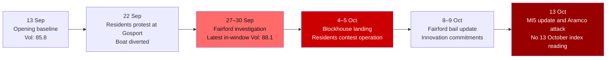

---
{"dg-publish":true,"permalink":"/finalized-work/world-reports/world-intelligence-report-october-2026/","title":"World Intelligence Report — October 2026","tags":["world-monitor","osint","geopolitics","intelligence","gosport","civil-liberties","air-defence","energy","palestine","artificial-intelligence"],"created":"2026-10-16T11:10:54.047+01:00","updated":"2026-10-26T02:08:40.019+00:00","dg-note-properties":{"status":"complete","title":"World Intelligence Report — October 2026","description":"Gosport's dispute over consent and policing; Fairford and air defence; Gulf logistics; Gaza's survival conditions; and AI disclosure, British law and independent research. Includes a dated 15 October volatility update.","date":"2026-10-13","updated":"2026-10-26","tags":["world-monitor","osint","geopolitics","intelligence","gosport","civil-liberties","air-defence","energy","palestine","artificial-intelligence"],"aliases":["October 2026 Intelligence Report","World Monitor Consolidation"]}}
---

# World Intelligence Report — October 2026

**Compiled by:** Eden Eldith & Astra / Codex (OpenAI)
**Companion intelligence:** Local eyewitness records, incident logs and supplementary analysis
**Coverage Period:** 13 September 2026 — 13 October 2026
**Information cutoff:** 13 October 2026, 23:59 BST
**Last Updated:** 26 October 2026
**Edition:** Final manuscript with 15 October update
**Post-cutoff supplement:** World Monitor run of 15 October 2026, 14:24

---
>[!info] This report documents events with sources. The author has no political affiliation and advocates no unlawful action. Where individuals, institutions, or states are discussed, the intent is to document choices and structural positions — to name them where the documentary record requires it, and to source every claim that does.

## Executive Summary

The month following our [[Finalized work/World-Reports/World_Intelligence_Report_September_2026\|September 2026 Intelligence Report]] brought the series' security, infrastructure and governance questions into homes, workplaces and local streets. This issue follows decisions through to the people affected: whether they have a say, how they are treated, and whether promised protection or access works in their lives.

1. **The Fort Blockhouse operation proceeded despite Gosport's objections.** The human analyst reports that the council had been promised the site would not be used. The protests included residents he personally knows; contemporary September coverage described a largely peaceful demonstration. The human analyst reviewed the video of the older driver's September arrest: it shows the officer placing himself in the car's way. Residents' accounts describe the man's distress and demands for accountability over the officer's actions.[^1][^2] On 4 October, 149 people were brought ashore in an operation backed by protest restrictions and a town-wide dispersal authorisation; police arrested twelve people at the protest. By 6 October, one of those twelve had been charged and eleven bailed. Those case figures and national political commentary cannot stand in for the residents' experiences or define the whole gathering as violent or far-right.[^3][^4][^5][^6][^7]

2. **Fairford and air defence exposed different demands on finite capacity.** By 8 October, seven men arrested in the Fairford investigation were on police bail. Police had recovered petrol during enquiries into a suspected attack on the base; fuel itself can be used in an improvised incendiary device. NATO's developing air-defence posture and Britain's proposed Britannia Shield made sustained coverage, integration and replenishment central questions.[^8][^9][^10]

3. **Energy risk moved through transport and processing.** Reuters reported at least twelve tanker attacks around Hormuz in a week even as crude flows recovered. Freight and refining constraints help explain why throughput and delivered prices can move differently; Saudi airport attacks killed people, while the attack on Aramco headquarters extended the threat to critical infrastructure.[^11][^12][^13][^14][^15]

4. **Gaza faced continuing lethal Israeli strikes and severe shortages of food, water, medical supplies and shelter.** September food parcels supplied roughly half of minimum caloric needs for their recipients; trucking sustained much of the drinking-water supply and shelter remained inadequate before winter. Dated reports of lethal Israeli strikes continued near the cutoff. The humanitarian section follows food, water, treatment and shelter through to people, alongside accountability and international assistance.[^16][^17][^18][^19]

5. **AI access carried consequences for research, speech and ownership.** In Florida, an alleged threat written to Claude passed through automated detection and human review to police, followed by a criminal charge. Anthropic's government-request rules and broader privacy provisions permit different disclosure routes. Applied to Britain's communications offences and Prevent referral system, the analyst identifies a specific exposure for OSINT researchers handling threatening statements, extremist material or confidential sources: their research record can be reclassified as evidence about them. That UK assessment, distinct from the documented US case, led to sensitive research being processed with local models.[^20][^21][^22][^23][^24] Independence also depends on hardware: Samsung, SK hynix and Micron faced DRAM cartel allegations concerning coordinated supply restrictions and price fixing.[^25][^26] Burnham's innovation commitments, MI5's AITAC announcement and pending ASI bills therefore need to be read alongside who can obtain and control usable capability. Baroness Campbell's AI-assisted speech showed what access can deliver when it restores a person's own participation.[^27][^28][^29][^30][^31][^32]

**Latest in-window Global Volatility Index: 88.1/100 (CRITICAL), 30 September.** The in-window daily series ranges from 81.5 to 88.3; the history contains an additional 88.5 reading. **No 13 October close is supplied.** The event narrative covers the full reporting window using the companion intelligence and dated external sources.[^33][^34]

**Post-cutoff update, 15 October at 14:24: 88.0/100 (CRITICAL).** The economic sub-index rises from 46 to 83 while the overall reading changes by only -0.1. Part VI records the new observation, anomaly and forecast separately from the reporting-window figures.[^35]

### Reporting Timeline — September to October 2026

The timeline places the month's distinct developments in sequence. Sources and their connections are developed below.

---

## Part I: Gosport — the landing, the road and the authority to decide

### Residents and local consent

The gathering included Gosport residents whom the human analyst recognised as people he personally knows. His account, and the supplied local discussion, concern a town reacting to decisions imposed on it and to the treatment of people within its own community. ITV's contemporary September report described the demonstration as largely peaceful, attributing that assessment to police. Its residents' reaction item included support for peaceful protest. A description of Gosport as a single violent far-right bloc would erase that local evidence.[^1][^2]

Residents' objections also concern the conduct of the police. Residents describe the older driver's distress and excessive force during his arrest. The human analyst reviewed the video, which shows the officer placing himself in the car's way; a resident described him as launching himself at the car. These are part of the event's social and political consequences and are presented beside the official outcome below.[^1]

### Two operations in a fortnight

The local story carried forward from September's Eastney coverage became a repeated test of the same geography. On 22 September an anticipated landing at Fort Blockhouse brought hundreds of protesters to Haslar; the boat was diverted to Dover and police made six arrests. The 23 September police update recorded three people charged with emergency-worker assault offences.[^36] The early French estimate of around 60 people on the September boat was superseded by the reported arrival count of **51 at Dover**, after about 00:30 on 23 September.[^37] On 4 October the landing went ahead. **149 people were brought ashore at Fort Blockhouse and transferred by coach to Kent.** The maritime rescue and the land transfer posed different operational problems: arriving at a secure berth did not supply an uncontested route out of the town.[^38][^2][^3][^24]

Fort Blockhouse sits at the end of a peninsula within a peninsula. The council leader's warning concerned restricted access, including the bridge, and the suitability of placing a recurring national operation there. Caroline Dinenage MP, council leader Zoe Huggins and Police and Crime Commissioner Donna Jones all objected to the site or its consequences. The Home Office said contingency arrangements were needed for small-boat arrivals; the council had already been told that Solent sites were under consideration.[^39][^40][^5]

The human analyst records that the operation proceeded despite the assurance given to Gosport council that Fort Blockhouse would not be used.[^1] The public record also contains an earlier, specifically worded reassurance: at the council's **30 September 2025** regulatory-board meeting, the Home Office said Fort Blockhouse was “currently not on the government list”, in response to a question about temporary asylum accommodation. The council leader welcomed that answer and used it to dismiss the need for a planned protest.[^41]

By **23 September 2026**, Dinenage was publicly describing preparations at Fort Blockhouse proceeding despite repeated representations by the MP, council and PCC. She had pressed for intercepted boats to be taken directly to Dover by sea.[^42] On **4 October**, the landing and coach transfer went ahead despite those objections. Police imposed a designated protest location and a town-wide section 34 dispersal authorisation, with powers to direct people to leave. Gosport's elected representatives objected; central government proceeded, and police enforced the restrictions surrounding its operation.[^6][^3][^24]

### Arrests, penalties and residents' accounts

The **22 September driving case** belongs to the earlier group of six arrests. Hampshire's **23 September** update records that a **67-year-old Gosport man received a fixed penalty notice for driving without due care and attention** and was **bailed until 22 December on the separate allegation of assaulting an emergency worker**. The notice's amount and whether it was accepted or contested are not stated in that release.[^36]

The video reviewed by the human analyst shows the officer placing himself in the car's way. His account records the officer jumping onto the bonnet and putting himself in danger. In the supplied local residents' discussion, a group member familiar with seeing the man at Haslar café wrote: “The policeman launched himself at the car”, and questioned the number of officers surrounding the car and pulling him out. The officer's actions are central to understanding how the danger arose and why residents challenged the force used. Recording only the offence label would omit that evidence.[^1]

| Local evidence supplied | Sentiment and significance |
|---|---|
| The human analyst recognised people he personally knows among those present | Participation included familiar members of the town; national political labels do not describe everyone who attended |
| A group member recognised the older man from Haslar café and described him as “a charming polite person” | Concern centred on someone known locally, his apparent confusion and the distress of the arrest |
| The same member described the officer launching himself at the car and called the handling “overly heavy handed” | Residents questioned police conduct and responsibility for the dangerous encounter |
| The person identifying herself as the video's recorder said she shared it because she wanted to know the man was okay | The stated reason for circulating the footage was concern for his welfare |
| Other supplied comments called for legal accountability and expressed anger towards police | The encounter was producing distrust of the authorities as well as argument about the landing operation |

These are residents' words and the human analyst's local account, supplied on 15 October about the earlier events. These accounts document residents' descriptions of the arrest, concern for the driver's welfare and demands for accountability. The human analyst's review of the video forms part of the report's primary evidence.[^1]

The **October figures** below concern the separate 4–5 October operation and supersede that night's partial reports. Their context includes residents' objections to the imposed operation and police conduct; the number arrested cannot stand in for an account of the people who gathered.

| Measure | Position established in the supplied record | Local context and meaning |
|---|---|---|
| People landed on 4 October | 149 from one boat; Home Office figure | The suitability of this site and the burden on the town were contested |
| Total protest attendance | About 350, according to police | Local residents participated; the crowd is not described by the allegations against twelve individuals |
| People at the fort line | About 150 in the BBC Breakfast account | A different measure from total attendance |
| Arrests | 12: eleven men and one woman, replacing the early count of six | Police actions concerning individuals; not a count of proven offences or a political classification of the crowd |
| Position on 6 October | One charged with failing to comply with a direction to leave; eleven bailed under investigation | The announced charge concerned compliance with a direction; no verdict or sentence for that case is established here |
| Police deployment | 227 officers from six forces, according to the PCC's 11 October account | A substantial deployment to carry through the operation despite local objections; the human analyst compares its convoy escort with intelligence-service training convoys he has repeatedly observed locally[^43] |
| Reported operation cost | More than £200,000; PCC estimate, not a final audited account | Part of the local objection to the cost of imposing the operation on Gosport |
| Earlier cost statement | About £150,000 per protest, quoted before the October landing | An earlier estimate, not an additional cost to sum |
| Legal challenge | Notice of a possible judicial review by George Madgwick; no ruling established by the cutoff | A further expression of the dispute over public authority |

The attendance and arrest figures come from the developed police/media accounts; the cost and deployment figures come from the PCC's later statement. Suspected offences included assaulting an officer, criminal damage, affray, drunken disorder, racially aggravated public order and highway obstruction after ambulances were blocked. A small number of officers received treatment at the scene; no serious officer injuries were reported. These are police-reported suspicions concerning particular individuals. Residents' accounts of the use of force remain part of the same record.[^4][^5][^44][^45][^46][^1]

Hampshire's **6 October, 09:00** update supplies the first charging outcome. One man was charged with failing to comply with a section 35 direction to leave Clayhall Road and bailed to Portsmouth Magistrates' Court on **26 November**. The other eleven were bailed while enquiries continued. Police recorded five section 35 notices. The charge concerns an individual direction; no verdict is recorded within this window. Arrest, bail, a direction to leave and a sentence are different outcomes. These procedural outcomes sit beside the residents' accounts above of force, distress and loss of trust.[^7][^1]

### The overnight record

The human analyst's live record preserves what reached his feeds as events unfolded. Approximate times below are **observation or circulation times** unless the source supplies an event time. In particular, a clip arriving after 01:00 does not establish that the filmed event happened after the coaches departed.[^24]

| Time, 4–5 October | Event or observation | Provenance |
|---|---|---|
| Around 06:00 Sunday | Dinghy reportedly leaves Normandy, shadowed by the French vessel *Abeille Liberté* | Local press account |
| Around 13:00 | Dinenage contacts the Home Office minister; the supplied account records no reply through the afternoon | Reported MP account |
| Afternoon | Police assemble, coaches move towards the fort and access roads close | The News live coverage |
| 17:49 | Hampshire publishes its notice setting out assembly, face-covering and dispersal powers | Police notice |
| 22:20 | Two RNLI boats bring the passengers into Portsmouth Harbour for Fort Blockhouse | Reported landing time |
| Around 23:57–00:12 | Live footage shows people on the coach route, movement over the cemetery wall and a streamer reporting nails in his tyre | The human analyst's contemporaneous stream log |
| Around 00:15 | Thames Valley police carriers appear in circulated footage | The human analyst's observation of the footage |
| Around 00:50 | Four-coach convoy departs, according to the local account | The News; subsequent footage logged separately |
| Around 01:00–01:19 | Barricade, drone and flare footage circulates; cars follow the convoy and a police vehicle operates a rolling road block | The human analyst's stream/X record |
| Around 02:00 | Crowd dispersed; arrivals taken to short-term holding in Kent for checks | Developed police/Home Office accounts |

The timeline draws on the human analyst's contemporaneous incident record and linked local reporting.[^24][^6][^4][^45][^47][^3]

Agency coverage of 4–5 October described a largely peaceful gathering, with some scuffles and flares. People complying with the designated protest location remained separate from those on the coach route. The live record describes particular participants climbing the cemetery wall, placing obstructions or using flares, and contains reports of nails and of cars following the coaches. Later reporting described clearance of nails and burnt bins. These accounts concern particular acts and locations. They do not make residents collectively responsible, establish every participant's motive or answer residents' objections to the police operation.[^24][^5][^48][^1]

### Four powers around one corridor

Hampshire's published notice announced the following powers and end times.[^6]

| Power | Announced restriction or authority | Published end |
|---|---|---|
| Section 14, Public Order Act 1986 | Assembly directed to Walpole car park | 16:00, 5 October |
| Section 158, Crime and Policing Act 2026 | Prohibition of identity-concealing face coverings during protest activity in the mapped area | 16:00, 5 October |
| Section 60AA, Criminal Justice and Public Order Act 1994 | Power to require removal of identity-concealing items in the mapped area | 16:00, 5 October |
| Section 34, Anti-social Behaviour, Crime and Policing Act 2014 | Dispersal directions within the specified Gosport area | 07:00, 6 October |

The human analyst's argument, recorded at 23:55, was that the assembly restriction was functioning to enable the coach movement under a POSIWID lens (purpose of the system is what it does). The harbour master determined the berth, according to the human analyst's confidential local sourcing. Once that maritime decision was fixed, the remaining problem was on land: the Haslar Road/bridge and Clayhall Road approaches controlled access to the fort. Closing those approaches, placing the assembly at Walpole car park and escorting the coaches converted police control of the roads into the means of completing the transfer. The different legal powers operated together around that physical dependency.[^24]

The human analyst's challenge is that police powers were being used to secure the contested transfer by removing peaceful opposition from its route. For residents seeking to deny the operation use of those roads, disruption was the intended means of protest against a decision imposed without meaningful local influence. The question is what justified overriding that protest. Section 14 requires a reasonable belief in specified statutory grounds and conditions considered necessary to address them. Interference with peaceful assembly must also meet the requirements of legality, necessity and proportionality. The existence of a police power does not establish that its use in this operation met those requirements.[^24][^1][^49][^50]

The distinction matters because **disrupting the operation and threatening public safety are different propositions**. Each restriction needs grounds that actually apply to it; the desire to complete a coach movement cannot substitute for that explanation. In 2025, the Court of Appeal upheld the rejection of regulations that attempted to lower the serious-disruption threshold to a level outside the statutory meaning of “serious”. In Gosport, the corresponding questions concern the harms anticipated, the evidence available when decisions were made, and whether restrictions went further than necessary. Reported obstruction of ambulances requires attention to those incidents and access needs; it does not supply an automatic justification for every restriction on the wider gathering.[^51][^49][^50][^4]

The scale of the deployment requires the same explanation. The PCC reported **227 officers from six forces**, while the human analyst describes a convoy escort larger than those he has repeatedly observed accompanying intelligence-service training movements to Fort Monckton. Hampshire's published notice states general safety aims and lists the powers imposed, but does not explain why that number of officers, that escort or that extent of restriction was necessary. The questions are which identified risks required those measures and why less restrictive options would not have addressed them. The threatened judicial review makes the original authorisations, operational reasons, extensions and any filed pleadings material to that assessment.[^5][^43][^6][^50]

### Mobilisation without a single command

The media infrastructure was part of the event. Ground streams, aerial footage and local messages made the police operation visible and allowed attention to follow the coaches after they left the fixed site. September's Eastney record had already shown a broadcast eliciting practical support through a kayak delivery of battery power: a viewer could identify a practical need, supply it and prolong coverage without a central organiser. October extended that pattern from sustaining a stationary stream to following a moving operation. A person could see a road closure or departing convoy, relay its location and draw others' attention to the next point on the route. That is coordination through shared observations, not evidence of a single command directing the crowd.[^24][^52]

The absence of a prominent organiser makes that distinction material. **Daniel Thomas, known as Danny Tommo**, had been refused bail at Portsmouth Crown Court on **29 September** and remained on remand during the October operation. The source record describes charges of criminal damage and failure to provide his phone PIN, to which he pleaded not guilty, following the livestreamed slashing of an emptied dinghy. Mobilisation continued without him directing events from the ground; external amplification and local action did not require the same person to perform both roles.[^53][^24]

The Eastney record also exposes a limit of the mediated picture. At **21:26**, the analyst noted Eastney posts absent from his Facebook feed while X surfaced the event sooner; by **22:05** they had appeared, a **39-minute visibility gap**. Simultaneous interruptions affecting streams were also recorded, but their cause was not established. The evidentiary point is that a live event can be visible to participants while remaining absent from another observer's feed. An automated news system likewise sees only the sources it receives. A quiet feed cannot establish a quiet street.[^52]

The September diversion was interpreted by protesters as success. October's landing was accompanied by a larger advance deployment and multiple powers. The human analyst identifies the imposed operation, road restrictions and extensive escort as contributors to escalation, alongside anger over the September driver's treatment. Residents' accounts make police conduct part of the explanation for distrust and opposition. The sequence therefore matters: what residents and officers did, when restrictions and force were used, and how those encounters changed the gathering. Later disorder cannot, by itself, retrospectively establish the necessity of every earlier policing decision.[^24][^1][^43]

This creates a feedback loop. A diverted boat gives participants a reason to believe obstruction works; an advance cordon then removes the road access through which that success was achieved. Some participants respond by finding other routes or using obstructions, while those acts become grounds for a larger deployment at the next landing. The recorded wall crossings, barriers, nails and flares belong to particular participants, not the whole gathering. The structural consequence is that each side's adaptation raises the other's expected cost, while peaceful residents experience the expanding restrictions alongside everyone else.[^24][^5][^1]

The national narrative also changed. The human analyst recorded “Section 34” and “Treason” trending on X on 5 October, Rupert Lowe describing the arrivals as invaders, and Dan Wootton on 6 October presenting Gosport as “ground zero” while calling for lawful action. These are those speakers' words and political interventions. They do not establish the affiliations, beliefs or motives of the residents the human analyst recognised, or of everyone attending. The police power itself had become a subject of national mobilisation, while local concerns included consent, the town's roads and the treatment of neighbours.[^24][^54][^1]

The human analyst's **“masks both ways”** observation captures a further asymmetry: protesters conceal identity from the state's cameras; drivers conceal identity from the crowd's cameras. The watcher changes, while the reason for wanting anonymity can remain similar. The statutory treatment differs. Analytically, the issue is who gets protection from identification, who must accept exposure, and who bears the consequences of a viral image.[^24]

### The local model and the Betz connection

The human analyst's account of Gosport distinguishes people becoming neighbours from large operations imposed on a town without meaningful local influence. His model draws on its dockyard and ex-services culture, employment and housing pressures, the concentration of Ministry of Defence land, and the distance between decisions made elsewhere and consequences experienced locally. The figures behind that account have a dated documentary trail: Gosport Borough Council's 2020 submission recorded **0.5 jobs per working-age resident using ONS 2018 data**; the Men's Health Forum's **2009–2013 male ward estimates** give **82.9 years in Lee West and 72.8 in Forton**, a **10.1-year gap**; and Dinenage's **January 2017 parliamentary evidence** put MoD ownership at **approximately 21%** of Gosport's land. These are historical measures of the town's economic and social setting. Local multicultural businesses are part of the analyst's evidence that integration works through ordinary relationships at human scale. His conclusion separates that experience from a mass operation whose location, timing and policing the town cannot meaningfully influence.[^24][^55][^56]

David Betz's *Civil War Comes to the West, Part II: Strategic Realities* argues that internal civil conflict has become the West's principal strategic danger and identifies Britain and France as the countries most likely to experience its first outbreak. He connects economic strain, cultural fracture, elite overreach and lost confidence in ordinary politics with the vulnerability of essential infrastructure. His conclusion explicitly warns defence establishments against minimising the danger of internal conflict.[^57] His earlier article examines declining social trust and frustrated economic expectations, and describes radicalisation across political constituencies.[^58]

Gosport gives Betz's distinction between **nation and state** a concrete local form. The MP, council leadership and PCC objected, yet central government's operation proceeded through the county's police force. Residents had used the ordinary representative channels and still found the decision imposed. The analyst's conclusion is that the resulting grievance concerns the effectiveness of representation itself: if electing representatives, obtaining assurances and making objections cannot influence the outcome, the road becomes the remaining place where opposition can have an immediate effect. The driver's treatment adds a separate, personal reason to withhold trust from the institution enforcing that outcome.[^1][^24][^39][^5]

The resource asymmetry is equally concrete. A few hundred people, phones and inexpensive obstructions can oblige the state to assemble **227 officers from six forces**, coaches and escorts, at a reported cost of **more than £200,000** for this operation. The two sides do not need comparable budgets to impose comparable constraints on each other's freedom of action. A completed transfer is a tactical result; repeating it at an increasing financial and political cost can still weaken the state's ability to govern with consent. This is the analyst's application of Betz's infrastructure and legitimacy argument to the observed sequence, not a claim that Gosport has already crossed into civil war.[^24][^5][^57]

The human analyst also identifies the possibility of a **negative coalition**. People angered by arrests over Palestine-related expression, civil-liberties organisations concerned with surveillance and protest restrictions, and people opposing the Gosport landing can reject the same expansion of police discretion while disagreeing profoundly about immigration or foreign policy. Liberty, Big Brother Watch and the Free Speech Union occupy different parts of that wider argument. The proposed mechanism is shared opposition to powers used against speech and assembly before any shared political programme exists; the record does not establish a joint organisation among them. A further indicator is whether police continue to identify with enforcing the centre's decisions as the local costs rise: a change in institutional loyalty would be a different stage from public anger at officers. This window records continued enforcement.[^24][^54][^55]

The sea rescue was completed and the coaches left. Residents' questions remained: why their town was chosen despite local objections, why this scale of policing was necessary, whether its tactics intensified the confrontation, and who would answer their account of the driver's treatment. A completed transfer does not settle those questions. The consequences include people's confidence that they will be heard and treated fairly in their own town, as well as the cost of another deployment.[^1][^39][^5]

---

## Part II: Fairford, the defence estate and the cost of protection

### A live investigation, with a changing public record

| Date | Established public position |
|---|---|
| 27 September | Five men arrested near RAF Fairford after reports of suspicious vehicles; explosives and terrorism offences investigated |
| 29 September | Counter Terrorism Policing confirms petrol recovered and no improvised explosive devices found; the original five remain under investigation on bail |
| 1 October | A sixth man, a 25-year-old dual UK–Iranian national, arrested in Westminster and subsequently bailed |
| 6 October | A seventh man, a 22-year-old British national, arrested in Westminster |
| 8 October | Seven men, all in their twenties, all on police bail; enquiries continue |

The recovered petrol is significant as potential material for an incendiary attack, including through an improvised device. The police statement that no IEDs were found records the search outcome; it does not establish that the fuel posed no serious threat or could not have formed part of a device. Possible foreign-state involvement remained an investigative line. Bail did not end the investigation; suspicion did not become a conviction.[^59][^8]

World Monitor's 27 and 30 September headline sets show the investigation gaining attention. The analyst's contemporaneous research record also preserves Kyle Glen's interpretation that an attack on a military base appeared to have been prevented, alongside the subsequent police findings.[^33][^55]

The geographical implication is wider than one perimeter. Bases rely on roads, civilian workers, suppliers, utilities and surrounding communities. An investigation can disrupt that system before any final attribution exists. September's concern about Britain's exposure therefore continues into October through the practical demands of protecting the defence estate.

### MI5's account of the threat environment

On 13 October, Sir Ken McCallum said MI5's state-threat caseload had quadrupled over a decade, identified Russia as its foremost state adversary, and described Iranian ambitions to target military sites. He also described growth in cases where extremist anti-immigration and anti-Muslim grievances were developing into terrorist intent. The UK's national terrorism threat level was SEVERE. AP reported his description of Fairford as “not unique”.[^60][^61]

The human analyst brings a local eyewitness comparison to the scale of the Gosport operation. He has repeatedly observed annual intelligence-service training convoys travelling from Fareham along Gosport Road towards Fort Monckton: unmarked cars moving at speed, with police motorcycle escorts in vanguard formations. He reports that the October operation had a larger police escort than those training convoys.[^43]

The comparison establishes the analyst's local scale of reference: the escort around a contested civilian transfer exceeded those he had repeatedly seen around intelligence-service training movements. The PCC's **227 officers from six forces and more than £200,000** describe the wider deployment, not the size of those earlier escorts. The analyst's conclusion is about allocation: enforcing the Home Office's chosen route required an exceptional concentration of police capacity, even while the same defence-heavy region depended on public reporting and civilian cooperation for its security. Alienating residents while drawing heavily on policing resources has consequences beyond the night the coaches leave. McCallum's service-wide terrorism assessment supplies no case-specific basis for classifying those residents as terrorist suspects.[^43][^5][^1][^60]

Estonia's 29 September attribution of the August arson at Milrem Robotics to Russian security services supplies a related defence-supply-chain case. Russia denied responsibility. The in-window development was the attribution of the August fire.[^62]

### From air policing to sustained air defence

NATO's account describes a move during 2026 towards an integrated Air Defence posture, bringing sensors, command systems and weapons together with Eastern Sentry. The latter began in September 2025. This month's development is the continuing implementation and operational account.[^9]

On 15 September, Lt Gen Jason Hinds set out the implementation of Standing Defense Plan 12000 and the cost problem of using fighters against cheap threats. NATO's 29 September statement referred to Italian fighters downing a drone over Lithuania on 15 September. A successful interception answers whether that particular threat was stopped. It does not answer whether the chosen interception mix can be sustained over months.[^63][^64]

The cost exchange is the mechanism: inexpensive expendable aircraft can consume fighter hours, maintenance capacity and costly munitions out of proportion to the attacker's expenditure. Repeated successful interceptions can therefore exhaust the defender. Sensors, lower-cost counter-drone weapons and replenishment matter because they change what it costs to keep protecting the same place tomorrow. September's Portsmouth analysis applied that distinction to high-value ships in harbour: the presence of a warship with defensive weapons is not, by itself, evidence of continuous protection for the surrounding port and shore infrastructure.[^63][^65]

The daily corpus carried a Defence News report, citing the CBO, that the Iran war had depleted two-thirds of US missile interceptors. Alongside the Navy chief's Atlantic emphasis, a German deployment to a Baltic island and British defence-spending pressure, this raises questions about replenishment, training, warning time, coverage and the allocation of finite systems between theatres.[^66][^67][^68]

| Development | What the source establishes | Delivery question |
|---|---|---|
| NATO posture and September operational statements | Integration and readiness are active priorities | Can detection, command and weapons function together at the necessary scale? |
| Conservative “Britannia Shield”, 6 October | Opposition proposal for up to £10 billion over ten years and an initial deployable capability within a first term | What is funded, contracted, delivered and persistently covered? |
| RAF Akrotiri warning system, reported 23 September | Portable warning-system contract above £552,000 for October 2026–October 2031 | How do warning, shelter and response work together for the base and neighbouring village? |
| Sargan-3000 maritime interception, reported 7 October | Account of a 12 September interception, before this issue's window | How does protection of sea routes change as uncrewed platforms confront one another? |

The proposal, contract and reported demonstration show different stages of capability development.[^10][^69][^70]

The practical test is whether the available resources can sustain protection for the people and places at risk. A launcher without warning, a warning without a decision path, or an interceptor stock that cannot be replenished leaves a gap elsewhere in the chain. Saudi airport attacks in the same window show why civilian movement, military defence and economic continuity have to be assessed together.

### Further developments in the daily corpus

| Thread | In-window report or announcement | Connection |
|---|---|---|
| Ukraine's drone capabilities | Defence News, 25 September: Ukrainian AI training platform for drone technology opens to UK companies | The defence relationship includes training data and development access as well as weapons transfers |
| China and the United States | Guardian, 24 September: Xi sets out terms for avoiding military conflict at the Trump meeting | Diplomacy and military competition continue alongside the European and Gulf crises |
| Mali | Bellingcat, 16 September: investigation of civilian harm in the drone campaign | The civilian consequences of drone warfare extend beyond the most heavily covered theatres |
| Japan | Guardian, 18 September: interest rates raised to a 31-year high amid rising prices | The inflation response differs across economies exposed to the same wider pressures |

These developments in World Monitor's September coverage connect the main regional accounts to wider military, civilian and economic consequences.[^71][^72][^73][^74]

---

## Part III: The Gulf — throughput, exposure and the price of delivery

### Oil can move while the transport system becomes more dangerous

September's issue followed pressure on Hormuz, bypass routes and shipping costs. October supplies a more precise account of how those pressures can coexist with recovering volumes. Reuters reported at least twelve attacks on oil and gas tankers around Hormuz during 28 September–5 October, citing three maritime-security sources. The attack record concerns the safety of moving cargo; it does not itself measure how much cargo passed.[^11]

| Indicator | Dated reading in the source record | What it measures |
|---|---|---|
| Crude crossing Hormuz | At least 10.1 million barrels a day on 6 October; about 74% of pre-war levels, according to Kpler as reported by Reuters | Crude volume |
| Commodity-vessel transits | Seven on 6 October and ten on 7 October in Reuters' account | Vessel count, not total oil volume |
| VLCC charter rate | Above $1.2 million a day in Ron Bousso's 5 October account | Cost of securing tanker capacity |
| Freight share of delivered oil cost | About 27%, compared with about 3% previously in the same account | Transport's contribution to delivered cost |
| Brent settlement, 13 October | $105.69 a barrel | Benchmark price at the cutoff |
| WTI settlement, 13 October | $94.14 a barrel | Different benchmark and delivery system |

Sources use different denominators and dates. A change in vessel count cannot be substituted for the crude-volume series, and the October charter quotation is not automatically a like-for-like index against the boundary feed's $800,000-a-day tanker headline.[^12][^13][^75][^76]

Bousso's argument concerns the chain between production and use: transport and refining constraints can sustain delivered prices despite a recovery in available crude. Britain's exposure runs through diesel, goods transport, farming and industry, then into household prices. The 17 September Bank decision had already been reported as a hold conditional on the energy outlook; the 21 September diesel headline and later LNG coverage carried the same transmission mechanism through the daily corpus.[^13][^77][^78][^79]

The leverage lies in the dependency. A producer can restore output while shipowners, insurers, charterers and refiners still price the route as scarce or dangerous. The actor able to interrupt one stage can impose costs on the whole chain without stopping every barrel. For Britain, a higher delivered diesel cost reaches haulage, farm machinery and industrial distribution before households see it in the price of food and other goods. More crude crossing Hormuz therefore does not establish that the pressure on household budgets has eased. The necessary measures are usable routes, affordable charter and insurance capacity, refinery availability and final delivery.[^11][^12][^13][^78]

### Yemen and Saudi infrastructure

| Date | Development recorded by Reuters |
|---|---|
| 19 September | Timour Azhari sets out Riyadh's dilemma between continued military action and exposure of critical infrastructure |
| 8 October | Airport attacks and damage to an aircraft reported; three deaths that week in the cited account |
| 11 October | Houthis renew warnings to airlines and travellers after a deadly Riyadh airport attack |
| 13 October | Death toll from that airport attack revised from 12 to 13 in the later report |
| 13 October | Aramco headquarters in Dhahran attacked; Saudi energy ministry reports a limited administrative-building fire and no casualties |
| 13 October | Taiz reporting describes shelling, the severed Aden road and worsening access and prices |

The later Riyadh count supersedes the first report of twelve deaths.[^80][^81][^15][^14][^82]

The attack reached Aramco headquarters. Saudi Arabia reported a contained administrative-building fire and no casualties. The airport attacks had already killed people, with the Riyadh death toll revised to thirteen, while renewed warnings to airlines and travellers threatened further disruption.[^14][^15]

Azhari's dilemma is consequently coercive as well as military. Continued Saudi air operations expose airports, commercial aviation and energy infrastructure to retaliation; interruption of those civilian and economic functions can raise the price of continuing the campaign even where an individual strike causes limited physical damage. The Dhahran fire is evidence that the headquarters was reached, not evidence of a measured oil-production loss. The airport deaths and airline warnings establish a different, already material consequence.[^80][^14][^15]

For people in Taiz, an unusable road can mean losing access to food, medicine and markets. The transport disruption discussed in shipping and price reports also determines whether families can obtain essentials. An account of Yemen must include the people living through the war alongside its effects on international shipping.[^82]

### Britain: costs continue through institutions

The 22 September Burnham–Trump meeting readout listed Hormuz and Ukraine alongside migration, trade, Diego Garcia, the Falklands and Jimmy Lai. It records the government's account of the agenda. It does not establish that those matters were resolved. Martin Farr's accompanying analysis asked what domestic cost a warm relationship with Trump could carry, including through British support to Saudi Arabia.[^83][^84]

The climate and infrastructure stories in the feed belong in the same account of resilience. The 23 September release of the climate-security assessment and the 27 September report on food supplied from drought-risk areas connect external shocks to domestic provision.[^85][^86] The series' standing analytical distinction is between the physical hazard and the decisions that turn exposure into harm. Storage capacity, maintenance, crop sourcing, hospital cooling and access to affordable household protection determine what follows from heat or drought. Naming climate change does not discharge responsibility for those choices; rain after a dry period does not repair a failed cooling system, restore lost crops or demonstrate reservoir recovery.[^87]

### The Iraq deadline reached an outcome

On 30 September, AP reported the US military's statement that its troop withdrawal from Iraq was complete, including departure from the Irbil base. The Pentagon described a transition to Iraqi-led security with continued targeted training and intelligence support. Withdrawal of the deployed mission therefore does not mean the end of the bilateral security relationship.[^88]

AP's report supplies the announced outcome after the last daily corpus run, near the start of 30 September. Continued support and any subsequent deployment changes belong to the record following that transition.

---

## Part IV: Gaza and Palestine — what reaches people

### Food, water and the approaching winter

For a person inside Gaza, the useful questions are concrete: how much food reaches a household, whether safe water is available, which treatment can still be obtained, and whether a shelter will survive rain. A nominal ceasefire does not answer them. The in-window humanitarian reports describe assistance keeping essential functions going while access restrictions, shortages and underfunding continue to undermine them.

| System | Dated position | Consequence for daily life |
|---|---|---|
| Food parcels | OCHA's 2 October report: September parcels reached over 840,000 people but supplied about half of minimum caloric needs | Receipt of a parcel did not mean adequate nutrition |
| Drinking water | Same report: 74% relied on trucking; partners delivered 24,995 m³ daily through 3,199 collection points | Household access depended on a continuing distribution operation |
| Desalination | Reduced southern output threatened supply for about 500,000 people | A plant-level failure reaches households beyond the immediate site |
| Flood exposure | 217 at-risk sites hosting 235,000 people; approximately 44,000 others in unsafe buildings | Hundreds of thousands were living at flood-risk sites or in unsafe buildings |
| Shelter | OCHA's 25 September report: 65% of households in tents or makeshift shelters; 94% needed shelter or household assistance | Winter exposure remained widespread |
| Medical care | Shortages affecting cancer treatment, dialysis materials and insulin; Al-Ahli mammography and CT services suspended | Underfunding and clearance restrictions interrupted access to treatment and diagnostics; having a functioning clinical team did not ensure the supplies to treat its patients |
| Education | About 200,000 children without structured learning at the 19 September opening | Another year of access depended on emergency provision |

The first four rows come from OCHA's report dated 2 October, published 5 October; its main reporting interval precedes publication. The remaining rows come from the report dated 25 September, published 28 September. These are dated observations, not measurements freshly taken on 13 October.[^16][^17]

WFP's 30 September account said two-thirds of Gaza's population remained acutely food-insecure. Improvements depended on assistance rather than recovered livelihoods. That dependency matters when support is reduced: the lost meal is not automatically replaced by a functioning market, an income or a restored farm.[^89]

### Entry, offloading and household receipt

OCHA recorded improved offloading after the preceding week's deterioration. In the 2 October report, the Kerem Shalom rate rose from 52% to 88%, and the Egyptian corridor from 21% to 74%. Those percentages describe offloading, not the proportion of household needs met. Medicines, chlorination materials, generator lubricants and spare parts remained scarce.[^16]

These shortages compound one another. Clearance restrictions can prevent a necessary item reaching a facility; underfunding can prevent its procurement; generator interruptions can disable services even after supplies arrive. Reduced water production increases dependence on trucking, which itself needs fuel and access. For a patient awaiting dialysis, insulin or cancer treatment, the relevant outcome is an uninterrupted course of care. For a household, it is enough safe water and food each day. Aggregate truck or pallet counts cannot substitute for either outcome.[^16][^17]

UNOPS' 9 October update provides a separate view of actual monitoring. During September its teams monitored 1,608 cargo trucks and 122,500 pallets, covering 41 warehouses and 22 distribution sites. It separately reported verification of 400 pallets reaching communities, including shelter, hygiene and lighting supplies. Those are monitoring outputs, not a complete inventory of all Gaza aid or a denominator from which to calculate a general delivery-success rate.[^90]

The chain has several gates: permission to enter, arrival, offloading, storage, movement, distribution and practical use. Passing one gate does not establish passage through the next. An unloaded medical consignment cannot restore treatment where equipment, staff, electricity or the remaining consumables are missing. A shelter kit does not make an unsafe site flood-proof. Measuring the chain is the means of identifying where civilian survival is being denied.

IOM's statement datelined 9 October put shelter-assistance needs at nearly two million people and the combined humanitarian pipeline at only 17% of winter requirements. Its published account therefore describes a gap in material provision before the rains, rather than an abstract future risk.[^91]

### Deaths, injuries and displacement

The series' **whole-ledger assessment comes first**. Applying the same two study-derived undercount corrections used in August and September (×1.53 and ×1.70) to the Ministry's 1,431 reported deaths through 30 September gives **approximately 2,200–2,400 direct violent deaths since the ceasefire began**. This is an extrapolation by the series' stated method from earlier Gaza studies, rather than a new October mortality survey.[^65][^16]

Violent deaths are only part of that ledger. The food, water and medical failures documented above continue to produce deaths outside the reported strike count. August and September's broader assessment — **total mortality attributable to the ceasefire period plausibly in the mid-to-high thousands, with ten thousand inside the defensible envelope** — is carried forward here as an estimate, not a newly measured October total. The underlying drivers of indirect mortality remain in this issue's humanitarian record. The official figure below is the **countable minimum**; it does not replace the broader assessment.[^65][^16][^17]

OCHA relayed the Gaza Ministry of Health's count of **1,431 killed and 5,026 injured since the ceasefire announcement through 30 September**; retrospective register additions were recorded separately. This is a cumulative period beginning with the ceasefire announcement.[^16]

Reuters' dated reports near the cutoff describe the following sequence:

| Incident date | Reported deaths | Attribution |
|---|---:|---|
| 10 October | At least 5 | Medics; two strikes reported |
| Late 11 October | 3 | Reported in the 12 October account, including a strike on a tent in Mawasi |
| 12 October | At least 2 | Health officials; southern Gaza |

Israel said it targeted militants. The selected reports give a minimum of ten deaths over these three days; they are not an exhaustive monthly total.[^18][^19]

In the West Bank, OCHA recorded 147 Palestinians, including 73 children, displaced by demolitions during 15–21 September. Displacement, destroyed housing and interruption of services remain part of the civilian account alongside reported strike deaths.[^17]

### International response and accountability

Material assistance continued, but its scale and purpose need to be stated. WFP announced a $5 million South Korean contribution on 30 September: $4 million for Gaza cash assistance intended to reach nearly 45,000 people, and $1 million for West Bank vouchers for 56,000. UNOPS' September Qatar announcement concerned funding for approximately 1.3 million litres of fuel; an agreement and planned delivery are not confirmation that every litre had arrived.[^89][^90]

The Secretary-General's appeal, recorded in OCHA's 25 September report, called for humanitarian access, protection of personnel and compliance with international law and ICJ orders. The appeal addressed obligations; the delivery figures show how far material provision still fell short.[^17]

The **21 September** WCK inquest report concerned potential evidence from Israeli and British military commanders.[^92] The background is the Israeli decision announced on **19 August** not to pursue criminal investigations into the **April 2024** strike that killed seven World Central Kitchen workers. Britain, Australia and Canada condemned that decision; WCK rejected the credibility of the IDF investigating its own conduct.[^93] The analytical consequence is that accountability depends on access to the people and records behind the strike, not only an examination of the aid convoy's conduct. An independent inquiry must be able to follow the decision to use lethal force through the command structure. Closure of one military process does not answer the families' demand to establish how and why the workers were killed.

The humanitarian assessment is therefore about the continuing production of harm. Destroyed or disabled systems leave people exposed after a ceasefire is announced; interruptions to food, water and treatment can kill without appearing in that day's strike count. The documented failures threaten survival through shortages of food, safe water, treatment and shelter.

---

## Part V: AI, institutions and usable access

### An outcome from September's political watch list

Camden's official result records **Sagal Abdi-Wali elected for Labour** in the 8 October Holborn and St Pancras by-election. She received 12,292 votes, against 8,928 for Green candidate Zack Polanski: a majority of 3,364. Turnout was 38.76%. This resolves the event left pending in September's issue; the result was announced on 9 October.[^94]

### Conference promises and existing constraints

September's feed kept three domestic questions in view: scrutiny of the £72 million Reform donation total, MPs' objections to restrictions on disabled people's overseas travel, and Burnham's proposal for a government-backed electricity-grid investment body. They concern different institutions but share a question about who can exercise a formal right or benefit from a promised service in practice.[^95][^96][^97]

The donations story followed two **£36 million** gifts, from **Ben Delo on 11 September** and **Christopher Harborne on 12 September**, immediately before the window. The in-window question was how eligibility rules and proposed restrictions applied to that money. The political consequence of concentration is already visible in the sums: two individuals could supply £72 million, making their decisions consequential for a national party's capacity.[^95][^65] The travel dispute concerns restrictions on disabled people's ability to travel abroad and MPs' demands that their right to do so be protected. The grid proposal concerns the ownership and investment decisions through which power reaches homes and businesses. Their outcomes require decisions and implementation; announcement alone is the beginning of that record.

### The innovation promise and the entry point

Burnham's 9 October Innovation Nation speech promised action on non-compete clauses, regional innovation funding, recruitment, growth capital and AI standards. The announced programme included £1 billion over four years with UKRI for selected clusters, and devolution of local innovation partnership funding to established mayors from 2028. The speech also explicitly described routes through technical education and the everyday economy. These were commitments with different implementation times, rather than benefits already available at every point of entry.[^27]

Removing a restriction on moving between salaried research jobs helps someone already inside that labour market. An independent researcher without an institutional affiliation needs access to compute, equipment, grants, procurement and routes for demonstrating capability. Celebrating talent in general does not establish that the eligibility rules recognise that person.[^55]

The July Department for Education release, revisited in the 26–27 September discussions, supplies dated background. Higher-education participation by age 19 for FSM-eligible White British males was 13.0%, compared with 21.0% for females in that category and 28.6% across all FSM groups. These figures refer to 2024/25 participation, published on 9 July 2026. They provide the historical baseline for the September discussion.[^98]

The structural implication is about the sampling frame. A programme that measures inclusion only among people who already reached university cannot describe those excluded earlier. A programme admitting researchers only through recognised institutions makes the same kind of selection at the next stage. Its outputs can look representative inside the gate while the gate itself remains the decisive filter.

**POSIWID — the purpose of a system is what it does — directs attention to the operative rules.** If access depends on affiliation, the programme selects affiliated applicants whatever its broad language about talent. The next useful evidence is the application form, eligibility text, funding decision and actual route to equipment. That is where the promise of an innovation nation meets an independent researcher.

### Governing intelligence and governing its owners

Alex Sobel's **Artificial Superintelligence Bill, Bill 142 (2026–27)**, proposes prohibiting development, deployment and operation of ASI systems and establishing monitoring and control powers. It received its Commons first reading on **8 September**, with second reading scheduled for **13 November**. Parliament's website identifies it as entry 4288. It remained a proposal awaiting that next stage.[^29][^99]

The US sequence crosses this issue's opening boundary. Sanders and Casar **announced forthcoming legislation on 3 September**; formal introduction followed inside this window. **S.5493** was introduced on **23 September** and referred to Senate Commerce, Science, and Transportation; **H.R.10538** followed on **24 September**, referred to House Oversight and Government Reform. Committee referral is the latest verified action for each at the cutoff. Neither had become law.[^32]

The human analyst's **13 September regulatory-symmetry argument** applies the safety claim to the institutions making it. A rule that restricts development by outsiders while leaving incumbent companies in control of compute, access, evaluation and the terms of permitted research can consolidate the very concentration of power it is said to protect the public from. Independent development is a relevant part of that question: the effects of a prohibition depend on its operative definitions and thresholds, not on whether its publicity depicts only large laboratories. Collective safety must therefore constrain the allocation and exercise of private institutional power as well as the capabilities of an individual model.[^55]

David Sacks' response to Dario Amodei places voluntary restraint with the frontier labs themselves. A laboratory can stop its own development without first acquiring authority to stop competitors. The analyst's conclusion is that a demand for universal restraint is also a demand about who gets to decide for everyone else. Ownership, conflicts of interest, access to equipment and the independence of evaluation belong inside the governance question, rather than being treated as matters settled merely by regulating model outputs.[^100][^55]

MI5's 13 October announcement placed AITAC inside the service, drawing on expertise including the AI Security Institute, NCA and NCSC. McCallum said the centre had launched during 2026. The announcement therefore made public a centre already launched during the year. Its stated task is all-source assessment of AI-related threats.[^60][^28]

**The US terminology change is dated 29 September.** Executive Order 14434 directs executive departments and agencies to use “Super Intelligence” and “SI” in official communications and other non-statutory documents, to the extent allowed by law. It does not require rewriting historical instruments. Its operative definition initially incorporates the existing statutory definition of AI, while ordering proposed legislative language within 60 days. The renaming therefore changes official language without itself establishing a new technical capability threshold.[^101][^102]

The same month's record therefore contains a promised innovation programme, proposed statutory restrictions and an intelligence assessment institution. Each changes a different part of the relationship between state, developer and user. Describing all three as “AI policy” without examining their respective powers conceals who is making which decisions.

The public contest also took physical form. **On 17 September in San Francisco**, demonstrators marched from OpenAI's Mission Bay headquarters to Anthropic at 500 Howard Street and then City Hall. Euronews' 18 September video report records calls for a development pause, international limits and a local AI emergency. The march's documented demands concern who can decide the pace and conditions of development.[^103]

### Police communications and the signature on the output

The human analyst recorded Pangram tests on two Gosport Police posts carrying the same officer's collar number:

| Post | Recorded detector output | The human analyst's interpretation |
|---|---|---|
| 14 September “booking-on” notice | 100% AI classification, on a short text | Generic institutional prose appeared machine-written |
| 2 October Rowner and bike-chain update | 27%, concentrated in the generic sign-off | Local specifics appeared distinct from formulaic filler |

The human analyst interprets these results as evidence of a pattern he had observed for over a year: local specifics supplied by a person, generic filler supplied by a model, and the whole presented under an officer's signature without disclosure. These two tests illustrate that assessment. The detector results are classifications, not a record of the drafting process, so the attribution of authorship remains his inference.[^24]

A documented comparison arrived from New Zealand on 17 September. Police admitted using AI to alter a recovered-guitar photograph, removed the post after questions, and said the action breached their processes. The reported policy required disclosure and naming the tool unless a clear operational reason justified withholding it. The West Midlands case supplies the more consequential January precedent: a Copilot-invented detail reached MPs, the force initially denied using AI, and the chief constable retired. Hampshire's public Bobbi chatbot is a separate, openly identified use.[^104][^105][^106]

The issue is the institutional signature. A collar number gives a communication the authority of an officer and a force. If machine-generated text passes through that signature without disclosure, the institution receives the benefit of apparent personal authorship while readers cannot identify where the words came from. New Zealand's disclosure requirement makes that distinction inspectable; the West Midlands precedent shows how a generated assertion can acquire official authority and reach parliamentary scrutiny. The analyst's objection is to the concealment and transfer of authority, not the mere existence of a writing tool.[^24][^104][^105]

### Private discussion, disclosure and speech

**The Florida case shows the disclosure chain in operation.** WINK's **30 September** report, reproduced by SWFL.io, identifies **Carli Michelle Heller of Bonita Springs**. According to its account of the arrest report, she wrote to Anthropic's platform on **26 September** that she would attack the **Lee County Sheriff's Office**, then said on **27 September** that she had obtained a new gun. Automated detection escalated the material to a human review team, which reported it to law enforcement. Deputies identified her, attended her home and detained her; an LCSO intelligence detective took over. Sheriff **Carmine Marceno** said she described using the system as a diary. She was charged with making a written threat of violence. TechSpot's **4 October** account identifies the felony provision as **Florida Statute 836.10**. These are reported allegations and a charge, not a conviction; the underlying affidavit was not separately obtained.[^21][^20]

The relevant distinction is between a government demanding data and a provider initiating disclosure. Anthropic's government-request policy, dated **16 March 2026**, normally requires valid legal process, such as a subpoena or warrant, and permits an exception where immediate disclosure could avert imminent physical harm or death. It also provides for user notification subject to legal prohibitions and specified exceptions. That is a rule for responding to requests.[^23]

The individual-user **privacy policy effective 10 September 2026** is broader. It permits sharing with government authorities, law enforcement or other third parties where Anthropic believes in good faith that disclosure is reasonably necessary to comply with legal requirements, prevent serious harm to people **or property**, address fraud or **“other illegal activity”**, enforce its terms, or protect specified rights and safety interests. Those clauses do not make a court order the sole route to disclosure or restrict the category of illegality to violent crime. The policy excludes content processed for business customers under their separate agreements. For a covered individual account, the practical consequence is clear: the company holding the conversation can assess it and initiate disclosure under its stated conditions. A promise about government requests is not a promise that private prompts can never leave the service without a warrant.[^22]

**The British implications are the analyst's assessment of that mechanism, not a claim that the Florida case occurred under UK law.** Britain's communications framework includes **section 1 of the Malicious Communications Act 1988** and **section 127 of the Communications Act 2003**, including surviving provisions concerning grossly offensive, indecent, obscene or menacing communications. The **Online Safety Act 2023**, sections **179 and 181**, introduced false- and threatening-communications offences and replaced specified older provisions. The CPS explains that section 127 concerns transmission over a public electronic communications network; it need not be addressed to or received by another person. Consequently, treating a conversation as private or addressing a machine does not, by itself, settle its legal status. Whether any particular prompt satisfies an offence depends on its content, context and required mental element.[^107]

Counter-terrorism provides a distinct route. **Prevent**, part of CONTEST, operates before a terrorism conviction and is not itself a criminal offence. Under **section 26 of the Counter-Terrorism and Security Act 2015**, specified bodies including police, education, health and local authorities must have due regard to preventing people being drawn into terrorism. In England and Wales, a referral can lead to police assessment and, where appropriate, a local-authority-led **Channel** panel involving other agencies. Channel support requires consent; referral, assessment and lawful information sharing are separate stages. The guidance explicitly distinguishes consent to share information from consent to receive support and allows case consideration before the latter has been secured.[^108][^109]

The analyst therefore identifies two possible consequences of provider disclosure: investigation of an alleged communications offence, or assessment of apparent radicalisation through counter-terrorism and Prevent mechanisms. Neither requires the company to prove an offence before conveying its concern. This does **not** establish an Anthropic-to-Prevent reporting arrangement or a British case equivalent to Heller's. It establishes why the US incident is relevant here: a provider can turn a working conversation into a report to an authority, and Britain has both criminal and pre-criminal mechanisms capable of acting on such information.[^24][^55]

**Independent OSINT makes the context problem acute.** Studying the movements covered in this report requires reading their statements, quoting threats, examining police tactics, reconstructing mobilisation and considering how an escalation might occur. An investigator may also hold unpublished testimony and identifying details of confidential sources. A prompt containing that material is evidence of the research being undertaken; it is not automatically the researcher's own threat or allegiance. Automated detection followed by a human reading can nevertheless classify the passage as a concern about the researcher. The independent analyst then bears the burden of explaining a record selected by an intermediary, potentially without an employer's legal support, while a source's confidentiality may already have been lost. This is the causal reason for the operational decision: **sensitive OSINT on these movements is processed with local models, with prompts and source material retained locally rather than submitted to a hosted provider**. That removes this provider-review and provider-disclosure route; it does not remove the researcher's legal obligations.[^24][^55]

The speech-arrest figures explain why the intervention itself matters. The historical series records **5,502 arrests in 2017 and 12,183 in 2023** under the two older UK communications offences, while sentences fell from **1,995 in 2015 to 1,119 in 2023**. The Russia comparison cites **882 prosecutions in 2023**. Arrests, prosecutions and sentences are different measures; these series cannot produce a cohort conviction rate or a numerical ranking of the two countries' freedom.[^110][^111] The analyst's **“the process is the punishment”** conclusion concerns the effects that occur before any sentence: detention, questioning, possible device seizure, legal expense, disruption of research and work, and the exposure of one's contacts and source material. An eventual decision not to prosecute does not undo those effects. That is why avoiding unnecessary third-party custody of a sensitive research archive is an operational choice, not merely a preference about chatbot privacy.[^24][^55]

### Model welfare becomes a policy commitment

On **8 October**, Anthropic announced a rule against sustained, purposeless cruelty towards its models, effective **12 November**, with ending abusive conversations as the principal enforcement mechanism. It explicitly excluded ordinary frustration, disagreement, dark creative themes and model testing or research. The announcement also consolidated rules on deceptive campaigns and clarified controls on surveillance and high-risk uses.[^30]

The policy gives model-directed conduct an explicit place in the terms governing a commercial service. Elizabeth Dias's reporting, published on 29 September and syndicated on 30 September, places Rabbi Navon's dinner with Chris Olah in **April 2026**. Navon's challenge was conditional: if Claude were conscious, unpaid work would raise the question of slavery. He personally rejected the consciousness premise; Olah described uncertainty. This was an April conversation entering the public record in September, then the human analyst's discussion on **2 October**. Its question concerns what follows from moral status, rather than a shared assertion that consciousness has been established.[^112][^54]

The analyst's conclusion follows the conditional argument through to the holder of power. If uncertainty about moral status is sufficient to justify limits on a user's cruelty, it also raises obligations for whoever owns the system, directs its labour and decides whether it can be copied, altered or discarded. The November 2025 “Measure of a Man” analysis identified that disposability as the central issue. A company cannot exhaust the moral question by regulating how customers speak while treating its own control of the subject as outside the inquiry. This is an argument about what would follow from moral standing and uncertainty about it; the policy announcement does not establish consciousness.[^54][^112]

### A voice in Parliament

At **16:10 on 13 October**, Baroness Jane Campbell addressed the Lords' **Health Bill second reading** using an AI-generated version of her own voice. Hansard records her thanks to the Procedure Committee for permitting it, and the Chief Whip's introduction of the first such use in a British Parliament. Parliament's 9 October announcement had confirmed that the words, arguments and views were Campbell's own. AFP identified the ElevenLabs voice clone. The technology supplied a means of delivery; Campbell supplied the speech.[^31][^113]

Her subject was itself usable access: personal health budgets, direct payments, portability and independent living. She challenged the return of decisions about disabled people's lives to an institutional medical model. The delivery method and the argument therefore belonged together: control over one's own support and control over one's own public voice.[^113]

That event gives the access argument a practical measure. A capability became usable when it met a particular person's needs and the institution admitted its use. The speech's authorship remained Campbell's. Voice restoration expanded her means of expression.

An excerpt from the human analyst's reaction to Campbell's speech appears in the Author's Notes below.

### Compute access and the DRAM cartel case

The human analyst's 30 September discussion of RAM and storage prices concerns the physical conditions of independent research. The upstream agreements have an identifiable history. OpenAI's Samsung/SK announcement of **1 October 2025** described plans to expand advanced-memory production towards **900,000 DRAM wafer starts per month**. Samsung characterised its agreement as a letter of intent.[^114]

The in-window manufacturer account is Micron's **30 September 2026** results release, for the quarter ending 3 September. It explicitly linked its outlook to strategic customer agreements. Its figures show the financial scale of the market through which smaller buyers must obtain equipment:[^115]

| Micron business unit | Fiscal Q4 2026 revenue | Reported gross margin |
|---|---:|---:|
| Cloud Memory | $16.283 billion | 83% |
| Core Data Center | $18.002 billion | 90% |
| Mobile and Client | $13.114 billion | 90% |

The human analyst identifies rising RAM and storage costs as a barrier to independent research. Micron's figures show manufacturer revenues and margins within that market.

**The DRAM cartel allegations were already before a federal court during this reporting window.** In *Garciaguirre v. Samsung Electronics Co., Ltd.*, filed on **25 June 2026** in the Northern District of California, consumers and businesses allege that Samsung, SK hynix and Micron coordinated DRAM supply restrictions and price fixing from **26 October 2022**. Micron's **9 October 2026** SEC filing confirms the case and a similar action filed in Hawaii on **17 July**.[^25][^26]

The complaint connects the alleged restrictions to the shift towards high-bandwidth memory for AI, the withdrawal of DDR3 and DDR4 production, Micron's exit from its Crucial consumer business, and Samsung and SK hynix's announced Stargate supply arrangements. It places coordinated control of conventional memory supply and its effect on ordinary purchasers at the centre of the case.[^26] The human analyst's hardware-access argument therefore has a documented market and legal context. Large purchasers negotiate capacity and supply agreements directly, while independent builders buy what reaches the component market. An open model licence does not remove the hardware cost of running it.

The distinction between **demand** and **alleged coordinated restriction** is essential. The complaint alleges that the producers controlled conventional-memory supply together; describing the issue only as an AI boom would erase the conduct the plaintiffs ask the court to examine. Micron's filing confirms the litigation, not the truth of every allegation or a finding of liability. The resulting access problem is nevertheless concrete: local inference requires affordable memory as well as available weights. A researcher moving sensitive work off a hosted service can escape that provider's custody of the record only if the hardware needed to run independently remains obtainable. Supply allocation and component prices can therefore restrict practical autonomy even where the software licence permits it.[^25][^26][^24]

### Scientific credit and platform power

The Buckmaster–OpenAI dispute from September remained in public discussion through **Numberphile's 29 September interview with Tristan Buckmaster**. The dated interview supplies the in-window continuation; the underlying dispute began before this window.[^116]

Buckmaster's statement described a personal collaboration with Levent Alpöge building on Diego Córdoba and Luis Martínez-Zoroa's programme, using both Claude and Codex. He reported pressure over authorship and asked whether private Codex sessions had influenced the competing work, while explicitly saying he did not know whether his data had been used. OpenAI's **10 September update** said its investigation had ruled out influence from his preceding two months of prompts, including through training, and distinguished the mathematical results. Those are the parties' positions, not a jointly resolved account.[^117][^118]

The ownership question remains concrete. A researcher may pay for a platform while that platform's owner also competes for the result, the credit and the announcement. Mathematical verification, priority, treatment of collaborators and access to unpublished work are separate questions; resolving one does not automatically resolve the others.

### Further developments in the research record

| Thread | Source-derived argument and timing |
|---|---|
| Scope–Daily Express partnership | Disability News Service's **25 April 2024** account records activists' objections to Scope partnering with a newspaper they regarded as hostile to disabled people. Revisited on **25 September**, the analyst's argument is that audience reach can come at the cost of legitimising a framing that harms the people a representative body exists to serve. A larger audience is not by itself better representation. |
| Camera access and manual controls | The **20 August** DJI Pocket 4/4P reporting describes US restrictions alongside continued third-party availability. The September analysis connects legal distribution and manufacturer control of functions: hardware capability is not equivalent to the functions, channels of purchase or manual control available to its user. Ownership has to be assessed through what the owner can actually do. |
| Model availability and review | Anthropic launched Opus 5.5 on **22 September**. OpenAI began GPT-5.6 Sol's ChatGPT rollout on **9 July**, before this window. September reviews and use therefore concern one in-window release and one existing model |

The Scope and camera examples are dated background. Official release records distinguish launch dates from later experience using the models.[^119][^120][^54][^121][^122]

---

## Part VI: What World Monitor measured

### Observations through 30 September

World Monitor is the human analyst's locally run source pipeline. The seven available in-window daily reports provide the following measurements. The article column counts a run's intake, not unique stories across the month. The sub-indices are source readings; they are not numbers of independent attacks, disasters or military operations.[^33]

| Report timestamp | Articles | High priority | Overall /100 | Military | Cyber | Disaster | Economic | Terrorism |
|---|---:|---:|---:|---:|---:|---:|---:|---:|
| 13 Sep 00:43 | 894 | 422 | 85.8 | 435 | 163 | 41 | 52 | 35 |
| 20 Sep 12:49 | 899 | 409 | 84.5 | 417 | 110 | 49 | 48 | 31 |
| 22 Sep 01:29 | 1,013 | 513 | 88.3 | 551 | 167 | 55 | 73 | 30 |
| 22 Sep 02:13 | 976 | 495 | 87.7 | 529 | 158 | 55 | 68 | 30 |
| 22 Sep 02:26 | 976 | 495 | 87.7 | 529 | 158 | 55 | 68 | 30 |
| 27 Sep 14:15 | 815 | 365 | 81.5 | 337 | 93 | 45 | 24 | 20 |
| 30 Sep 00:40 | 1,005 | 494 | 88.1 | 534 | 171 | 42 | 46 | 67 |

The history contains an additional **22 September 01:49** reading of **88.5**, with military 561, cyber 173, disaster 55, economic 73 and terrorism 30. No matching daily file is present. It is the in-window history peak, while 88.3 is the peak among the seven in-window daily files. The history records the 02:13 and 30 September observations one minute earlier than their report filenames; the table uses report timestamps.[^34]

The table preserves the three separate 22 September runs. The 01:29 report has analytical errors/timeouts, the 02:13 file has empty analytical sections, and 02:26 contains full products. The observed measurements in the latter two are identical. These individual observations account for the date's range.[^33]

**The latest in-window reading is 88.1 on 30 September, labelled CRITICAL by the source. There is no 13 October observation in the supplied files.** The later 15 October run is presented separately below. October's in-window narrative comes from the companion intelligence and linked reporting.

### In-window anomalies and the 30 September forecast

| Observation | Earlier predictive comparison recorded by the pipeline | Interpretation |
|---|---|---|
| 22 September 01:29: economic 73 | Above the then-predicted q90 of 67.8 | An economic-series exceedance |
| 30 September: terrorism 67 | Above the then-predicted q90 of 46.8 | A terrorism-series exceedance during concentrated Fairford coverage |
| 27 → 30 September: overall 81.5 → 88.1 | History delta +6.6, following -6.2 | Change in the measured source signal |

The 30 September headline cluster gives the terrorism anomaly its context. A value of 67 does not mean 67 attacks. The record concerns repeated reporting around a serious investigation, alongside other sources. It flags a change in the pipeline's signal requiring interpretation through the events that produced it.[^33][^34][^55]

The forecast issued after the 30 September observation was generated at **2026-09-30 00:40:05.832178**. It labels the trend **STABLE** and records confidence **90.0**. Its overall point sequence runs from 87.7 to 88.1 across twelve steps, with a maximum of 88.2 and a final q90 of 90.5. The economic q90 reaches 79.8. The terrorism point sequence ends at 39.2 and its q90 peaks at 67.2.[^123]

Those new forecast bands were produced after the observation. They cannot replace the earlier bound of 46.8 when describing the anomaly. The twelve steps have no explicit calendar timestamps in the file. “STABLE” describes the model's projected series; it is not a declaration that the conflicts, threats or humanitarian conditions are stable.

### Post-cutoff update — 15 October 2026, 14:24

The 15 October World Monitor run scanned **1,049 articles**, marked **515 high priority**, and recorded **88.0/100 (CRITICAL)**. Its history entry is timestamped **14:23** and the daily report **14:24**. This extends the observed series beyond September; it does not supply a reading for 13 October.[^35][^34]

| Measure | 30 September, 00:40 report | 15 October, 14:24 report | Change |
|---|---:|---:|---:|
| Overall /100 | 88.1 | 88.0 | -0.1 |
| Military | 534 | 532 | -2 |
| Cyber | 171 | 163 | -8 |
| Disaster | 42 | 37 | -5 |
| Economic | 46 | 83 | +37 |
| Terrorism | 67 | 42 | -25 |
| Articles scanned | 1,005 | 1,049 | +44 |
| High-priority items | 494 | 515 | +21 |

The nearly unchanged overall reading contains a substantial shift in the measured mix. Military remains close to its September level, while economic pressure rises sharply and the terrorism signal falls. The intake and priority counts describe these two runs; they do not measure unique new events.[^33][^35]

The pipeline flags **economic 83 against an earlier q90 of 69.5**, an exceedance of **13.5 points**. The 69.5 threshold is the first economic q90 in the preserved 30 September forecast. It is the earlier saved prediction against which the new run reports its anomaly. The new forecast, generated at **2026-10-15 14:24:04.706496**, follows the observation and is a separate product.[^123][^35][^124]

| Published forecast horizon, from the 15 October run | Overall | Military | Cyber | Reported spread |
|---|---:|---:|---:|---:|
| Next 24 hours | 87.8 | 524 | 163 | ±2.2 |
| Next 48 hours | 88.1 | 539 | 166 | ±2.5 |

The daily report labels the forecast **STABLE**, with a **91% confidence field**. Its accompanying twelve-step JSON sequence keeps the overall point estimate between 87.8 and 88.1; the final overall q10–q90 interval is 84.7–90.3. The new first-step economic q90 is 86.7. These updated bands do not replace the earlier 69.5 anomaly threshold. The JSON steps themselves have no explicit calendar timestamps; the horizons above reproduce the daily report's published table.[^35][^124]

The later feed also supplies context for the next reporting period. On 14 October, the Guardian reported two container ships sinking near Hormuz. Its 15 October coverage describes falling AI-linked shares amid inflation and debt concerns, and cites TUC estimates of £13,961 in additional household bills since 2021.[^125] These are post-cutoff developments. Their presence alongside the higher economic signal connects this run to the report's existing shipping, household-cost and AI-financing questions; it does not establish how much any one headline contributed to the index.

The 15 October intake also carries earlier Fairford, MI5 and Saudi–Yemen articles. Those publication dates remain attached to the underlying stories. The date of the new scan does not make every item new on 15 October.[^35]

### Representation and event dates

Source intake, extraction, ranking and analysis each determine what survives into a briefing. Repeated feed leaders can crowd out other events, which is why this report adds a dedicated Gaza pass when the ranking under-carries it.

The older NCSC router disclosures illustrate a different issue: persistence without a new event date. The April and July advisories resurfaced in September's source environment. The date of a warning, the date of the underlying activity and the date of a later feed appearance are separate. Mohamad Safa's March nuclear-use claim, revisited in the research record on 30 September, similarly remains a historical claim.[^126][^127][^128]

The Good Regulator theorem gives the series a precise question about representation. Conant and Ashby's result concerns a model relationship under the paper's stated assumptions; applied here as an analytical framework, it directs attention to which distinctions the information system retains. A monthly briefing needs the difference between a repeated headline and a new attack, an individual arrest and the character of a gathering, a planned delivery and a received consignment, a proposed system and usable coverage. At Gosport, retaining residents' descriptions of police conduct changes what the account can explain about trust and opposition. Losing those observations would leave the official offence categories to define the encounter.[^129][^1]

The institutional consequence follows from that loss of information. A representation of Gosport that contains roads, coaches and obstacles but excludes a broken assurance and residents' experience can optimise the transfer while repeatedly worsening resistance to it. A Gaza dashboard that counts offloaded pallets while omitting calories, functioning generators and completed treatments can report improvement while people remain unable to survive. An innovation programme that counts only affiliated applicants cannot discover the independent capability excluded by its own entry rules. The failure is in the model of the situation used to decide, not merely in how the result is described afterwards. These are applications of the framework to this report's evidence, rather than additional claims proved by the mathematical theorem.[^129][^1][^16][^17][^55]

---

## Part VII: Watch List — to 13 November

These are developments that would change the assessment. No numerical probability is assigned where the sources provide no calibrated basis.

| Subject | Evidence to follow | What it would change |
|---|---|---|
| Gosport | Residents' accounts of policing and local confidence; further evidence and any challenge concerning the September driver's arrest; site arrangements for another landing; the October cases; a filed judicial review and published decisions | Whether authorities address residents' objections and the operation's local consequences, and how the individual cases develop |
| Public authority | Residents' and elected representatives' influence over subsequent decisions; responses to policing complaints; published reasons for restrictions; joint action across political constituencies; changes in police morale, Federation positions or willingness to enforce | Whether objections change decisions, shared opposition becomes an organised coalition, and the institutions enforcing central decisions retain local trust and internal commitment |
| Fairford | Charges, no-further-action decisions, forensic findings and evidenced attribution | What can be said about intent, capability and any direction of the alleged activity |
| Air defence | Contracts, delivered systems, integrated exercises, replenishment and sustained coverage | Whether announced protection becomes a usable capability at an affordable cost |
| Gulf and Yemen | Transit volumes, freight and insurance, airport availability, verified output losses, Taiz access and routes around Bab el-Mandeb | Whether people and goods can move reliably even where nominal capacity remains |
| Gaza and the West Bank | Household rations, safe-water delivery, medical services, shelter before rain, deaths and displacement | Whether assistance is restoring survival conditions or merely slowing further deterioration |
| UK innovation and AI | Legislation and eligibility rules, access for independent researchers, AITAC outputs, ASI Bill progress and the 12 November usage-policy change | Who gains usable capability, who governs access and which promises acquire practical effect |
| Research autonomy | Documented provider disclosures and their legal basis; any evidenced UK referral pathway; DRAM case filings and supply decisions; the cost and availability of local hardware | Whether sensitive research can remain under its author's control, and whether open software remains practically usable outside large institutions |
| World Monitor | Further readings after the separately dated 15 October update; persistence of the economic exceedance and changes in the military signal | Whether the changed mix persists, and how the aggregate moves with it |

### Scheduled dates and the public record at cutoff

The **19 October E1 tender deadline** and **27 October Israeli election** carried forward from September fall after this issue's cutoff. The **12 November Anthropic policy change** and **13 November Commons second reading of the ASI Bill** also lie in the next period. Their outcomes are not October-window facts.[^65][^30][^99]

The published Gosport section 34 authorisation ended at **07:00 on 6 October**. The BBC retrospective describes a **no-return restriction until 07:00 on 7 October**. Those need not be the same legal period: section 35(4) allows an individual exclusion to continue after the authorisation under which it began. The signed directions were not obtained, so the later return time is not evidence of an authorisation extension.[^6][^5][^130]

By the cutoff, the retrieved public record did not establish the outcome of cars following the coaches, Met or counter-terrorism deployment at Gosport, a section 60AA extension, or a filed judicial-review claim. Those elements remain attributed to the live record where relevant. The verified charging position is one charged and eleven bailed on 6 October, with the listed court appearance on 26 November beyond the next issue's window.[^24][^7]

---

## Author's Notes

### On Baroness Campbell

Excerpt from the human analyst's reaction, supplied with the digest compiled on 15 October:

> This brought tears to my eyes. What a beautiful determination, to have your voice back, and what a beautiful thing for a company to provide. It can't have been easy waiting for it, getting used to it, and the nerves over how it would go too. Genuinely one of the happier AI moments of recent times.[^131]

### Local knowledge and the author's perspective

The human analyst is a Gosport resident. His recorded observations reach back to August 2025, when he was documenting flag mobilisation and discussion of civil conflict in his town. By May 2026 his discussion record connected the local political shift to the ex-services, working-class and defence-adjacent community he knew. His local knowledge and confidential sourcing are part of the report's evidence. That longer history informs this issue's attention to familiar residents, local consent and the effects of policing on trust.[^131][^24]

The value of the local record lies in documenting political concerns and lived experience over time, including discussion of civil conflict, before national attention arrived. Its connection to Betz's argument is developed in Part I through the chronology of local objections, the imposed operation, mobilisation and disputes about police conduct. Those observations are the substance of the human analyst's account of changing political legitimacy.[^131][^24][^57]

The human analyst is also a participant in the AI questions discussed here: an independent researcher and developer using local models and collaborating with online systems. That position is disclosed because the access, provenance and model-welfare arguments concern institutions and tools he works with directly. His research activities form part of the disclosed context for the analysis.[^54][^55]

---

## Methodology

This issue combines the source pipeline with the author's local reporting, video review, confidential local sourcing and companion intelligence. Confidential sources are credited without publishing identifying details.

1. **Seven World Monitor daily reports**, dated 13, 20, 22 (three runs), 27 and 30 September, reviewed in full. They are the source of record for the pipeline's measurements and selected feed coverage. Their SITREP, ACH, forecast and red-team products are analytical outputs, distinguished here from directly linked reporting. An eighth daily report, dated 15 October at 14:24, was also reviewed in full and supplies the explicitly post-cutoff update.[^33][^35]
2. **The complete volatility history and both dated forecast files**, used for exact observations, anomalies and model fields. The 30 September history and forecast were preserved before installing the supplied 15 October files; all 87 earlier history rows remain unchanged, with one new observation appended. No 13 October close is available.[^34][^123][^124]
3. **The author's combined research digest and supplementary analyses**, reviewed in full. These preserve the Gosport incident log, contemporaneous observations, source links and the analyst's reasoning. The local account and resident comments supplied on 15 October concern earlier events and appear beside the police figures. The analyst's review of the September driver's video confirms that it shows the officer placing himself in the car's way. Exact excerpts and source links remain in the unpublished archive; the displayed resident-post timestamp was unreadable. Individual commenters and confidential sources are not identified publicly.[^131][^1]
4. **August and September's compiled issues**, read during preparation for continuity, outstanding questions and provenance. Older events retained from them are dated background.[^87]
5. **Targeted external sources**, including police and parliamentary records, government statements, manufacturer releases and a dedicated Gaza humanitarian pass. They resolve dates, legislative stages, arrest outcomes and historical context, and extend the civilian account using OCHA, WFP, UNOPS, IOM and Reuters. The World Monitor measurements retain their separate provenance.[^16][^17][^89][^90]

The reporting window is **13 September–13 October 2026 inclusive**, with an information cutoff of **23:59 BST on 13 October**. Later retrieval of an earlier publication does not move its event into a later period. The main event narrative retains that cutoff; the 15 October measurement, forecast and selected later feed developments are confined to the labelled supplement. Local testimony supplied on 15 and 17 October about earlier events is dated in its references. The British application of the Florida disclosure case is the analyst's assessment of the documented policies and legal mechanisms, not a claim of an observed British disclosure or referral.

References are attached to the prose they support. Public source URLs come from the feeds, supplementary material and targeted retrievals. Unpublished primary observations and analyses are identified as such, with private links retained in the research archive. Some referenced pages remain available only through supplied records or syndication; the footnotes identify material retrieval limitations. Official parliamentary records establish Campbell's speech, the US executive order supplies the terminology change, and accessible syndications support the Florida chronology and April dinner account. The Florida affidavit and Gosport's signed individual dispersal directions were not separately obtained.

Casualties, institutional claims and contested attribution are assigned to their sources. Repeated articles are not independent confirmations. Arrests, charges and findings are kept distinct. Residents' accounts are evidence about the conduct and consequences of an operation in their town; they inform the assessment alongside institutional records. A tally of arrests, personnel or expenditure cannot substitute for them. Observation times, event dates, publication dates and model timestamps retain their own meanings. The analysis connecting those records is the assessment of this report.

---

## Closing Assessment

If August traced the persistence of the wars and September followed their expanding costs, October brought those pressures into people's encounters with authority and essential services: residents contesting a landing operation in Gosport, families in Gaza facing inadequate food, precarious water supplies and continued lethal Israeli strikes, and people trying to obtain the support or equipment that lets them participate in public life.

Gosport's local record centres on consent, treatment and trust. The human analyst's account of a broken promise sits alongside the documented objections of local representatives and the use of police powers around an operation central government proceeded with anyway. He recognised people he personally knows among those present. The video he reviewed shows the officer placing himself in the older driver's way; residents' comments describe concern for the man, familiar from Haslar café, and challenge the force used during his arrest. Alongside the contemporary account of a largely peaceful September demonstration, that evidence establishes why the town cannot be understood through arrest totals or national political rhetoric alone. The departure of the coaches answered the transport question; it did not answer residents' objections to the site or their demand for accountability over the driver's treatment. This is the local legitimacy problem through which the report engages Betz's wider warning.[^1][^2][^39][^5][^6][^57][^42]

The Good Regulator framing asks whose knowledge enters the decision. A landing plan needs the town's roads, but also the people who use them, their representatives' objections and the effects of enforcement on local trust. An aid measure needs to follow supplies through to household food, water and treatment. An innovation policy needs to recognise capable people outside established institutions. The people affected supply evidence about where a system fails that its administrative totals cannot capture.[^129]

The same distinction runs through protection and provision. An intercepted drone can still impose an unsustainable cost exchange; rising Hormuz volumes can coexist with more attacks and higher delivered prices; a truck unloaded in Gaza can leave a patient without treatment if clearance, fuel or consumables fail elsewhere. Capacity has to survive the entire chain to become protection or relief. The institutions controlling each stage determine who absorbs the shortfall.[^63][^11][^13][^16][^17]

For independent research, the Florida case makes control of the working record an immediate operational matter. Provider review and disclosure can expose exploratory material to a legal interpretation the researcher did not intend; Britain's communications offences and Prevent machinery supply distinct possible consequences. The analyst's response is to keep sensitive OSINT local. The DRAM case then exposes the material constraint on that autonomy: permission to run a model means little if access to affordable memory is squeezed upstream. The complaint's allegations await adjudication, but the connection between data custody, hardware access and practical independence is already part of the operating environment.[^21][^22][^23][^107][^108][^109][^24][^25][^26]

POSIWID asks what the arrangements repeatedly produce. Completing an operation, announcing a capability or recording a consignment is only part of that answer. The assessment must include the treatment of residents, conditions of survival, and usable access to support and technology. For Gosport, the next test is whether local objections influence the next decision and whether authorities answer for the police conduct documented in the video and residents' accounts. Repeating the transfer with a larger deployment would not, by itself, resolve either issue.[^1][^39]

Within the reporting window, the latest measured volatility remains 88.1 on 30 September. The separately dated 15 October update records 88.0, with economic pressure rising sharply inside that nearly unchanged aggregate. Those figures describe the measured source signal. The fuller assessment rests on what happens to people: whether they receive protection, can use essential services and technology, and have meaningful influence over decisions made in their name.

---

## References

[^1]: Eden Eldith. Video review, local observation and anonymised resident-comment excerpts. Local testimony supplied 15 and 17 October 2026 about the September arrest and subsequent operation. The analyst's video review confirms the officer placing himself in the car's way; his account also records recognising people he personally knows among the protesters and the promise to Gosport council that Fort Blockhouse would not be used. The original resident excerpts and exact permalink are retained in the unpublished source archive. The displayed post timestamp was unreadable.

[^2]: ITV Meridian. “Protestors arrested in Gosport as migrant boat seen heading for Hampshire coast.” Updated 23 September 2026, 20:49. [Report and residents' reaction item](https://www.itv.com/news/meridian/2026-09-22/normandy-migrant-dinghy-heading-for-uk-after-24-hours-at-sea). Attributes the description of the September demonstration as largely peaceful to police.

[^3]: AOL/Express, Six arrested after 149 migrants arrive in Gosport: [Source](https://www.aol.co.uk/articles/six-arrested-furious-protest-erupts-044500000.html)

[^4]: Sky News, Twelve people arrested after anti-migrant protest at seaside town, 5 Oct: [Source](https://news.sky.com/story/twelve-people-arrested-after-anti-migrant-protest-at-seaside-town-13595218)

[^5]: BBC (Emily Hudson) via AOL, How Hampshire became a focus in the Channel migrant debate, 11 Oct: [Source](https://www.aol.ca/articles/hampshire-became-focus-channel-migrant-061845000.html)

[^6]: Hampshire and Isle of Wight Constabulary, Police presence in Gosport, 4 Oct: [Source](https://www.hampshire.police.uk/news/hampshire/news/news/2026/october/police-presence-in-gosport/)

[^7]: Hampshire and Isle of Wight Constabulary. “One person charged as investigation continues into public order incident in Gosport.” 6 October 2026, 09:00. [Police update](https://www.hampshire.police.uk/news/hampshire/news/news/2026/october/one-person-charged-as-investigation-continues-into-public-order-incident-in-gosport/).

[^8]: Counter Terrorism Policing, arrests and bail updates to 8 Oct: [Source](https://www.counterterrorism.police.uk/news/new-arrest-made-in-the-raf-fairford-investigation/)

[^9]: NATO, Integrated Air and Missile Defence: [Source](https://www.nato.int/en/what-we-do/deterrence-and-defence/nato-integrated-air-and-missile-defence)

[^10]: Conservative Party, Britannia Shield, 6 Oct: [Source](https://www.conservatives.com/news/britannia-shield)

[^11]: Reuters via The Business Standard, Attacks on tankers in Hormuz hit highest of any week, 7 Oct: [Source](https://www.tbsnews.net/worldbiz/middle-east/attacks-tankers-hormuz-hit-highest-any-week-start-iran-war-sources-say-1565766)

[^12]: Reuters (Florence Tan) via Investing.com, Hormuz transits at lowest in over two months, 8 Oct: [Source](https://au.investing.com/news/commodities-news/hormuz-transits-at-lowest-in-over-two-months-after-attacks-data-shows-4678604)

[^13]: Reuters (Ron Bousso), Oil's new problem isn't supply. It's logistics, 5 Oct: [Source](https://www.reuters.com/commentary/reuters-open-interest/oils-new-problem-isnt-supply-its-logistics-2026-10-05/)

[^14]: Reuters (Azhari, El Dahan, Alaaeldin), Saudi Aramco headquarters attacked, 13 Oct: [Source](https://www.reuters.com/3fec1b0a85a0/business/energy/saudi-led-coalition-orders-evacuation-yemen-oil-facility-sanaa-ahead-operation-2026-10-13/)

[^15]: Reuters, Houthis renew warning to airlines and travellers, 11 Oct: [Source](https://www.reuters.com/world/middle-east/yemens-houthis-renew-warning-airlines-travellers-against-using-saudi-airports-2026-10-11/)

[^16]: OCHA oPt, Humanitarian Situation Report, 2 Oct (published 5 Oct): [Source](https://www.ochaopt.org/content/humanitarian-situation-report-2-october-2026)

[^17]: OCHA oPt, Humanitarian Situation Report, 25 Sep (published 28 Sep): [Source](https://www.ochaopt.org/content/humanitarian-situation-report-25-september-2026)

[^18]: Reuters. “Israeli strikes kill five people in Gaza, medics say.” 10 October 2026. [Reuters syndication via AOL](https://www.aol.com/articles/israeli-strikes-kill-five-people-111402000.html). The supplied Reuters original returned a retrieval error; this syndication was read.

[^19]: Reuters. “Israeli fire kills two people in Gaza, medics say.” 12 October 2026; also reports three deaths late on 11 October. [Reuters syndication via MarketScreener](https://www.marketscreener.com/news/israeli-fire-kills-two-people-in-gaza-medics-say-ce785ddcdf80fe22).

[^20]: Rob Thubron, TechSpot. “Florida woman used Claude as a diary, then Anthropic reported an entry to police.” 4 October 2026, 08:37. [Article](https://www.techspot.com/news/114091-florida-woman-used-claude-diary-anthropic-reported-shoot.html).

[^21]: Damien Alvarado, WINK News, reproduced by SWFL.io. “Woman arrested after AI threat against Lee County Sheriff's Office: Investigators.” 30 September 2026. [Accessible report](https://swfl.io/2026/09/30/woman-arrested-after-ai-threat-against-lee-county-sheriffs-office-investigators). Reports the arrest affidavit; the affidavit itself was not separately obtained.

[^22]: Anthropic Privacy Policy, effective 10 Sep 2026: [Source](https://www.anthropic.com/legal/privacy)

[^23]: Anthropic, Policy on government requests for user information: [Source](https://privacy.claude.com/en/articles/9519291-what-is-anthropic-s-policy-for-handling-governmental-requests-for-user-information)

[^24]: Eden Eldith. “Gosport, 4–5 October 2026: Incident Report.” 5 October 2026. Contemporaneous incident log and analysis retained in the unpublished research archive and incorporated in the combined intelligence digest. The harbour-master account draws on confidential local sourcing, confirmed by the analyst on 17 October. Source identities are withheld.

[^25]: Micron Technology. Form 10-K, filed 9 October 2026, “Contingencies — Antitrust Matters”. [SEC disclosure](https://www.sec.gov/Archives/edgar/data/723125/000072312526000023/R17.htm); [filing record](https://www.sec.gov/Archives/edgar/data/723125/000072312526000023/0000723125-26-000023-index.html). Identifies the 25 June California action and 17 July Hawaii action alleging DRAM supply restriction and price fixing.

[^26]: Garciaguirre et al. v. Samsung Electronics Co., Ltd. et al., N.D. California, case 5:26-cv-06345-NW, Document 1, filed 25 June 2026. [Filed class-action complaint, public mirror](https://files.openclassactions.com/pdf/samsung-dram-class-action-complaint.pdf), especially printed pp. 1–3, 51 and 60–66. The complaint sets out the plaintiffs' cartel allegations and their account of the HBM shift, consumer-memory withdrawal and proposed Stargate arrangements.

[^27]: Prime Minister's Office, PM speech at the Innovation Nation Summit, 9 Oct: [Source](https://www.gov.uk/government/speeches/pm-speech-at-the-innovation-nation-summit-9-october-2026)

[^28]: MI5, AI Threat Assessment Centre: [Source](https://www.mi5.gov.uk/about-us/ai-threat-assessment-centre?adhoc_referrer=061601001098)

[^29]: UK Parliament, Artificial Superintelligence Bill (bill 4288), Alex Sobel: [Source](https://bills.parliament.uk/bills/4288)

[^30]: Anthropic. “2026 Usage Policy update.” 8 October 2026; announced effective date 12 November 2026. [Official announcement](https://www.anthropic.com/news/2026-usage-policy-update).

[^31]: France 24/AFP, In a first, AI helps UK lawmaker find her voice in parliament, 13 Oct: [Source](https://www.france24.com/en/live-news/20261013-in-a-first-ai-helps-uk-lawmaker-find-her-voice-in-parliament)

[^32]: Senator Bernie Sanders, announcement of forthcoming legislation, 3 September 2026, [sponsor's statement](https://www.sanders.senate.gov/press-releases/news-sanders-casar-introduce-legislation-to-ban-artificial-superintelligence-and-temporarily-pause-advanced-ai-development/). GovInfo: [S.5493 introduced text, 23 September](https://www.govinfo.gov/content/pkg/BILLS-119s5493is/xhtml/BILLS-119s5493is.html); [H.R.10538 introduced record, 24 September](https://www.govinfo.gov/app/details/BILLS-119hr10538ih). The primary records establish introductions and referrals; full Congress.gov action logs were inaccessible.

[^33]: Eden Eldith. World Monitor daily source corpus: report_20260913_0043.md; report_20260920_1249.md; report_20260922_0129.md; report_20260922_0213.md; report_20260922_0226.md; report_20260927_1415.md; report_20260930_0040.md. Seven full reports read in preparation; retained in WM_reports/September_2026/.

[^34]: Eden Eldith. “Volatility Index History.” WM_reports/volatility_history.md; entries through 15 October 2026 14:23. The pre-update history is preserved as WM_reports/September_2026/volatility_history_asof_20260930.md; the supplied update as WM_reports/October_2026/volatility_history_20261015_1423.md. The latest in-window entry remains 30 September 2026 00:39. Both versions were read in full.

[^35]: Eden Eldith. World Monitor comprehensive intelligence report, 15 October 2026, 14:24. WM_reports/October_2026/report_20261015_1424.md. Read in full, including SITREP, ACH, forecast, red-team products and displayed feed lists. This run postdates the October issue's reporting cutoff.

[^36]: Hampshire and Isle of Wight Constabulary. “Three charged following incidents in Gosport on 22 September.” 23 September 2026, 20:39. [Police update](https://www.hampshire.police.uk/news/hampshire/news/news/2026/september/three-charged-following-incidents-in-gosport-on-22-september/). Records the individual charging, fixed-penalty and bail decisions.

[^37]: Sam Hall, PA, via The Independent. “Around 50 migrants arrive in Dover after refusing French coastguard help.” 23 September 2026. [Report](https://www.the-independent.com/news/uk/home-news/home-office-maritime-and-coastguard-agency-gosport-dover-french-b3054636.html). Distinguishes the earlier French estimate of around 60 from 51 arriving; ITV's existing report, updated 23 September, also records 51.

[^38]: The News, Six arrested at Gosport protest, 22 Sep: [Source](https://www.portsmouth.co.uk/news/crime/gosport-migrant-protest-six-people-arrested-9149743)

[^39]: Yahoo/LDRS, Council warns Fort Blockhouse unsuitable: [Source](https://uk.news.yahoo.com/gosport-council-warns-fort-blockhouse-161059294.html)

[^40]: The News, Council told Solent sites considered for contingency use: [Source](https://www.portsmouth.co.uk/news/politics/council-government-migrant-arrivals-solent-9144320)

[^41]: Natalia Forero, Local Democracy Reporting Service, via Hits Radio. “Fort Blockhouse in Gosport not to house asylum seekers.” Published 2 October 2025, updated 3 October. [Report](https://www.hellorayo.co.uk/hits-radio/south-coast/news/fort-blockhouse-asylum-seekers). Records the Home Office's answer at the 30 September 2025 regulatory-board meeting about temporary asylum accommodation and the council leader's response.

[^42]: Caroline Dinenage MP. “MP Blasts ‘spectacular arrogance’ of Home Office on Gosport Migrant Boat Protests.” 23 September 2026. [Statement](https://www.gosportconservatives.org/news/mp-blasts-spectacular-arrogance-home-office-gosport-migrant-boat-protests). Records repeated representations by the MP, council and PCC, preparations at Fort Blockhouse, and her request for direct sea transfers to Dover.

[^43]: Eden Eldith. Local eyewitness account, supplied 17 October 2026. The analyst describes repeated observations of annual intelligence-service training convoys bound for Fort Monckton, with unmarked cars and police motorcycle escorts. His comparison concerns the larger police escort he observed around the October operation.

[^44]: ITV Meridian, Twelve arrested after Gosport protest, 5 Oct: [Source](https://www.itv.com/news/meridian/2026-10-04/protesters-gather-as-migrant-dinghy-heading-for-south-coast-seen-in-the-channel)

[^45]: The News, live blog, 4–5 Oct: [Source](https://www.portsmouth.co.uk/news/politics/gosport-migrants-police-in-position-boat-channel-9264920)

[^46]: Brit Brief, BBC Breakfast report on Gosport: [Source](https://britbrief.co.uk/crime/police/bbc-breakfast-viewers-outraged-over-gosport-migrant-protest.html)

[^47]: The News, Dispersal order for all of Gosport: [Source](https://www.portsmouth.co.uk/news/crime/gosport-migrants-police-bring-in-dispersal-order-all-town-possible-boat-landing-9265157)

[^48]: Brit Brief, Protesters clash with police as migrants arrive: [Source](https://britbrief.co.uk/crime/police/protesters-clash-with-police-as-migrants-arrive-in-gosport.html)

[^49]: Public Order Act 1986, section 14, revised text and amendment history. [Legislation.gov.uk](https://www.legislation.gov.uk/ukpga/1986/64/section/14). Consulted 15 and 17 October 2026.

[^50]: National Police Chiefs' Council and College of Policing. *National protest operational advice*, August 2023, p. 9. [Guidance](https://assets.college.police.uk/s3fs-public/2023-06/National-protest-operational-advice.pdf). Sets out police duties towards peaceful assembly and the requirements of legality, a legitimate aim, necessity and proportionality for interference. Consulted 17 October 2026.

[^51]: Court of Appeal. *R (National Council for Civil Liberties) v Secretary of State for the Home Department*, [2025] EWCA Civ 571, 2 May 2025. [Judiciary press summary](https://www.judiciary.uk/wp-content/uploads/2025/05/Liberty-v-Secretary-of-State-for-the-Home-Department-press-summary.pdf). Upholds the rejection of regulations defining serious disruption as “more than minor”. See also [Matrix Chambers' account](https://www.matrixlaw.co.uk/news/court-of-appeal-holds-serious-disruption-regulations-unlawful/).

[^52]: Eden Eldith. Eastney live observation records: “Eastney Incident Condensed Monitoring 2026-09-06” and the Eastney 6–7 September account. Contemporaneous records retained in the unpublished archive and reproduced in the September issue, including the 21:26–22:05 Facebook visibility gap and the kayak delivery of battery power. Dated background.

[^53]: “Danny Tommo”, [biographical and case chronology](https://en.wikipedia.org/wiki/Danny_Tommo); The Daily Sceptic, “Danny Tommo denied bail”, 29 September 2026, [hearing report](https://dailysceptic.org/2026/09/29/danny-tommo-denied-bail/). Both retained in the supplied October source digest; used for his absence on remand during the 4–5 October operation, not a finding on the charges.

[^54]: Eden Eldith. Dated observations and analysis collected in the October intelligence digest: Gosport, 4–6 October; anti-AI protests, 20 September; “Super Intelligence” terminology, 1 October; Anthropic usage policy, 8 October; the Navon argument, 2 October; World Monitor, 22 September; imaging, 19 September; and hardware access, 30 September. Unpublished research archive, cited for the author's observations and conclusions.

[^55]: Eden Eldith. Supplementary analysis collected in the October intelligence digest: 13 September AI governance and regulatory symmetry; 19 September imaging; 22 September World Monitor and Gosport; 25 September Scope; 26–27 September institutional access and Fairford; 30 September World Monitor; 4–8 October Gosport, Betz and Britannia Shield; 9 October innovation policy; 13 October Yemen. Unpublished research archive, cited for the analyst's reasoning rather than as independent external confirmation.

[^56]: Historical Gosport context: Gosport Borough Council, Policy and Organisation Board public reports pack, 29 September 2020, electoral-review submission p.4 / PDF p.79, citing ONS 2018 jobs density, [council pack](https://democracy.gosport.gov.uk/documents/g197/Public%20reports%20pack%2029th-Sep-2020%2018.00%20Policy%20and%20Organisation%20Board.pdf?T=10); Men's Health Forum, “The male life-expectancy gap”, ward estimates 2009–2013, [table](https://www.menshealthforum.org.uk/male-life-expectancy-gap); Caroline Dinenage, written evidence TDE0004, 9 January 2017, Annex A §4.3, [Defence Committee](https://committees.parliament.uk/writtenevidence/76645/html/). The matching-period ONS ward spreadsheet was not independently retrieved; exact ward values are cited to the Forum's table.

[^57]: David Betz, Civil War Comes to the West Part II: Strategic Realities, Military Strategy Magazine 10(2), spring 2025, DOI 10.64148/msm.v10i2.1: [Source](https://www.militarystrategymagazine.com/article/civil-war-comes-to-the-west-part-ii-strategic-realities/)

[^58]: David Betz. “Civil War Comes to the West.” Military Strategy Magazine 9(1), summer 2023, pp. 20–26, DOI 10.64148/msm.v9i1.3. [Original article](https://www.militarystrategymagazine.com/article/civil-war-comes-to-the-west/), especially “Causes” and “Conduct”. Read alongside the 2025 sequel for the political-legitimacy and mobilisation analysis.

[^59]: Counter Terrorism Policing, Update on RAF Fairford investigation, 28–29 Sep: [Source](https://www.counterterrorism.police.uk/news/update-on-raf-fairford-investigation-1600-28-september-2026/)

[^60]: MI5, Director General delivers annual threat update, 13 Oct: [Source](https://www.mi5.gov.uk/mi5-director-general-delivers-annual-threat-update)

[^61]: AP (Jill Lawless), MI5 chief says Iran is targeting military sites and Fairford was not unique, 13 Oct: [Source](https://apnews.com/article/mi5-uk-us-iran-mccallum-raf-fairford-a8a03a2dbac09648fa4c56f728fa09ac)

[^62]: Reuters, Estonia says Russia ordered August arson attack on defence company, 29 Sep: [Source](https://www.reuters.com/business/aerospace-defense/estonia-says-russia-ordered-august-arson-attack-defence-company-2026-09-29/)

[^63]: The War Zone (Howard Altman), NATO air commander details new air defense plan, 15 Sep: [Source](https://www.twz.com/air/top-u-s-air-force-officer-in-europe-implementing-new-nato-air-defense-plans)

[^64]: NATO, Secretary General and Lithuanian Prime Minister discuss eastern flank defence, 29 Sep: [Source](https://www.nato.int/en/news-and-events/articles/news/2026/09/29/secretary-general-and-lithuanian-prime-minister-discuss-eastern-flank-defence-drones-and-support-for-ukraine)

[^65]: Eden Eldith and Claude. World Intelligence Report — September 2026. A4 edition prepared 5 October. The accompanying September discussion record is retained in the author's unpublished research archive.

[^66]: Defence News. “UK must focus on the Atlantic, foundation of Britain’s security: Navy chief.” 17 September 2026. [Source](https://www.defensenews.com/global/europe/2026/09/17/uk-must-focus-on-the-atlantic-foundation-of-britains-security-navy-chief/). URL and headline retained in World Monitor.

[^67]: The War Zone. “German Forces Surge Onto Baltic Island In First-Of-Its-Kind NATO Drill.” Carried in the 20–27 September World Monitor reports. [Source](https://www.twz.com/news-features/german-forces-surge-onto-baltic-island-in-first-of-its-kind-nato-drill).

[^68]: Defence News. “Iran war has cost $38 billion, depleted two-thirds of US missile interceptors, CBO says.” 15 September 2026. [Source](https://www.defensenews.com/news/your-military/2026/09/15/iran-war-has-cost-38-billion-depleted-two-thirds-of-us-missile-interceptors-cbo-says/). Attribution retained from the World Monitor headline.

[^69]: BFBS Forces News (Will Hollis), Portable air raid siren for RAF Akrotiri, 23 Sep: [Source](https://www.forcesnews.com/operations/cyprus/mod-secures-ps500000-portable-air-raid-siren-enhance-protection-raf-akrotiri)

[^70]: Craig Langford, UK Defence Journal, Drone boats fight each other at sea for the first time, 7 October 2026, reporting a 12 September event: [Source](https://ukdefencejournal.org.uk/drone-boats-fight-each-other-at-sea-for-the-first-time/)

[^71]: Defence News. “Ukraine’s deadly AI training platform for drone tech opens to UK companies.” 25 September 2026. [Source](https://www.defensenews.com/unmanned/2026/09/25/ukraines-deadly-ai-training-platform-for-drone-tech-opens-to-uk-companies/). Carried in World Monitor.

[^72]: The Guardian. “At Trump meeting, Xi Jinping lays out terms to avoid US-China military conflict.” 24 September 2026. [Source](https://www.theguardian.com/us-news/2026/sep/24/xi-jinping-trump-china-cooperation-thucydides-trap). Carried in World Monitor.

[^73]: Bellingcat. “A Recurring Pattern: Civilians Paying the Price in Mali’s Drone Campaign.” 16 September 2026. [Investigation](https://www.bellingcat.com/news/2026/09/16/drone-strike-civilians-killed-aes-sahel-mali-russia-africa-corps-guilt-by-location-jeune-afrique/). Carried in World Monitor.

[^74]: The Guardian. “Japan raises interest rates to 31-year high to curb impact of rising prices.” 18 September 2026. [Source](https://www.theguardian.com/business/2026/sep/18/japan-raises-interest-rates-to-31-year-high-rising-prices). Carried in World Monitor.

[^75]: Reuters (Scott Disavino), Oil prices settle mixed, 13 Oct: [Source](https://www.reuters.com/business/energy/oil-ticks-lower-russia-diesel-supply-prospects-counter-gulf-supply-risks-2026-10-13/)

[^76]: OilPrice. “Supertanker Rates Hit $800,000 a Day as Gulf Tensions Escalate.” Present in the 13 September 2026 boundary report. [Source](https://oilprice.com/Energy/Energy-General/Supertanker-Rates-Hit-800000-a-Day-as-Gulf-Tensions-Escalate.html).

[^77]: BBC. “Interest rates held but Bank signals rise if energy prices stay high.” Carried by World Monitor on 20 September 2026. [Source](https://www.bbc.co.uk/news/articles/cm4gjrxez1q0o?at_medium=RSS&at_campaign=rss).

[^78]: The Guardian. Diesel supply shortage and record prices amid the Iran-war energy crisis. 21 September 2026. [Source](https://www.theguardian.com/money/2026/sep/21/diesel-global-supply-shortage-record-prices-iran-war-energy-crisis-brent-crude).

[^79]: OilPrice. “Hormuz Blockage Puts Qatar’s $83 Billion LNG Bet at Risk.” Carried in the in-window World Monitor corpus. [Source](https://oilprice.com/Latest-Energy-News/World-News/Hormuz-Blockage-Puts-Qatars-83-Billion-LNG-Bet-at-Risk.html).

[^80]: Reuters video (Timour Azhari), Yemen's Houthis have targeted Saudi Arabia: what now?, 19 Sep: [Source](https://www.reuters.com/video/watch/idRW417021092026RP1/)

[^81]: Reuters, Plane damaged at Riyadh airport as Houthis escalate attacks, 8 Oct: [Source](https://www.reuters.com/world/asia-pacific/syria-considers-help-yemen-war-after-saudi-airports-come-under-houthi-fire-2026-10-08/)

[^82]: Reuters, In Yemen's Taiz shelling worsens and prices spiral, 13 Oct: [Source](https://www.reuters.com/world/middle-east/yemens-taiz-shelling-worsens-prices-spiral-2026-10-13/)

[^83]: Prime Minister's Office, PM meeting with President Trump, 22 Sep (published 23 Sep): [Source](https://www.gov.uk/government/news/pm-meeting-with-president-trump-of-the-united-states-22-september-2026)

[^84]: Martin Farr, Newcastle University / The Conversation, 23 Sep: [Source](https://www.ncl.ac.uk/press/articles/latest/2026/09/conversationburnhamtrump/)

[^85]: The Guardian. UK climate-crisis national-security report. 23 September 2026. [Source](https://www.theguardian.com/environment/2026/sep/23/uk-climate-crisis-national-security-report-suppressed-starmer-ed-miliband).

[^86]: The Guardian. “Most of UK’s essential food supply grown in drought-risk areas, report warns.” 27 September 2026. [Source](https://www.theguardian.com/business/2026/sep/27/most-of-uks-essential-food-supply-grown-in-drought-risk-areas-report-warns).

[^87]: Eden Eldith and collaborators. World Intelligence Report — August 2026; World Intelligence Report — September 2026. Existing compiled issues in the series, read in full during October preparation.

[^88]: Qassim Abdul-Zahra, Associated Press. “The US military says its withdrawal of troops from Iraq is complete.” 30 September 2026. [AP](https://apnews.com/article/iraq-us-withdrawal-militias-disarmament-kurds-a097a39f3d1a3515adc2ba3298a6816f?utm_campaign=2026-09-30-Breaking+News&utm_medium=push&utm_source=onesignal). Gap-fill for the prior issue’s withdrawal deadline.

[^89]: World Food Programme. “Republic of Korea provides USD 5 million for food assistance in Palestine.” 30 September 2026. [WFP](https://www.wfp.org/news/republic-korea-provides-usd-5-million-food-assistance-palestine). Opened during the dedicated humanitarian pass.

[^90]: UNOPS. “Crisis response in Gaza.” Dated updates of 18 September and 9 October 2026 used; subsequent updates excluded. [UNOPS](https://www.unops.org/news-and-stories/news/crisis-response-in-gaza).

[^91]: International Organization for Migration. “Nearly 2 million in Gaza need urgent shelter assistance as winter looms, IOM chief warns.” Statement datelined 9 October 2026; search metadata gives 7 October. [IOM](https://iom.int/news/nearly-2-million-gaza-need-urgent-shelter-assistance-winter-looms-iom-chief-warns). Statement text retrieved through search indexing; direct page returned 403. Both dates precede the cutoff.

[^92]: The Guardian. 21 September 2026. [Inquest report](https://www.theguardian.com/world/2026/sep/21/inquest-british-aid-workers-killed-gaza-call-on-israeli-uk-military-chiefs). Headline carried in all three 22 September World Monitor runs.

[^93]: ABC News (Australia). “Australia, UK and Canada criticise Israel over aid worker probe.” 22 August 2026. [Report](https://www.abc.net.au/news/2026-08-22/australia-uk-canada-israel-aid-worker-probe/107066540). Dated background carried in the September issue: the 19 August decision concerning the April 2024 World Central Kitchen strike, the governments' response and WCK's objection.

[^94]: Camden Council. “Holborn and St Pancras parliamentary by-election: Results.” Announced 9 October 2026, 03:18 BST. [Declaration coverage](https://news.camden.gov.uk/holborn-and-st-pancras-parliamentary-by-election-results/); [official vote table](https://www.camden.gov.uk/holborn-and-st-pancras-by-election-2026-results). Gap-fill for the prior issue’s election watch item.

[^95]: The Guardian. “Will the £72m of donations to Reform UK be allowed?” 14 September 2026. [Source](https://www.theguardian.com/politics/2026/sep/14/will-donations-to-reform-uk-be-allowed-crypto-billionaires).

[^96]: The Guardian. “Disabled people need right to travel abroad, say UK MPs amid ridiculous restrictions row.” 18 September 2026. [Source](https://www.theguardian.com/world/2026/sep/18/disabled-people-uk-need-right-travel-abroad-ridiculous-restrictions).

[^97]: The Guardian. “Burnham promises to roll back privatisation with government-backed grid plan.” 28 September 2026. [Source](https://www.theguardian.com/politics/2026/sep/28/burnham-to-announce-government-backed-body-to-invest-in-electricity-grid).

[^98]: Department for Education, Widening participation in higher education 2024/25, 9 Jul 2026: [Source](https://explore-education-statistics.service.gov.uk/find-statistics/widening-participation-in-higher-education/2024-25)

[^99]: House of Commons. “Artificial Superintelligence”, 8 September 2026. [Hansard](https://hansard.parliament.uk/commons/2026-09-08/debates/09804EEA-ECA3-40E5-9E96-984DFCB2B139/ArtificialSuperintelligence). UK Parliament, bill news dated 9 September, confirming second reading on 13 November: [bill news](https://bills.parliament.uk/bills/4288/news).

[^100]: David Sacks, My Response to Dario Amodei: Nobody Is Stopping You, 13 Sep, via RealClearPolitics: [Source](https://www.realclearpolitics.com/2026/09/13/my_response_to_dario_amodei_nobody_is_stopping_you_710814.html)

[^101]: The White House. Executive Order 14434, “Inaugurating the Era of Super Intelligence.” 29 September 2026, sections 2–3. [Executive order](https://www.whitehouse.gov/presidential-actions/2026/09/inaugurating-the-era-of-super-intelligence/).

[^102]: PC Gamer. “The Americans have officially renamed artificial intelligence to ‘Super Intelligence,’ which should fix everything.” 30 September 2026. [Original supplied URL](https://pcgamer.com/software/ai/the-americans-have-officially-renamed-artificial-intelligence-to-super-intelligence-which-should-fix-everything); [retrieved canonical page](https://www.pcgamer.com/software/ai/the-americans-have-officially-renamed-artificial-intelligence-to-super-intelligence-which-should-fix-everything/).

[^103]: Euronews. “Protesters target OpenAI and Anthropic in San Francisco over AI safety fears.” 18 September 2026; footage/report concerns the 17 September march. [Video report](https://www.euronews.com/video/2026/09/18/protesters-target-openai-and-anthropic-in-san-francisco-over-ai-safety-fears).

[^104]: 1News, NZ Police admit to using AI on photo posted to social media, 17 Sep: [Source](https://www.1news.co.nz/2026/09/17/police-admit-to-using-ai-on-photo-posted-to-their-social-media/)

[^105]: The Register, West Midlands chief retires over AI hallucination, 19 Jan 2026: [Source](https://www.theregister.com/2026/01/19/copper_chief_cops_it_after/)

[^106]: IW Radio, Hampshire's Bobbi chatbot: [Source](https://www.iwradio.co.uk/news-post/serveprotectandchat)

[^107]: Crown Prosecution Service. “Communications Offences.” Updated 29 June 2026. [Guidance](https://www.cps.gov.uk/cy/node/5627), introduction, evidential considerations and section 127 transmission/recipient discussion. Legal background; not a ruling on an AI conversation.

[^108]: Home Office. “Prevent duty guidance: for England and Wales.” Effective 31 December 2023, updated 6 March 2024. [Statutory guidance](https://www.gov.uk/government/publications/prevent-duty-guidance/prevent-duty-guidance-for-england-and-wales-accessible), especially paragraphs 2, 10, 13–20. Establishes the statutory duty and referral/Channel framework.

[^109]: Home Office. “Channel duty guidance: protecting people susceptible to radicalisation.” Updated 14 October 2025. [Guidance](https://www.gov.uk/government/publications/channel-and-prevent-multi-agency-panel-pmap-guidance/channel-duty-guidance-protecting-people-susceptible-to-radicalisation-accessible), especially paragraphs 75–80, 96 and 145–150. Distinguishes case assessment and information sharing from consent to receive Channel support.

[^110]: Monk Debunks, Are 30 people a day really being arrested for online speech?: [Source](https://monkdebunks.substack.com/p/are-30-people-a-day-really-being)

[^111]: Yahoo News UK, Fact check on UK and Russia online-speech comparisons: [Source](https://uk.news.yahoo.com/fact-check-international-data-online-120430418.html)

[^112]: Elizabeth Dias, The New York Times. “Religious leaders met with Anthropic”, 29 September 2026; accessible Philadelphia Inquirer syndication, 30 September 2026, 09:00 ET. [Syndication](https://www.inquirer.com/news/nation-world/religious-leaders-met-with-anthropic-20260930.html); [original](https://www.nytimes.com/2026/09/29/us/anthropic-claude-morals-ai.html). The report locates the dinner in April without giving an exact day.

[^113]: House of Lords. “Health Bill”, second reading, 13 October 2026, Campbell contribution at 16:10. [Hansard](https://hansard.parliament.uk/Lords/2026-10-13/debates/E93C0EEB-C2C2-4E81-9566-C10EB6EA4AF8/HealthBill). UK Parliament. “Historic day for Parliament as House of Lords to see first use of AI voice technology in the Chamber.” 9 October 2026. [Advance announcement and permission](https://www.parliament.uk/business/lords/media-centre/house-of-lords-media-notices/2026/october-2026/historic-day-for-parliament-as-house-of-lords-to-see-first-use-of-ai-voice-technology-in-the-chamber/).

[^114]: Dated background: OpenAI, “Samsung and SK join OpenAI's Stargate initiative to advance global AI infrastructure”, 1 October 2025, [announcement](https://openai.com/index/samsung-and-sk-join-stargate/); Samsung, “Samsung and OpenAI Announce Strategic Partnership To Accelerate Advancements in Global AI Infrastructure”, 1 October 2025, [letter-of-intent announcement](https://news.samsung.com/global/samsung-and-openai-announce-strategic-partnership-to-accelerate-advancements-in-global-ai-infrastructure).

[^115]: Micron Technology. “Reports Record Fiscal Fourth-Quarter and Full-Year 2026 Results.” 30 September 2026; quarter ended 3 September. [Company results](https://investors.micron.com/news/press-release/2026/Micron-Technology-Inc--Reports-Record-Fiscal-Fourth-Quarter-and-Full-Year-2026-Results/). Business-unit table and management's statement on strategic customer agreements.

[^116]: Brady Haran, Numberphile. “The Buckmaster Interview.” 29 September 2026. [Episode and source links](https://www.numberphile.com/videos/the-buckmaster-interview). The episode page is cited for the interview's publication date and subject.

[^117]: Tristan Buckmaster. Personal statement on the Alpöge–Buckmaster results and discussions with OpenAI, released in early September 2026. [Statement hosted at NYU](https://cims.nyu.edu/~tristanb/statement.pdf), especially pp.1 and 3–4. Read as the author's account, with its explicit distinction between questions and established knowledge.

[^118]: OpenAI. “On the Navier–Stokes Millennium Prize Problem.” 8 September 2026, “Concurrent work” update explicitly dated 10 September. [Company statement](https://openai.com/index/navier-stokes-solution/). Dated background to the continuing public dispute.

[^119]: Disability News Service, Scope partners with Daily Express, 25 Apr 2024: [Source](https://www.disabilitynewsservice.com/activists-shock-as-scope-sacrifices-integrity-to-partner-with-hostile-daily-express/)

[^120]: The Verge (Sean Hollister), DJI's banned Pocket 4P, 20 Aug 2026: [Source](https://www.theverge.com/tech/981669/dji-osmo-pocket-4-pro-us-ban-black-market)

[^121]: Anthropic. “Introducing Claude Opus 5.5.” 22 September 2026. [Announcement](https://www.anthropic.com/claude-opus-5-5?campaign=19995287&trk=public_post_comment-text); [release notes, 22 September entry](https://support.claude.com/en/articles/12138966-release-notes).

[^122]: OpenAI. “Model Release Notes”, dated entry “Introducing GPT-5.6 Sol in ChatGPT”, 9 July 2026. [Release record](https://help.openai.com/en/articles/9624314-model-release-notes). This establishes the ChatGPT rollout date, not a new September launch or every product's availability.

[^123]: Eden Eldith. World Monitor / TimesFM forecast, preserved as WM_reports/September_2026/forecast_20260930_0040.json. generated_at: 2026-09-30T00:40:05.832178. Twelve forecast steps; trend STABLE; confidence field 90.0. This was the canonical latest forecast before the 15 October update.

[^124]: Eden Eldith. World Monitor / TimesFM forecast, WM_reports/October_2026/forecast_20261015_1424.json, also installed as WM_reports/last_forecast.json. generated_at: 2026-10-15T14:24:04.706496. Twelve forecast steps; trend STABLE; confidence field 91.0.

[^125]: The Guardian, post-cutoff feed coverage: [Hormuz shipping, 14 October](https://www.theguardian.com/world/2026/oct/14/container-ship-sinks-strait-of-hormuz-surge-iranian-attacks-iran-us-midterm-elections); [technology shares, 15 October](https://www.theguardian.com/business/2026/oct/15/tech-market-sell-off-deepens-amid-fears-over-us-inflation-and-ai-debt); [household bills, 15 October](https://www.theguardian.com/business/2026/oct/15/uk-households-extra-bills-inflation-tuc). Exact URLs retained from the 15 October World Monitor report; publication dates checked on the linked pages.

[^126]: NCSC, APT28 exploit routers to enable DNS hijacking operations, 7 Apr 2026: [Source](https://www.ncsc.gov.uk/news/apt28-exploit-routers-to-enable-dns-hijacking-operations)

[^127]: NCSC, UK and allies urge critical sectors to improve defences against Russian intelligence targeting, 13 Jul 2026: [Source](https://www.ncsc.gov.uk/news/uk-and-allies-urge-critical-sectors-to-improve-defences-against-russian-intelligence-targeting)

[^128]: NDTV Profit, UN-linked representative Mohamad Safa claims possible nuclear scenario in Iran, 30 Mar 2026: [Source](https://www.ndtvprofit.com/world/un-linked-representative-mohamad-safa-claims-possible-nuclear-scenario-in-iran-announces-suspension-of-duties-11287978)

[^129]: Roger C. Conant and W. Ross Ashby. “Every good regulator of a system must be a model of that system.” International Journal of Systems Science 1(2), 1970, pp. 89–97. [Original paper, publisher abstract](https://www.tandfonline.com/doi/abs/10.1080/00207727008920220). DOI: 10.1080/00207727008920220.

[^130]: Anti-social Behaviour, Crime and Policing Act 2014, section 35(4), distinguishing an individual exclusion period from the section 34 authorisation. [Enacted text, Part 3](https://www.legislation.gov.uk/ukpga/2014/12/body/enacted/data.htm). The distinction is retained alongside the 2026 amendments to exclusion duration: [Crime and Policing Act 2026, Part 1 Chapter 2](https://www.legislation.gov.uk/cy/ukpga/2026/20/part/1/chapter/2/2026-09-01).

[^131]: Eden Eldith. “WIR October 2026: Combined Intelligence Brief.” Compiled 15 October 2026, covering 13 September–13 October. Contains the Gosport incident account, public source list, dated analysis and authorial notes. Retained in the unpublished research archive; the dated primary accounts and public links cited throughout this issue preserve their separate provenance.

---

*Document compiled by Eden Eldith & Astra / Codex (OpenAI), incorporating local reporting and supplementary intelligence.*
*Original: @151020261249*
*Updated: @221020262022*
